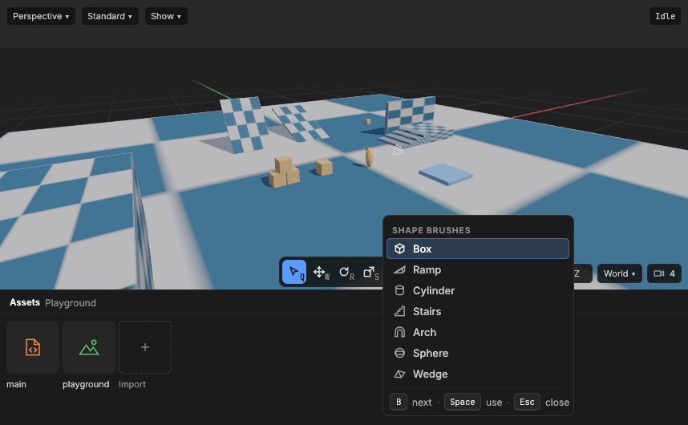
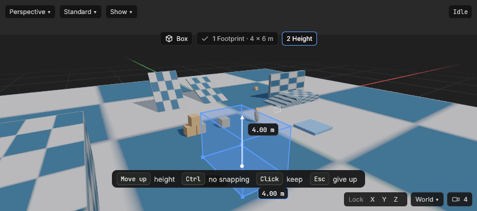
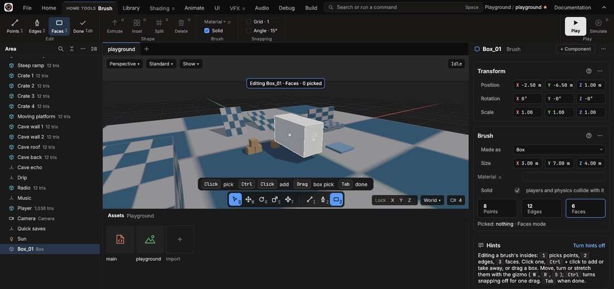
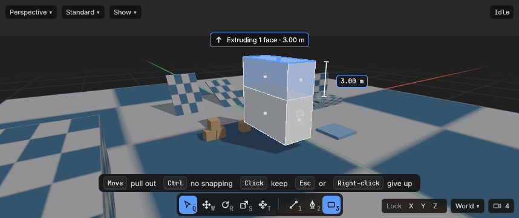

# Brushes

> Shapes made in the editor itself: a box, a ramp, stairs, drawn out on the ground, reshaped point by point, edge by edge and face by face, extruded, inset, split and merged, saved in the area and solid in the game.

## When to use it
For blocking out a level: the floors, walls, ramps, steps and platforms you walk on while you work out how a place plays. A **brush** is a shape made of flat faces, kept in the area itself, so there's no model to make in another program first: you can try a layout, play it, change it and play it again in minutes. Once the layout is right, brushes can stay (simple, clean shapes suit many art styles) or be replaced by models made elsewhere.

Use an imported [model](importing-models.md) instead for anything detailed or curved, such as a character, a tree or a statue: a brush is made of flat faces.

## How to use it

The brush list, opened with `B` over the view: each `B` moves down it, `Space` takes the lit shape.

A brush is made in two parts: you choose its shape from the **brush list**, then **draw it out** in the view: first its footprint on the ground, then its height.

**Choosing a shape**
1. Rest the pointer over the 3D view (or the 2D view) and press `B`. The brush list opens beside the pointer: Box, Ramp, Cylinder, Stairs, Arch, Sphere and Wedge, each with a small picture.
2. Press `B` again to move the highlight down the list, as many times as you need: after Wedge it comes back to Box. The status bar says which one is highlighted ("Choosing a shape brush: Ramp").
3. Press `Space` to take the highlighted shape, or click any row. `Esc`, or a click anywhere else, closes the list without taking one.

The **Shape** button on **Home**, in the **Create** group (its key, B, is written small beside it), opens the same list. It stays lit while the list is open and while you draw.

**Drawing it out**

Drawing a box: the footprint is dragged on the ground, and now the mouse moves up for its height. The sizes show beside the edges, the steps at the top, the keys at the foot.

1. Press the left mouse button on the ground where one corner of the brush should be, and drag to the opposite corner. This is the brush's **footprint**: its size shows in metres beside two of its edges, and in the steps at the top of the view ("1 Footprint · 4 × 3 m").
2. Let go. Now move the mouse **up** (without pressing anything): the brush rises from the footprint, and an arrow shows its height in metres.
3. Click to keep it. The brush is added to the Area list, named after its shape (**Box_01**, then Box_02; **Ramp_01** for the first ramp) with its shape's picture and name beside it, and picked, so its gizmo and Properties are ready.

Corners and heights land on the grid, in the step set in the ribbon's **Grid** (**Grid · 0.5**: half a metre), so brushes line up with each other; drawing out snaps whether or not Grid is ticked. Hold `Ctrl` while dragging or pulling up to draw freely, off the grid. `Esc` or a right-click gives the brush up at any point, leaving nothing behind. `Ctrl + Z` takes a brush you kept away again in one step, like any change ([Undo](undo.md)).

> **Good to know:** a drag that starts on top of a brush draws the new one on top of it, at that height: that's how you stack a platform on a block, or a step on a floor. Anywhere else it starts on the ground grid.

**The Ramp and the Stairs** climb along the longer side of the footprint, starting low where your drag started. Stairs get a step for every 25 cm of height; a **Cylinder** and a **Sphere** have 16 sides, and an **Arch**'s curve 12 pieces.

**In the 2D view** (and the flat Front and Right views), the footprint is drawn flat in the view itself and there is no height step: letting go makes the brush, one grid step deep. The status bar and Hints say so.

**What you see while drawing:** the steps along the top of the view (the shape, 1 Footprint, 2 Height, the one in hand outlined), the keys for that step along the bottom, the sizes beside the brush, and what's happening in the status bar ("Drawing a Box: height 1.75 m · Click to keep · Esc to give up"). The **Hints** card in Properties ([Interface tour](interface-tour.md)) says how it works too.

Once made, a brush moves, turns and resizes with the gizmos like any entity ([Selecting and moving](selecting-and-moving.md)), and its **Transform's scale** stretches it. Press **Play**: characters stand on it and bump into it, because it is **Solid**.

A brush is drawn **flat**: every face is one shade, so its edges look crisp, as a block-out should. Picked, a brush is outlined along its own edges.

**Editing its insides**

Editing a brush (`Tab`): `3` picks faces, the other entities fade, and the **Brush** card counts its points, edges and faces.

A brush is made of [points, edges and faces](concepts.md#the-area). Editing its insides lets you move those parts, not just the whole brush: pull one face of a box out to make it longer, lift one corner of a floor into a slope, turn the top of a pillar.

1. Pick one brush (click it, or click it in the Area list) and press `Tab`. The ribbon becomes **Home tools · Brush**, the other entities fade so the brush stands out, its edges are drawn in white, and the top of the view and the status bar say "Editing Box_03 · Faces · nothing picked".
2. Choose what clicks pick: `1` **points** (corners), `2` **edges** (where two faces meet) or `3` **faces** (the flat sides). The same three are the first buttons on the ribbon, and they also join the **tool bar** at the foot of the view, after a short line beside Select, Move, Rotate, Scale and Transform, with their keys small in a corner; the mode in use is lit. They show there only while you edit a brush. Editing starts in faces mode; points show as dots, and each face as a dot at its middle. Switching keeps what you picked: the points of a picked face, or the edges and faces made wholly of picked points.
3. Pick parts as you pick entities: a **click** picks the part under the pointer (it lights up before you click), `Ctrl` + click adds a part or takes it away, a **drag** on empty space picks everything inside the box (through the brush, its far side too), and a click on empty space picks nothing. Clicks reach only this brush: the others can't be picked while you edit.
4. Use the **Move**, **Rotate** or **Scale** tool (`W`, `R`, `S`, or their buttons on the tool bar) as for entities. The gizmo sits in the middle of what's picked; drag it. Snapping follows **Grid** and **Angle** on the ribbon, and `Ctrl` turns it off for one drag. **World** or **Local** (the pill at the bottom right, or `L`) chooses the world's axes or the brush's own.
5. Press `Tab` again, or **Done**, to stop. The ribbon goes back to Home.

Each drag is **one undo step** (`Ctrl + Z`). Parts shared by what you picked move together, so the brush never comes apart at a seam: moving a face moves its edges and corners, and the faces beside it stretch to follow.

> **Good to know:** a change that would break the brush is refused. If a move, turn or stretch would fold a face over itself (turn it inside out), flatten a face to nothing (two corners on one spot), or push the brush through itself, the brush snaps back when you let go and the status bar says why ("Put back: it would fold a face over itself"). A face that ends up **bent** (its corners no longer on one flat plane, after lifting one corner) is fine: it is cut into triangles to draw and to be solid.

**Undo while editing** steps back through the brush's changes as usual; undoing past the moment you pressed `Tab` (the brush's own making, say) ends editing. Picking something else in the Area list ends editing too and picks that instead. `Delete` and `Backspace` delete the picked parts while you edit (below), never the whole brush.

**Shaping: Extrude, Inset, Split and Delete**

Extruding the top face of a box: the new part follows the mouse, its distance shows beside it and at the top of the view, and the keys are along the foot.

Moving parts only reshapes what's there. To **add** to a brush or **take** from it, use the **Shape** group on **Home tools · Brush**. Each of the four is greyed while it can't be used, and resting the pointer on it says why ("Pick faces to extrude first").

- **Extrude** (`E`): pulls the picked faces out into a new part of the brush, joined to it by new side faces (walls). Pick one or more faces (`3`), press `E` (or click **Extrude**), then move the mouse: the new part follows, straight out from the faces, and the distance shows in metres beside it, at the top of the view ("Extruding 1 face · 2.00 m") and in the status bar. Click to keep it. Moving the mouse the other way pushes the faces **in**, making a dent. The distance snaps to the grid's step (**Grid · 0.5**: half a metre at a time); hold `Ctrl` to pull freely. `Esc` or a right-click gives it up, leaving the brush as it was. Faces that touch go out **together as one block** (pick the top and a side of a box, and they come out as one L-shaped part); faces that don't touch each go out their own way. The faces you extruded stay picked, so `E` again pulls out another step.
- **Shift + drag** on the Move tool's gizmo does the same in one go: hold `Shift`, then drag an arrow, a square or the middle of the gizmo, and the picked faces are extruded as they move, any way you drag them.
- **Inset**: makes a smaller face inside each picked face, with a border of new faces round it, all still flat: a window frame, or the rim of a well before you extrude its middle down. Click **Inset**, move the mouse away from where it was to widen the border (it snaps to the grid; `Ctrl` for no snapping), and click to keep it. `Esc` or a right-click gives it up. Inset has no key. The inner faces stay picked, ready to extrude.
- **Split** cuts what's picked, as the mode says. **Points:** pick two points on the same face, and that face is cut in two along a new edge between them. **Edges:** each picked edge gets a new point at its middle (and so does every face along it). **Faces:** each picked face is cut in two across its middle, so its longer sides are halved (a 4 × 2 m face becomes two 2 × 2 m faces). If the pick doesn't allow it, nothing happens and the status bar says why ("Pick two points on the same face").
- **Delete** (`Delete` or `Backspace` while editing): takes the picked parts out and closes the gap. **Points and edges:** they go, and the faces around them merge into one (delete the edge between two halves of a split face, and it's one face again). **Faces:** picked faces that touch merge into one face. A point left in the middle of a straight side goes with them.

Each of these is **one undo step** (`Ctrl + Z`).

> **Good to know:** a brush is never left broken. After every extrude, inset, split and delete it is checked: it must stay **closed** (no holes), **facing outwards**, with room inside it, with at least **four faces**, and not passing through itself. Anything that fails is refused before it's kept: the brush stays as it was, and the status bar says why ("Put back: it would make the brush pass through itself"). That's why deleting one face on its own is refused (it would leave a hole: pick two faces that touch to merge them), and why pushing a face in further than the brush is deep is refused too.

**A brush read from a file** that has a hole, or faces facing the wrong way (written by hand, say, or by another tool), is mended as it's read when that's simple and safe: faces facing the wrong way are turned round, and a hole whose edge is one flat loop is filled with one face. Anything else (a hole whose edge bends round a corner, say) is left as it is: the brush is drawn as read, the [Problems](problems.md) list names it and says why, and extruding, insetting, splitting and deleting its parts are refused until it's whole. The file's own text changes only when you change the brush.

**In the 2D view** you edit the same way, moving parts across the view's plane.

## Settings
The **Brush** card in Properties:

| Setting | What it does |
|---|---|
| Made as | The shape the brush was made from. Choosing another makes the brush again as that shape, filling the same box it filled (a 4 × 2 × 1 m box becomes a 4 × 2 × 1 m cylinder), in one undo step. If you had edited its insides, those edits are replaced by the fresh shape, and the status bar says so: `Ctrl + Z` brings them back. |
| Size | The brush's box, in metres (X across, Y deep, Z up), in its own space. Typing a size stretches the brush about its middle, as one undo step; a stretch that would break the brush is refused. Each side is kept between 1 cm and 10 km. |
| Material | Not finished yet: brush materials come with a later update. Every face is drawn in the plain material. |
| Solid | On: the game's characters and bodies collide with it, as with a floor or a wall. Off: it's only drawn, and things pass through it (a light shaft, a hint of where something goes). A brush never falls: it stays where it's placed. Also on the ribbon while editing. |
| Points, Edges, Faces | How many the brush has, in three boxes; while its insides are edited, the box of the mode in use is outlined, and the line under them says what's picked ("Picked: 1 face · Faces mode"). |

## Shortcuts
| Action | Shortcut |
|---|---|
| Open the brush list (pointer over the 3D or 2D view) | `B` |
| Move down the list (it wraps round) | `B` |
| Take the highlighted shape | `Space`, or click its row |
| Close the list | `Esc`, or click elsewhere |
| Draw the footprint | Drag on the ground |
| Draw freely, off the grid | Hold `Ctrl` while dragging or pulling up |
| Keep the brush | Move the mouse up, then click |
| Give it up | `Esc`, or right-click |
| Start or stop editing the picked brush's insides | `Tab` |
| Pick points, edges or faces (while editing) | `1`, `2`, `3` |
| Pick a part; add or take one away; pick with a box | Click; `Ctrl` + click; drag on empty space |
| Pick every part of the mode; pick nothing (while editing) | `Ctrl + A`; `Esc` |
| Extrude the picked faces (while editing) | `E`, move the mouse, click to keep |
| Extrude as you move | Hold `Shift` and drag the Move tool's gizmo |
| Extrude or inset freely, off the grid | Hold `Ctrl` while moving the mouse |
| Give an extrude or inset up | `Esc`, or right-click |
| Delete the picked parts, closing the gap (while editing) | `Delete`, or `Backspace` |

With a tile map picked, `B` is the tile map's Brush instead ([Painting tiles](painting-tiles.md)); the Shape button still opens the list.

## Tips and common problems
- **Problem:** `Tab` does nothing. **Why:** editing needs exactly one brush picked, and the game stopped. **Fix:** click one brush (not a lamp or a model), or stop the game.
- **Problem:** a drag snapped back when let go. **Why:** it would have broken the brush; the status bar said how. **Fix:** move less far, or move the faces beside it too (pick them with `Ctrl` + click), so nothing folds over.
- **Problem:** clicking another entity while editing doesn't pick it. **Why:** while editing, clicks reach only the brush being edited. **Fix:** press `Tab` to stop, or pick the other entity in the Area list.
- **Problem:** `Delete` doesn't delete the brush. **Why:** while editing, Delete deletes the picked parts of the brush, never the brush. **Fix:** press `Tab` to stop editing, then `Delete`.
- **Problem:** deleting a face says it would leave a hole. **Why:** a face on its own can't go without leaving the brush open. **Fix:** pick it and a face beside it (`Ctrl` + click) to merge the two into one, or delete an edge or a point instead.
- **Problem:** an extrude or inset was put back when clicked. **Why:** it would have broken the brush (pushed through its far side, or an inset wider than the face); the status bar said how. **Fix:** pull less far, or make the inset narrower.
- **Problem:** `E` says only an edge on an open side can be extruded. **Why:** edges extrude only where a brush is open, and brushes are closed. **Fix:** press `3` and pick faces to extrude instead.
- **Problem:** Extrude, Inset, Split or Delete is greyed. **Why:** the mode or the pick doesn't allow it (Inset needs faces, Split in points mode needs two points on one face). **Fix:** rest the pointer on the button: it says what to pick.
- **Problem:** pressing `B` paints tiles instead of opening the list. **Why:** a tile map is picked, and B is its Brush. **Fix:** pick something else (or nothing, `Esc`), or use the **Shape** button.
- **Problem:** "Nothing made: the footprint had no size". **Why:** you clicked without dragging. **Fix:** press and drag to the opposite corner before letting go.
- **Problem:** "Nothing made: the brush had no height". **Why:** you clicked before moving the mouse up. **Fix:** after letting go of the footprint, move the mouse up until the height shows, then click.
- **Problem:** a brush stands in mid-air. **Why:** the drag started on top of another brush, so it was drawn at that height. **Fix:** move it down with the gizmo, or undo and start the drag on the ground.
- **Problem:** a character falls through a brush. **Why:** its **Solid** is off. **Fix:** tick **Solid**.
- **Problem:** a brush gives a body or a collider of its own as well. **Why:** a **Collider** component on the same entity is used instead of the brush's shape. **Fix:** take the Collider off to collide with the brush's own faces.
- **Problem:** a brush from a damaged file shows nothing, and the [Problems](problems.md) list names it. **Why:** its points or faces couldn't be read (the problem says which: a face naming a point that isn't there, say, or more than a brush may hold, 65,536 points or faces). **Fix:** the file's text is kept as it was, so it can be put right by hand; or choose its **Made as** again, which makes it again as that shape at its standard size; or delete it and draw it again.

## Related
- [Entities and components](entities.md): a brush is an entity with a Brush component.
- [Physics](physics.md): colliders and bodies, which a Solid brush works with.
- [Saving areas](saving-areas.md): how a brush is written in the area's file.
- [Keyboard shortcuts](keyboard-shortcuts.md): every key in one place.
- [Selecting and moving things](selecting-and-moving.md): the gizmos, snapping and world or local axes, which editing a brush's insides uses too.
- [Concepts](concepts.md#the-area): brush, footprint, mesh, point, edge, face, extrude, inset.
