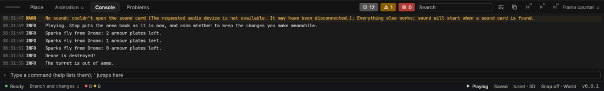

# Your first game: the turret sample

> A small game to read, play and change: a turret shoots at a drone, and the drone's health, armour and sparks react. It's written in all three of Solis's languages, which talk to each other through events.

## When to use it
Right after reading [Game code](game-code.md), or instead of it if you learn best from a working example. Everything in it is ordinary game code you can change while it runs.

## How to use it
1. Choose **Make the sample game…** (press **Space** and type it, or use **File › Learn**) and pick an empty folder. Solis makes a project there called **Turret sample**, opens it, and opens its area.
2. Press **Play**. The sample has no models yet, so its story is told in the Console (later phases give it models). Watch the Console: every half second the turret fires. The drone's armour dents three times ("Sparks fly from Drone: 2 armour plates left"), and after eight hits the drone is destroyed and drops to the ground.
3. While it plays, click the Game panel and press **P** (or Start on a controller): the game stops and a pause menu shows (the **Pauser** component on the **Game** entity, and `ui/pauseMenu.lst`). **Resume** carries on; **Quit** leaves it stopped with a note. See [Game screens](screens.md).
4. Press **Stop**, then open the code from the Library's **Code** tab.


The turret sample playing: the turret fires, the drone's armour dents and its sparks fly, all told in the Console.

## What's in it

**The turret** (Lust, in `main.lst`) has a target (the drone, set in Properties), ammo, damage and a cooldown. Each tick, `update` counts the cooldown down. When it reaches zero, it fires: `send Hit(this, damage) to target;`.

In the sample each component is written in one language: the turret and Health in Lust, Armour in Rust, Sparks in Lua. The switch above each example shows it in all three, so you can read the whole sample in the language you know.

```lust
event Hit(entity by, float damage);

component Turret {
    has {
        entity target = nothing;
        int ammo = 12;
        float damage = 2.5;
        float cooldown = 0.5;
        float reload = 0;
    }

    method update(float dt) {
        reload = reload - dt;
        is reload <= 0 && ammo > 0? then {
            send Hit(this, damage) to target;
            ammo = ammo - 1;
            reload = cooldown;
        }
    }
}

pass Turret;
end
```

```rust
use reflect::{EntityId, Value};
use script::{Context, RustComponent};

pub struct Turret {
    target: Option<EntityId>,
    ammo: i64,
    damage: f64,
    cooldown: f64,
    reload: f64,
}

impl RustComponent for Turret {
    fn update(&mut self, cx: &mut Context<'_>, dt: f64) {
        self.reload -= dt;
        if self.reload <= 0.0 && self.ammo > 0 {
            let me = cx.me();
            let hit = vec![Value::Entity(Some(me)), Value::Float(self.damage)];
            cx.send(self.target, "Hit", hit);
            self.ammo -= 1;
            self.reload = self.cooldown;
        }
    }

    // values() and set(): as Mover's in Game code, under Components.
}
```

```lua
local Turret = component("Turret", {
    { "target", "entity" },
    { "ammo", "int", 12 },
    { "damage", "float", 2.5 },
    { "cooldown", "float", 0.5 },
    { "reload", "float", 0 },
})

function Turret:update(dt)
    self.reload = self.reload - dt
    if self.reload <= 0 and self.ammo > 0 then
        solis.send(self.target, "Hit", self.me, self.damage)
        self.ammo = self.ammo - 1
        self.reload = self.cooldown
    end
end
```

**The drone** carries three components, one in each language. Each reacts to the events it cares about:

| Component | Language | Reacts to | Does |
|---|---|---|---|
| **Health** | Lust (`main.lst`) | `Hit` | Takes the damage; at 0 it sends `Destroyed` to the drone. |
| **Armour** | Rust (`armour.rs`) | `Hit` | Dents a plate, and sends `Dented` with the plates left. |
| **Sparks** | Lua (`sparks.lua`) | `Dented`, `Destroyed` | Says so in the Console; when destroyed, drops the drone to the ground. |

The drone's armour (in the sample, Rust: `armour.rs`) dents a plate at each hit and says how many are left:

```lust
event Hit(entity by, float damage);
event Dented(int platesLeft);

component Armour {
    has {
        int plates = 3;
    }

    on Hit(entity by, float damage) {
        is plates > 0? then {
            plates = plates - 1;
            send Dented(plates) to this;
        }
    }
}

pass Armour;
end
```

```rust
use reflect::Value;
use script::{Context, Event, RustComponent};

pub struct Armour {
    plates: i64,
}

impl RustComponent for Armour {
    fn handle(&mut self, cx: &mut Context<'_>, event: &Event) -> bool {
        if event.name != "Hit" || self.plates == 0 {
            return false;
        }
        self.plates -= 1;
        let me = cx.me();
        cx.send(Some(me), "Dented", vec![Value::Int(self.plates)]);
        true
    }

    // values() and set(), and the RustKind that registers it: see armour.rs.
}
```

```lua
local Armour = component("Armour", {
    { "plates", "int", 3 },
})

function Armour:on_Hit(by, damage)
    if self.plates > 0 then
        self.plates = self.plates - 1
        solis.send(self.me, "Dented", self.plates)
    end
end
```

And its sparks (in the sample, Lua: `sparks.lua`) react to each dent:

```lust
fetch "solis/world":World;

event Dented(int platesLeft);

component Sparks {
    has {
        int shown = 0;
    }

    on Dented(int platesLeft) {
        shown = shown + 1;
        World:say("Sparks fly from " + name() + ": " + platesLeft.text() + " armour plates left.");
    }
}

pass Sparks;
end
```

```rust
use reflect::Value;
use script::{Context, Event, RustComponent};

pub struct Sparks {
    shown: i64,
}

impl RustComponent for Sparks {
    fn handle(&mut self, cx: &mut Context<'_>, event: &Event) -> bool {
        if event.name != "Dented" {
            return false;
        }
        self.shown += 1;
        let plates = match event.values.first() {
            Some(Value::Int(left)) => *left,
            _ => 0,
        };
        let me = cx.me();
        let name = cx.host().name(me).unwrap_or_default();
        cx.host().say(&format!("Sparks fly from {name}: {plates} armour plates left."));
        true
    }

    // values() and set(): as Mover's in Game code, under Components.
}
```

```lua
local Sparks = component("Sparks", {
    { "shown", "int", 0 },
})

function Sparks:on_Dented(platesLeft)
    self.shown = self.shown + 1
    solis.World:say("Sparks fly from " .. solis.entity.name(self.me) .. ": " .. platesLeft .. " armour plates left.")
end
```

The events are declared once, in Lust (`event Hit(entity by, float damage);`). Lust checks its own `send`s before the game runs, so a wrongly-sent event in Lust is a mistake in Problems. When Lua or Rust sends one with the wrong values, it isn't sent, and the Console names the component that sent it.

## Things to try
- **While it plays,** change the turret's `damage` to `10` in Properties: the drone goes down in two hits.
- **While it plays,** change `reload = cooldown;` in `main.lst` to `reload = cooldown / 5;` and save. The turret fires five times faster at once, keeping the ammo it has left. (Changing a starting value instead, such as `cooldown = 0.5`, doesn't change a turret that's already running: running components keep their values. Set it in Properties for that.)
- In `sparks.lua`, change what it says and save while it plays: the next dent says the new words.
- Give the drone more armour: select it and set **Plates** to 10.

## Tips and common problems
- **Problem:** I changed `armour.rs` and nothing changed. **Why:** Solis can't build a game's own Rust yet (that comes with the full export, which isn't built yet). Until then, the Armour built into Solis runs, and the Console says your changes don't. **Fix:** try changes in the Lust and Lua instead.
- **Problem:** "Couldn't make the sample game". **Why:** the folder is already a project, or already has a file where the sample's would go (such as `assets/main.lst`); Solis never replaces your files. **Fix:** choose an empty folder.

## Related
- [Game code](game-code.md): components, events and changing code while it runs, in detail
- [Play mode](play-mode.md)
- Concepts: [component, event, tick](concepts.md#game-code)
