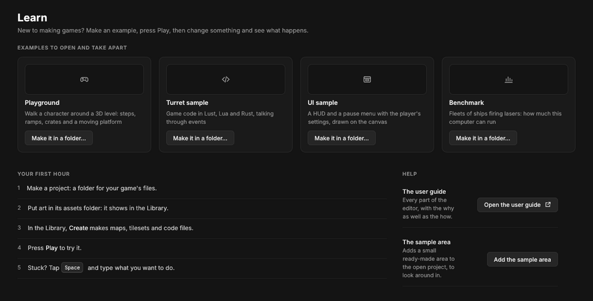

# Getting started

> How to get Solis onto your computer, open it, and make your first project.

## When to use it
The first time, and whenever you want the newest version.

## How to use it

**Install it (Windows, recommended):** download `solis-setup.exe` from the newest release on the repository's **Releases** page and run it. Solis then updates itself whenever a new build is merged. See [Installing and updating](installing-and-updating.md).

**Or download the program on its own:**
1. Open the Solis repository on GitHub and go to the **Actions** tab.
2. Click the newest run of **Windows EXE**.
3. At the bottom of the page, download **solis-windows**.
4. Unzip it anywhere and double-click `dist\solis.exe`. (The `setup` folder beside it holds the installer.)

A copy run this way doesn't update itself. Each download stays available for 30 days.

**Build it yourself:**
1. Install Rust from [rustup.rs](https://rustup.rs).
2. In the `solis` folder, run `cargo run --release -p app`. The first build takes a few minutes; later ones are quicker.
3. For **Documentation** to open the [user guide](user-guide.md), put the guide beside your build once: `cargo run -p user-guide -- --out target/release/user-guide/index.html`. A downloaded or installed copy has it already.

**Opening with a model:** `solis --import ship.glb` opens Solis and imports the model straight away (repeat `--import` for more than one).

## Making your first project

Solis starts on the [launcher](launcher.md), a small window listing your projects. Why a project? A game is many files (pictures, models, sounds, code, levels), and a [project](concepts.md#projects) is the folder that keeps them together, so Solis can find them all and keep them in step.

1. Click **New project** at the top right of the launcher.
2. Type a **Name**, such as *Farm Days*. Solis makes a folder of that name for the project; the line under the name shows where (in a **Solis projects** folder in your Documents, the first time).
3. Choose its **Kind**: **2D**, **3D** or **Both**. It's kept with the project and can be changed later ([Project kind](concepts.md#projects)).
4. **Start from** **Empty**, or from one of the examples to take apart (they're 3D games, so they're greyed while 2D is chosen).
5. Click **Create**. The launcher becomes the editor, with your project open. **File › Close project** brings the launcher back.

**Learn**, in the launcher: the four examples, each with **Make it in a folder…**, the first steps, and this guide.

New to making games? **Learn**, down the launcher's left side, makes one of the four examples as a project, ready to play and take apart.

## Settings
Solis remembers your panel layout, accent colour, interface scale, camera and viewport controls in your user folder, so each start looks like the last.

## Tips and common problems
- **Problem:** Windows warns that the program is from an unknown publisher. **Why:** the program isn't signed with a paid certificate yet. **Fix:** choose **More info**, then **Run anyway**.
- **Problem:** the viewport says "No 3D view" and a reason. **Why:** Solis couldn't use the graphics card. **Fix:** update your graphics drivers. The rest of the editor still works.

## Related
- [The launcher](launcher.md): your projects, New project, Learn and Updates.
- [Interface tour](interface-tour.md)
- [Your first 2D platformer](first-platformer.md): once Solis is running, start here.
