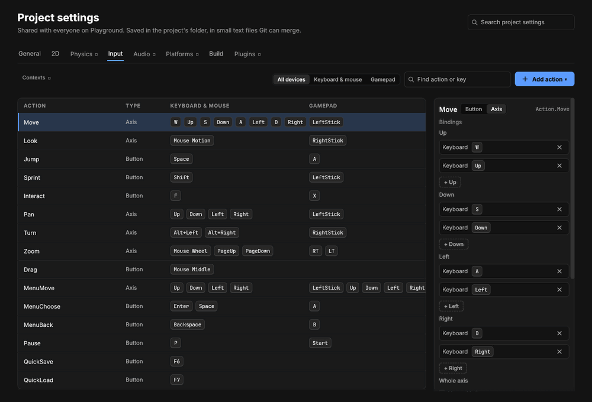

# Input

> Your game's controls as named actions: Move, Look, Jump, Sprint, Interact, the cameras' Pan, Turn, Zoom and Drag, the menus' MenuMove, MenuChoose, MenuBack and Pause, and any you add, from the keyboard, mouse or a gamepad, and rebindable.

## When to use it
Whenever the player controls something. Game code never asks "is W down?"; it asks "is the player moving?" (`Input:axis(Action.Move)`) or "did they press Jump?" (`Input:pressed(Action.Jump)`). Which keys and buttons mean Jump is set in one place, **File › Project settings › Input**, so:
- a gamepad works without extra code (the A button is bound to Jump too);
- players can change the keys (rebinding) without changing your game;
- a play's input can be recorded and played back exactly, which is how you check the game always comes out the same.

## How to use it


**File › Project settings › Input**: each of the project's actions and the keys, buttons and sticks that set it off.

**Playing with the keys and mouse**
1. Press **Play**.
2. **Click the Game panel.** The game now has the mouse and keys: the pointer disappears (moving the mouse turns, instead of moving a pointer), and the editor's own keys (W for the move tool, Delete, Ctrl + Z…) are off, so they can't change your area by accident while you play.
3. Press **Esc** to give the mouse and keys back to the editor. Stop does too.

A connected **gamepad** works whenever the game is playing; it has nothing of the editor's to clash with. Solis uses the first one connected, Xbox layout.

**The ready-made actions**

| Action | Keyboard and mouse | Gamepad | What game code gets |
|---|---|---|---|
| Move | W A S D, or the arrow keys | left stick | which way to go: x across (right +1), y forward (+1) |
| Look | mouse | right stick | how far to turn this tick, in degrees |
| Jump | Space | A | held, pressed, released |
| Sprint | Shift | left stick click | held, pressed, released |
| Interact | F | X | held, pressed, released |
| Pan | arrow keys | left stick | which way to move the [RTS camera](characters-and-cameras.md) |
| Turn | Alt + left and right arrows | right stick | which way to turn the RTS camera |
| Zoom | mouse wheel, Page Up and Page Down | right and left triggers | how far to zoom this tick, in steps (a wheel notch is one) |
| Drag | middle mouse button | | held while dragging the map |
| MenuMove | arrow keys | d-pad, left stick | moves the focus between a [screen's buttons](screens.md) |
| MenuChoose | Enter, Space | A | chooses the button with the focus |
| MenuBack | Backspace | B | held, pressed, released (your code decides what "back" does) |
| Pause | P | Start | held, pressed, released (your code opens its pause menu) |

While a screen with buttons is shown, only the four menu actions reach game code: Jump on Space doesn't also jump while Space chooses a button. A project whose input actions file is from before them still gets them while playing.

**Changing them: File › Project settings › Input**
1. The table lists every action: its name, whether it's a **Button** or an **Axis**, its keyboard and mouse inputs as keys, and its gamepad's. **All devices**, **Keyboard & mouse** and **Gamepad** over the table show one kind or both; **Find action or key** narrows the rows.
2. Click an action's row to pick it: its card at the right lists its bindings, each with the device it's on. Click a binding to pick it, then **Backspace** clears it; its **×** does the same.
3. **+ Add binding** (on an axis: **+ Up**, **+ Down**, **+ Left**, **+ Right**), then press the key, mouse button or gamepad button to bind. **Esc** calls it off; while it waits, Backspace is a key you can bind like any other. Hold Ctrl, Alt or Shift while pressing a key to bind the **combination**, such as `Alt+Left`; turn the mouse wheel to bind a notch up or down.
4. An **axis** (like Move) has **Up**, **Down**, **Left** and **Right** keys, and whole-axis inputs (a stick, the mouse's movement, or the mouse wheel), ticked under **Whole axis**. One that goes with the mouse or the wheel has a **Mouse speed** and a **Stick and key speed**. **Button** and **Axis** at the top of the card change which it is; **Remove the action** takes it away.
5. **Add action ▾**: type a name and choose **Add button** or **Add axis** (letters, digits and _, starting with a capital: `OpenMap`, `Fire_2`, so game code can name it `Action.OpenMap`).
6. **Add the ready-made actions it's missing** appears in projects made before the cameras: it adds the ones it lacks (Pan, Turn, Zoom and Drag; MenuMove, MenuChoose, MenuBack and Pause) and changes nothing else. **Restore the ready-made actions** puts all the ready-made ones back as they were, leaving your own.

**Clashes.** The ready-made actions share some keys on purpose: the arrows are Move, Pan and MenuMove, and Space is Jump and MenuChoose. When an action of your own shares a key with another, both are marked with ⚠ and the key in amber, and a line under the table says which: both fire on one press. Contexts, Fires on, Buffer, the stick's dead zone and Invert look Y are [unfinished parts](unfinished-parts.md).

**Combinations.** A key on its own doesn't count while you hold modifiers that some action binds with it. With Turn on `Alt+Left` and Pan on `Left`, holding Alt and pressing the left arrow turns, and doesn't pan as well. The up arrow (with no `Alt+Up` bound) still pans while Alt is held.

Changes are saved straight away, and a game that's playing takes them at once (any rebinding game code did in this play gives way to them). A speed you drag shows its number as you go and counts when you let go of the mouse, and a typed one when you press Enter or click somewhere else: the change is saved, and reaches a playing game, then. They're kept in the project's `input.solinput`, a small text file beside `project.solis` that Git can merge.

**In game code**, the actions are names Lust checks: Solis writes them into `solis/project.lst` as `state Action` whenever you change them here, so `Action.Jmp` is a mistake before the game runs, listing the real actions. Fetch `Input` and `Action`, and ask `Input`. In Lua the action's name is text (`solis.Input:held("Jump")`), and in Rust the host gives an action's whole state at once (`cx.host().action("Jump")`, with `held`, `pressed`, `released` and `axis`):

```lust
fetch "solis/input":Input;
fetch "solis/project":Action;

component Walker {
    has {
        float speed = 4;
    }

    method update(float dt) {
        vec3 way = Input:axis(Action.Move);
        vec3 step = [way.x, way.y, 0];
        moveTo(position() + step * speed * dt);
        is Input:pressed(Action.Jump)? then {
            moveTo(position() + [0, 0, 1]);
        }
    }
}

pass Walker;
end
```

```rust
use glam::Vec3;
use script::{Context, RustComponent};

pub struct Walker {
    speed: f32,
}

impl RustComponent for Walker {
    fn update(&mut self, cx: &mut Context<'_>, dt: f64) {
        let me = cx.me();
        let way = cx.host().action("Move").axis;
        let step = Vec3::new(way.x, way.y, 0.0);
        let here = cx.host().position(me).unwrap_or_default();
        cx.host().move_to(me, here + step * self.speed * dt as f32);
        if cx.host().action("Jump").pressed {
            cx.host().move_to(me, here + Vec3::new(0.0, 0.0, 1.0));
        }
    }

    // values() and set(): as Mover's in Game code, under Components.
}
```

```lua
local Walker = component("Walker", {
    { "speed", "float", 4 },
})

function Walker:update(dt)
    local way = solis.Input:axis("Move")
    local step = vec3(way.x, way.y, 0)
    solis.entity.moveTo(self.me, solis.entity.position(self.me) + step * self.speed * dt)
    if solis.Input:pressed("Jump") then
        solis.entity.moveTo(self.me, solis.entity.position(self.me) + vec3(0, 0, 1))
    end
end
```

| Method | What it gives |
|---|---|
| `bool Input:held(Action action)` | Whether it's held down this tick (an axis: not at rest). |
| `bool Input:pressed(Action action)` | True once, the tick it went down. A tap between two ticks still counts. |
| `bool Input:released(Action action)` | True once, the tick it came up. |
| `vec3 Input:axis(Action action)` | An axis's two numbers as x and y (z is 0). |
| `string Input:binding(Action action)` | The key that sets it off, such as `F`, for showing "Press F" to the player. |
| `Input:rebind(Action action, string input)` | Binds a new input (`"E"`, `"Mouse Right"`, `"Pad Y"`) in place of its others of the same kind, from the next tick: what a controls menu does. Lasts while the game plays. |

Input is read **once per [tick](concepts.md#game-code)**, so every component, on every core, sees the same input for that tick.

**Recording and playing back** (the **Play** menu)
1. With a [project](projects-and-the-library.md) open, choose **Debug › Play and record inputs**. Play as usual.
2. Press **Stop**. The recording is saved in the project's `recordings` folder (the Console says its name).
3. Choose **Debug › Replay a recording…** and pick it. (While it replays, the game's `Saves:saveTo` makes its save as the recorded play did, but doesn't write over your saves.) Solis plays from the start with the same seed and every tick's recorded input, checking the game is exactly the same tick by tick ([checksums](concepts.md#simulation)). At the end it pauses and says whether it matched, or by which tick it stopped matching (the world is compared every tick, game code's own values once a second).

A replay that stops matching means the game came out differently from the same input: the area or code changed since recording, or something in the game isn't deterministic. That's how you find it the tick it starts.

## Settings
| Setting | What it does |
|---|---|
| Mouse speed | For an axis that goes with the mouse: how far a pixel of movement (or a notch of the wheel) goes. For Look, 0.15 degrees suits most mice; raise it for a faster turn. For Zoom it's 1: a notch is one step. |
| Stick and key speed | How far a stick or key held all the way goes in a second. For Look, 180 is half a turn a second; for Zoom, 8 steps. |

## Shortcuts
| Action | Shortcut |
|---|---|
| Give the game the mouse and keys | Click the Game panel while playing |
| Give them back to the editor | Esc |
| Give up binding an input (after **+ Add binding**) | Esc |
| Clear the picked binding | Backspace |
| Pick an action | Click its row |

While the game has them, every key is the game's: the editor's shortcuts are off.

## Tips and common problems
- **Problem:** my character doesn't move when I press W. **Why:** the editor has the keys. **Fix:** click the Game panel first; its corner says when the game has the mouse and keys.
- **Problem:** pressing W while playing picked the move tool. **Why:** the same: the game didn't have the keys. **Fix:** click the Game panel.
- **Problem:** `Input:pressed(Action.Jump)` is never true. **Why:** the action has no inputs. **Fix:** check File › Project settings › Input.
- **Problem:** the Console says an input action "can't be named in game code". **Why:** game code names actions as Lust names, which start with a capital and hold letters, digits and `_` (`OpenMap`, `Fire_2`), and aren't all capitals. **Fix:** rename it in File › Project settings › Input.
- **Problem:** Esc does nothing in my game. **Why:** in the editor, Esc gives the mouse and keys back, so a game can't use it there. **Fix:** give the action another key as well, to try it in the editor (the ready-made **Pause** is on P). In an [exported game](playtest-export.md) every key is the game's, Esc included.
- **Problem:** the Console says the input actions couldn't be read. **Why:** `input.solinput` was changed by hand and has a mistake. **Fix:** the Console says what; fix it, or change any action in the window, which writes it again.
- **Problem:** the Console says the input actions file had a mistake and was kept as `input.solinput.bak`. **Why:** the file couldn't be read, so the ready-made actions were used; changing anything in the window writes the file again, so Solis kept yours first. **Fix:** copy what you need from the `.bak` file, then delete it.
- **Problem:** recording paused, saying it reached the most Solis keeps. **Why:** a recording is at most an hour, or 64 MB. **Fix:** Stop saves what was recorded; record shorter plays.
- **Problem:** a replay stops matching at once. **Why:** the area or the code changed since it was recorded, or it was recorded with an earlier Solis, whose checks were worked out differently. **Fix:** record again.

## Related
- [Game code](game-code.md)
- [Play mode](play-mode.md)
- [Physics](physics.md)
- [Characters and cameras](characters-and-cameras.md)
- Concepts: [action, binding, recording](concepts.md#simulation)
