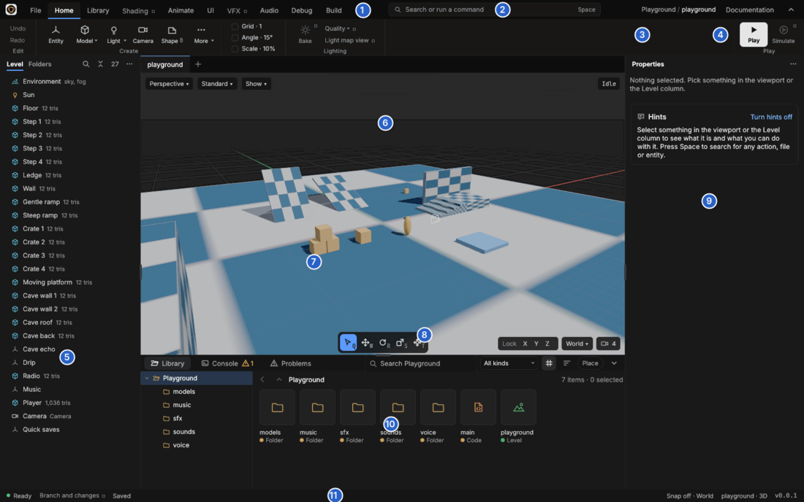
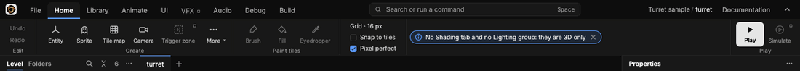
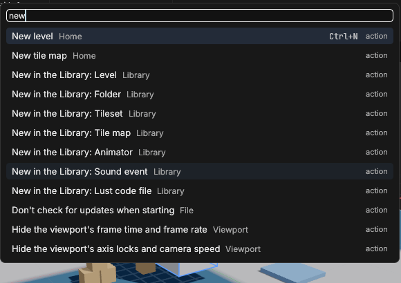

# Interface tour

> What's where in the editor, and how to rearrange it.

## When to use it
When finding your way around, or making the layout suit your screen.

## How to use it

This page follows what you see, in the order you meet it: the launcher Solis starts in, then the editor from its tab bar down to its status line. All of it is drawn in one look: dark neutral greys, lighter the nearer a surface is to you, with one [accent colour](concepts.md#the-window) for what's chosen. The accent, and how large the editor is drawn, are yours to choose in **File › Preferences** ([Settings](settings.md)).

The editor with the playground open: **1** the tabs, **2** the search, **3** the ribbon, **4** Play, **5** the Level panel (the left slot), **6** the level in the viewport (the centre), **7** the tool bar, **8** the Library (the bottom panel), **9** Properties (the right slot), **10** the bottom panel's tabs, **11** the status line. Each is explained below.

**[The launcher](launcher.md)** is what Solis always starts on: a small window of its own. Your projects are cards, each with its kind (**2D**, **3D** or **2D + 3D**), with **Search projects**, a filter by kind, **Sort by**, **Open folder…** and **New project**; down its left side, **Projects**, **Learn** and **Updates**, with **Preferences** and the **User guide** at the foot. Double-click a card and the window becomes the editor, with that project open, at the editor's own size and place. Why start there? Solis doesn't open the last project by itself, so you always choose what to work on. **File › Close project** brings the launcher back.

**The tab bar** is the dark strip along the very top. From left to right:
- **The logo**, in a small light tile.
- **The [tabs](concepts.md#the-window):** **File**, **Home**, **Library**, **Shading**, **Animate**, **UI**, **VFX**, **Audio**, **Debug** and **Build**. Each is one kind of work, and a click on one changes the [ribbon](concepts.md#the-window) under it and what the editor shows (see **The tabs** below). The tab in front is lit, with a line of the accent colour under it. **Shading** and **VFX** are grey with a small hollow square after their names: those screens aren't built yet ([Unfinished parts](unfinished-parts.md)).
- **A tab that comes with a file** (a [contextual tab](concepts.md#the-window)): while a tileset, a picture's crops or a selected tile map is open, a tab such as **LIBRARY TOOLS · Tileset** stands right after the tab it belongs to, with a ribbon of that file's own tools. Click it to bring that file to the front; it goes when the file closes. A tileset and a picture's crops fill their tab (with **‹ Back to Library** at the right of the document's tab); a tile map's tab is Home with the **Map** tab in front in the bottom panel.
- **Search or run a command**, in the middle: one search for everything (see below). Its right end shows its key, **Space**.
- **The project and the level**, as in `Harbour / docks`, with an amber dot after the level's name while it has unsaved changes.
- **Documentation** opens the [user guide](user-guide.md), this manual as one page in your browser, with a search. It is there on every tab, the File pages too, project or not.
- **The chevron** at the far right collapses the ribbon (see below).

**The ribbon** is the band under the tab bar: the things you do on the tab in front, as buttons you can see instead of menus you have to open. Why a ribbon? Everything for the job at hand is on screen at once, each with its name under it, and nothing is hidden two menus deep. It is made of **groups**, each with its name underneath:
- **A large button** is an icon over a word. Point at one and it says what it does, its shortcut if it has one, and, when it is greyed, why it can't be used right now.
- **A small row** is a line of words: a switch has a box that is filled while it is on (**Grid · 1** in Snapping), and a row with a small arrow opens a list (**More**).
- **A button that makes one of several kinds** has a small arrow at the end of its name: click the button for the usual kind (**Light** makes a point light), or click the arrow, or right-click the button, for the list (a spotlight).
- **Grey controls with a small hollow square** aren't built yet: they show where things will be ([Unfinished parts](unfinished-parts.md)), and one setting hides them all.

**The Play group** is at the ribbon's right end on every tab: **Play** is the one light button on screen. While the game runs it becomes **Stop**, with **Pause** and **Step** beside it; nothing else in the editor changes colour. See [Play mode](play-mode.md).

**When the window is narrow** the ribbon doesn't wrap: it scrolls sideways. Turn the mouse wheel while pointing at it.

**To give the ribbon's room to the editor,** click the chevron at the tab bar's right end, or double-click a tab: only the tabs stay. Click a tab then and the ribbon drops down over the editor until you choose something on it or move the pointer below it. The chevron, or another double-click, brings the ribbon back for good.

**The tabs, one per job:**
- **Home** is for building [levels](saving-levels.md): the level big in the centre with the tool bar floating at its foot (Select, Move, Rotate, Scale and Transform, and while a [brush](brushes.md) is edited, Points, Edges and Faces; see [Selecting and moving](selecting-and-moving.md)), its entities in the **Level** panel at the left, the picked one's **Properties** at the right, and your files in the **Library** under the level. Its ribbon, each group named underneath: **Edit** (**Undo** and **Redo**, each named for the step it acts on when you point at it; see [Undo and redo](undo.md)), **Create** (**Entity**, **Model**, **Light**, **Camera**, **Shape** (the [brush](brushes.md) list; its key, `B`, is written beside it), and **More** for a sprite, a tile map, the level's [ground](ground.md) (**Ground…**, 3D only), a reverb zone or a [prefab](prefabs.md) from the selection), the snaps (**Grid**, **Angle** and **Scale**; click the value after "·" for the steps, see [Selecting and moving](selecting-and-moving.md)) and **Lighting** (not built yet). **Save** and **Build** aren't on it: save with `Ctrl + S`, **File › Save all**, a right-click on the level's tab, or a click on **Saved** or **Not saved yet** in the status line; build on the **Build** tab. With the Library's **Place** switch on, the ribbon takes its build form for [placing](projects-and-the-library.md).
- **Library** is the project's files ([Projects and the Library](projects-and-the-library.md)): the same browser as Home's bottom panel, filling the centre, with the file picked in **Details** at the right. Its ribbon: **Add** (Import, Create, Folder), **View** (List, Show folders), **Filter** (Type) and **Use** (Place).
- **Animate** is for animating sprites: a clips file's frames and clips, or an animator's graph and preview, each with a ribbon of its own ([Animating sprites](sprite-animation.md), [Animators](animators.md)). With neither open it shows the Sequencer's page, not built yet.
- **UI** draws game screens on the **Canvas**, with the drawing tools down its left edge; double-click a screen's file in the Library and Solis switches to UI with it open ([The UI editor](ui-editor.md)).
- **Audio** is the [mixer](mixer.md): a strip per bus with **Master** last in the centre, the project's sound events at the left, the bus you pick at the right with its ducking, and the Library under the mixer. Its ribbon: **Bus** (a new bus), **Add rule**, **Remove**, **Clear solo**, **Mute the game** and **Heard at once**.
- **Debug** is for testing the game: the [Profiler](profiler.md) in the centre (the frames as bars, the frame you click as a timeline, and Statistics), with the **Game** as a tab beside it, and the [Console](console.md) in front under it. Its left slot, **Running**, isn't built yet; the Profiler holds its own Statistics. Its ribbon has **CPU** and **GPU** for the Profiler and the **Session** group: **Load save** ([Save games](save-games.md)), **Play and record inputs** and **Replay a recording…** ([Input](input.md)).
- **Build** is [Export for playtesting](playtest-export.md) as a page: the game's name, the level it starts in, the folder and the window, with **Export**, and the Console under it. Its ribbon has **Export** and **Open folder** (the last export's folder); the full export beside them isn't built yet.
- **Shading** and **VFX**, and the **model viewer** (a model's right-click in the Library, **Open in the model viewer**), are screens that aren't built yet: their ribbon and bottom tabs are shown greyed, round one page saying what will be there and when ([Unfinished parts](unfinished-parts.md)).

**In a 2D or a 3D project** the editor shows only what that kind of game uses ([project kind](concepts.md#projects)). A 2D project has no **Shading** tab and no **Lighting** group, and Home's ribbon is laid out for 2D: **Create** has **Entity**, **Sprite**, **Tile map**, **Camera**, **Trigger zone** (not built yet) and **More** (a point light, a reverb zone, Make prefab…); **Paint tiles** has the tile painter's **Brush**, **Fill** and **Eyedropper**, which paint the tile map picked; and the snaps are **Grid · 16 px** (the project's tile size), **Snap to tiles** and **Pixel perfect** (moves land on whole tiles, or on the game's whole pixels). The view is the 2D one, its pill saying its zoom (**2D · 200%**). A 3D project hides the tile painter, tile maps and the 2D view instead. The first few times a project opens as, or is switched to, 2D or 3D, a note on Home's ribbon says what's hidden; its **×** puts it away. Why hide anything? Each kind of game uses only part of the editor, and the rest is in the way. Nothing is deleted: set **Project settings › General › Kind** to **Both** to see everything ([What each kind hides](settings.md#what-each-kind-hides)).

A 2D project's Home: no Shading tab, the ribbon's **Create**, **Paint tiles** and tile snaps, and the note saying what's hidden.

Each tab remembers its own bottom tab, whether its bottom panel is folded, which panels you hid, the split between its groups and every edge you dragged.

**File** is different: it is a page in place of the ribbon and the editor, with a column of items down its left side. **Back to editor** (or **Esc**) returns to the tab you came from. It holds what belongs to the open project and the editor; your projects, Learn and Updates are the [launcher](launcher.md)'s, which **Close project** goes back to.

| Item | What it does |
|---|---|
| Save all | Saves the open level. Every other file saves as you change it. |
| Project settings | This project's settings: General, 2D, Input (the game's actions and their keys, see [Input](input.md)) and Build ([Settings](settings.md)). |
| Preferences | The editor's own settings, such as its accent colour ([Settings](settings.md)). |
| Plugins | Not built yet. |
| About | The program's name, version and build, its licences, **Check for updates** and the [user guide](user-guide.md). |
| Close project | Closes the project, asking about unsaved work first, and goes back to the [launcher](launcher.md). Closing the editor's window does the same. |
| Exit | Closes Solis, asking about unsaved work first. |

The search, opened with `Space`, with "new" typed: actions with their tab and key, and files and entities, in one list.

**One search for everything:** press **Space** (with nothing being typed) or click **Search or run a command** in the tab bar. Type part of a name and the list finds:
- everything the editor can **do** (Save level, Add point light, Play…), each with where it lives and its shortcut beside it when it has one, so you pick up the keys as you go. Going to a tab, collapsing the ribbon, folding the bottom panel, **Show hidden panels**, **Start placing** and hiding unfinished parts are there too;
- every **file** in the project, which opens it as a double-click in the [Library](projects-and-the-library.md) would. A file you place rather than open (a model, a prefab, a sprite sheet, a tile map or a picture) is picked in the Library instead, with its folder open, ready to drag in;
- every **entity** in the level, which selects it and points the camera at it;
- a **panel** by its name, which comes to the front.

Up and Down choose, **Enter** does it, **Esc** closes. Why? You don't have to remember which tab something is on: type what you want. Things without a button on the ribbon are found here too, wherever else they are: **New level** and **Open level…** (the **+** after the level's tab), **Save level as…** (a right-click on the level's tab), **Duplicate**, **Delete**, **Rename**, **Select all** and **Select nothing** (a right-click in the Level list), **Reset layout** (**File › Preferences**), **Documentation ↗** (the tab bar), **Add the sample level**, **Check for updates** (**File › About**), **Close project** (**File**), and showing or hiding the viewport's corner controls (its **Show ▾** pill). Things that can't be done right now (Pause while editing, Delete with nothing selected) aren't listed. In the Frames tab, Space still plays and stops the clip, so point somewhere else first.

**One frame on every tab.** Under the ribbon, every tab divides the window the same way: a **left slot** and a **right slot** run full height down to the status line, the **centre** sits between them, and the **bottom panel** sits under the centre only. Each tab fills those slots with its own panels (the table below says which): on Home, the Level panel, the level, Properties and the Library. Why the same everywhere? A panel is always where you last saw one, whatever the tab, and the lists and settings keep their full height.

**Every edge drags.** Point at the line between the left slot and the centre, between the centre and the right slot, or along the bottom panel's top, and the line takes the accent colour and the pointer becomes a two-headed arrow: drag to give one side more room. Each of these three edges has a small grip at its middle. The line between two panels stacked in a slot, between two editor groups and beside the placing column drag too. **Double-click** an edge to put it back to its standard size. Every part keeps a least size and the centre never goes, so nothing can be dragged away. Sizes are shares of the window: make the window larger or smaller and the panels keep their proportions. Each tab keeps its own sizes; turn **Each tab keeps its own panel sizes** off in **File › Preferences › Layout** and a size you drag on one tab is used on all of them. When the window is too narrow for everything, the centre gives way first (down to 240 points), then the right slot, then the left (down to 180 each); narrower still, the right slot goes, then the left, until the window is wide enough again.

**Hiding a panel.** Each slot's header has its title and, at the right, **⋯**: its panel's own menu (the Level panel's folding and showing), then **Hide**. A hidden panel gives its room to the centre. To bring it back, click its small icon at the right of the bottom panel's bar (**Show Level**, **Show Properties**), or press **Space** and choose **Show hidden panels**, or choose a [layout](concepts.md#the-window) in **File › Preferences › Layout**.

**The bottom panel** holds small tabs of one panel: on Home **Library**, **Console** and **Problems** (and **Map** while a tile map is selected), each with its count: the Console's warnings and errors, how many problems there are. Open, its bar has the tabs at the left and, at the right, the tools of the tab in front (the Console's **Info**, **Warnings** and **Errors**, **Search the log**, **Clear** and **Copy**; the Library's **Place** switch on Home, then its search, **All kinds ▾** and grid or list) and **▾**. Drag its top edge to any height. **Fold** it with **▾**, a click on the tab in front, or `Ctrl + Space` (while typing too): it becomes **one thin line** over the status line, still naming its tabs with their counts, the newest warning or error faintly beside them, and **Click a name to open it**. A name opens that tab at the height it had. The Console's [command line](console.md) shows only on the Console tab, so it's never in the way.

**Layouts.** **File › Preferences › Layout** shows each layout as a small drawing: point at one to see it large in the **Preview** box, click it to use it at once (a small note says **Layout is now …** with **Undo**). A layout changes where the slots sit, on every tab, never what the panels do:

| Layout | Where things sit |
|---|---|
| **Standard** | The left slot at the left, the right slot at the right, the Library under the view. |
| **Wide view** | The left and right slots share the right; the view gets the width. |
| **Two views** | The standard, with two views side by side in the centre (from above and in perspective). The view's own menu goes back to one. |
| **Library on the left** | The Library under the left slot, in a tall list; the view runs down to the bottom line. |
| **Tall properties** | The right slot full height and wider; the bottom panel runs under the left slot too. |
| **Just the view** | Every panel hidden and the bottom panel folded; its line stays, with the panels' names to bring them back. |
| **Library on the right** | The Library under the right slot. |

**Reset sizes** puts every edge you dragged back where the layout in use starts. Layouts saved by an older build open as the nearest one: the side layouts of before as **Library on the left**, **Library on the right** or the standard, and the shelf as the standard.

- **Editor groups** hold *documents*: the level, the running game, an animator, a tileset, the mixer. Each group has a strip of tabs along its top (the one in front is lighter, with a thin accent line on top); click one to bring it to the front. A tab for a file has a **×** that closes the file; nothing asks whether to save, because those files save as you change them. When a tab shows two groups side by side, drag the thin line between them to give one more room; when the window is too narrow for both, they sit one above the other.
- **Drag a document's tab** onto the left or right half of the centre and it gets a group of its own there, the rest beside it; drag it onto another group's tabs and the two groups join. **Esc** while dragging puts it back. Each tab keeps what you did while Solis runs.
- **The level's tab** carries a **+**: **New level** and **Open level…**. Right-click the tab for **Save**, **Save as…**, **Close others** and **Show in the Library**. (Close is there but greyed: one level is open at a time, so open or make another in its place.)
- **What each tab remembers:** its bottom tab, whether its bottom panel is folded, which panels are hidden, and every edge you dragged, separately for each layout, also after closing Solis. **Reset layout** (the search, or **File › Preferences › Appearance**) puts the tab you're on back as it started.

What each tab shows:

| Tab | Left slot | Centre | Right slot | Bottom panel |
|---|---|---|---|---|
| Home | **Level** or **Folders** (the toggle in the slot's title) | The level (its viewport, with the tool bar floating at its foot); a **Game** tab beside it, brought to the front, while the game runs | **Properties** | **Library** (with **Place**) · **Console** · **Problems** · **Map**, while an entity with a tile map is selected |
| Library | (empty: the browser has its own folders) | The Library | **Details**: Properties, showing the file picked | **Code** (the game's code files and what uses each) · **Console** · **Problems** · Import queue and History (not built yet); folded at first |
| Library tools · Tileset | **Terrains** | The tileset open (its picture, the chosen terrain's slots, Try it) | **Slot**: the slot picked | **Console** · **Problems** |
| Library tools · Picture | **Crops** | The picture with its crops | | **Console** · **Problems** |
| Animate | **Clips** while a clips file is open, **Parameters** while an animator is | The viewport while a clips file is open; with an animator, the **Animator** beside it and its **Preview** as a group of its own; with neither, the Sequencer's page (not built yet) | **Properties** (the state picked) while an animator is open | **Frames** (the timeline) and **Clip** while a clips file is open, each with a × that closes it · Animation, Sequencer and Key (not built yet) · **Console** |
| UI | **Elements** | The **Canvas**, with its toolbox down its left edge (a × closes the screen open on it) | **Properties** (the piece picked) | **Library** · **Pictures** (for the Image tool) · **Console** · **Problems** |
| Audio | **Sound events** | The mixer (`mixer.solmix`) | **Bus**: the bus picked, with a switch to its Effects (not built yet) | **Library** · Snapshot (not built yet) · **Console** |
| Debug | Running (not built yet) | The **Profiler** (its Statistics at its right), with the **Game** as a tab beside it | | **Console** · **Problems** · Hottest functions and Memory snapshot (not built yet) |
| Build | | Export for playtesting, as a page | | **Console** · **Problems** · Build log (not built yet) |

Where each panel is:

| Panel | Where | What it's for |
|---|---|---|
| Viewport | The level's tab on Home and Animate | The 3D world, in one, two or four views (flat ones too). See [Moving around the viewport](navigating-the-viewport.md). |
| Game | Beside the level while playing; beside the Profiler on Debug | The running game, through its camera, when you press Play. See [Play mode](play-mode.md). |
| Level | Home's left slot (in **Wide view**, over Properties at the right) | Every [entity](entities.md) in the level, as a tree, with its count in the header. The header's magnifier searches by name, the next button folds everything, and **⋯** unfolds everything, shows what's hidden, unlocks what's locked and hides the panel. Point at a row for its eye (hide) and lock; right-click it for Rename, Duplicate, Delete, Add…, Create prefab and Select all or nothing. |
| Properties | The right slot of Home, UI and Animate (with an animator), and the Library tab's (as **Details**) and a tileset's (as **Slot**) | Along its top the selected entity: its name (click and type to rename it), what it is and what it's under, **+ Component**, and **⋯** for rarer actions. Below, each [component](entities.md) is a card with its settings, side by side as many as fit; a card's **?** opens its chapter of the [user guide](user-guide.md) and its **⋯** (or a right-click on the card) copies, pastes, resets or removes it. The last card is **Hints**: a few plain sentences about what's selected and what you can do with it. **Turn hints off** on it once you know your way around; **File › Preferences** turns them back on. |
| Library (under the view) | The **Library** tab of the bottom panel on Home, UI and Audio; under the left or right slot in **Library on the left** or **on the right** | The same browser as the Library tab's, showing the same folder: its folder tree, back, up and the breadcrumb, the files as tiles or a list. Drag a tile into the viewport to place it, right-click for the Library's menus. While placing, only what can be placed, with chips and a search, and a double-click places. |
| Folders | Home's left slot, when its title's toggle says **Folders** | The project as trees of folders and files, one or several side by side (**Open another tree** in a tree's **⋯** menu), to move files between folders by dragging. |
| Placement | Beside the Library while placing (over it, where the Library is a column) | How placed things land: on the grid, or where you point. |
| The Library browser | The Library tab's centre | The open [project](projects-and-the-library.md)'s folders and files as tiles or a list, with its folder tree, a kind filter and a search: the same browser as the one under the view. |
| Code | The Library tab's bottom panel | The project's game code files in Lust, Rust or Lua. See [Game code](game-code.md). |
| Console | A tab of the bottom panel on every tab | Messages from the editor and the engine, and (on its tab only) a command line. See [The Console](console.md). |
| Problems | A tab of the bottom panel on Home, the Library, UI, Debug, Build and the Library tools | Mistakes found in the game's code and in the level, such as a missing model. See [Problems](problems.md). |
| Mixer and Bus | Audio's centre and right slot | The project's buses, a strip each, and the bus picked with its ducking. See [The Mixer](mixer.md). |
| Sound events | Audio's left slot | Every sound event in the project, and the one picked to change and hear. See [Sound events](sound-events.md). |
| Profiler | Debug's centre | Where each frame's time goes. See [The Profiler](profiler.md). |
| Export for playtesting | Build | A folder with the game in it, to send. See [Export for playtesting](playtest-export.md). |
| Clips, Frames and Clip, Animator, Parameters and Preview, Map, Tileset and Terrains, Atlas Crop and Crops, Canvas, Elements and Pictures | While their file is open (the Map while a tile map is selected) | See [Animating sprites](sprite-animation.md), [Animators](animators.md), [Painting tiles](painting-tiles.md), [Tilesets and autotiling](tilesets.md), [Atlas Crop](atlas-crop.md) and [The UI editor](ui-editor.md). Opening the file brings its tab to the front, and shows its slots if they were hidden. |

**Questions** that stop your work (unsaved changes, a file changed on disk, keeping what you changed while playing) are a card over the dimmed window: the answer that sets your work aside at the left, the main one in the accent colour at the right.

**The status line** is one thin line along the bottom that says what's happening, so you don't have to go looking:
- On the left, a green dot and **Ready** while the game's code is clean (Solis checks it when the project opens and each time you save a code file; hover to see when it last did), or, in red, how many mistakes it has. Beside it, the branch and its changes (not built yet).
- Then **Saved**, **Unsaved changes** or **Not saved yet** for the open level: click it to save ([Saving levels](saving-levels.md)). Then **Playing** or **Paused** while the game runs, and what is selected (**Crate 1 selected**, **3 selected**). While the brush list is open or a [brush](brushes.md) is being drawn out, what's going on (**Choosing a shape brush: Ramp**) stands there instead; for three seconds after you click a part that isn't built yet, so does a line saying so ([Unfinished parts](unfinished-parts.md)).
- On the right: in the 2D view, the tile map's cell under the pointer while a map is picked (**Tile 13, 9**); what moves snap to and which way the gizmo points (**Snap 0.25 · World**, **Snap off**, or in the 2D view **Snap 16 px** on tiles and **Snap whole pixels**); in a 2D or 3D project, the project and its [kind](concepts.md#projects) (**Farm Days · 2D**), and in a project of both kinds the level's name, whether the viewport shows it in 2D or 3D, and for 2D the game's size in pixels (`farm · 2D · 480 × 270`, from **File › Project settings**); then Solis's version, and **Restart to update** once an update has downloaded.
- The problems' counts are on the bottom panel's **Problems** tab, in its line even while it's folded.

**From an older build:** panels used to be dragged anywhere and the Library could be a drawer; later the shelf ran along the bottom with its own tabs. An arrangement from the dragging days isn't carried over (the Console says so once); the shelf's tabs and heights are: the tab in front becomes the bottom panel's, and the layout chosen becomes its nearest.

## Settings
| Setting | What it does |
|---|---|
| Layout (**File › Preferences › Layout**) | Where the slots sit on every tab, chosen from drawings, with Undo ([Settings](settings.md)). |
| Each tab keeps its own panel sizes (**File › Preferences › Layout**) | On (the standard): each tab remembers its own sizes. Off: a size you drag on one tab is used on all of them. |
| Reset sizes (**File › Preferences › Layout**) | Puts every edge you dragged, on every tab, back where the layout in use starts. |
| Reset layout (in the search, and in **File › Preferences › Appearance**) | Puts the tab you're on back as it started: its bottom tab, unfolded, its hidden panels shown, every edge's size in every layout, and how its groups were arranged ([Settings](settings.md)). |
| File › Preferences | The editor's own settings, such as its accent colour: see [Settings](settings.md). |
| The viewport's **Show ▾** pill | Switches the frame time, the axis locks and camera speed, and the tool bar (**Tools**) on and off (the search does too). |

## Shortcuts
| Action | Shortcut |
|---|---|
| Search for anything to do, any file, entity or panel (with nothing being typed) | `Space` |
| Choose a result in the search list | `Up`, `Down` |
| Do what's chosen | `Enter`, or click a result |
| Close the search | `Esc`, or click outside it |
| Leave the File page for the tab you came from | `Esc` |
| Collapse the ribbon, or bring it back | Double-click a tab, or the chevron |
| Scroll a ribbon that doesn't fit | The mouse wheel, over the ribbon |
| List the other kinds a Create button makes | Its small arrow, or a right-click |
| Fold the bottom panel to one line, or open it again (while typing too) | `Ctrl + Space`, or **▾**, or a click on the tab in front |
| Open a bottom tab (from the folded line too) | Click its name |
| Make the bottom panel taller or shorter | Drag its top edge |
| Make a slot wider or narrower | Drag the line at its edge |
| Give one of two groups, or two panels in a slot, more room | Drag the line between them |
| Put an edge back to its standard size | Double-click it |
| Hide a panel | **⋯** in its header, then **Hide** |
| Show a hidden panel again | Its icon at the right of the bottom panel's bar, or **Space** and **Show hidden panels** |
| A document in a group of its own, or two groups joined | Drag its tab to a half of the middle, or onto the other group's tabs |
| Put a dragged tab back | `Esc`, while dragging |
| New level, Open level… | The **+** after the level's tab |
| Save, Save as…, Close others, Show in the Library | Right-click the level's tab |

See [Keyboard shortcuts](keyboard-shortcuts.md) for the rest.

## Tips and common problems
- **Problem:** a panel has disappeared. **Why:** it lives on another tab, it was hidden, or the bottom panel is folded. **Fix:** press **Space** and type its name: choosing it brings its tab to the front and shows it. **Ctrl + Space** opens the bottom panel; **Show hidden panels** brings back what was hidden.
- **Problem:** a menu from an older build is gone (File, Edit, Entity, Help). **Why:** the tabs and the ribbon took the menu bar's place. **Fix:** press **Space** and type what you want: the list says where it lives now.
- **Problem:** Save and Build aren't on Home's ribbon. **Why:** Save is `Ctrl + S` (or a click on **Saved** in the status line), and Build has a tab of its own. **Fix:** use either; **File › Save all** saves too.
- **Problem:** the shelf and its Place tab are gone. **Why:** the shelf became the bottom panel, under the view only, and placing is the Library's **Place** switch. **Fix:** see **The bottom panel** above.
- **Problem:** Properties is cramped. **Why:** its slot is narrow. **Fix:** drag the edge at its left for more room, it's remembered; or choose **Tall properties** in **File › Preferences › Layout**.
- **Problem:** a side panel went when the window got narrow. **Why:** the window is too narrow for both slots and the centre. **Fix:** widen the window: it comes back by itself.
- **Problem:** an edge won't go further. **Why:** each part keeps a least size, and the centre keeps room. **Fix:** make the part beside it smaller first, or double-click the edge to start again.
- **Problem:** two of a tab's documents are side by side, or one group holds them all. **Why:** a tab was dragged. **Fix:** drag it back, or **Reset layout**.

## Related
- [The launcher](launcher.md): the window Solis starts in, with your projects, New project, Learn and Updates.
- [Projects and the Library](projects-and-the-library.md): the Library.
- [Play mode](play-mode.md): Play, Pause, Step and Stop.
- [Unfinished parts](unfinished-parts.md): what is greyed with a hollow square, and the setting that hides it all.
- [Concepts](concepts.md): panel, tab, ribbon, frame, slot, bottom panel, edge, layout, editor group, contextual tab, dialog card, workspace, accent colour.
