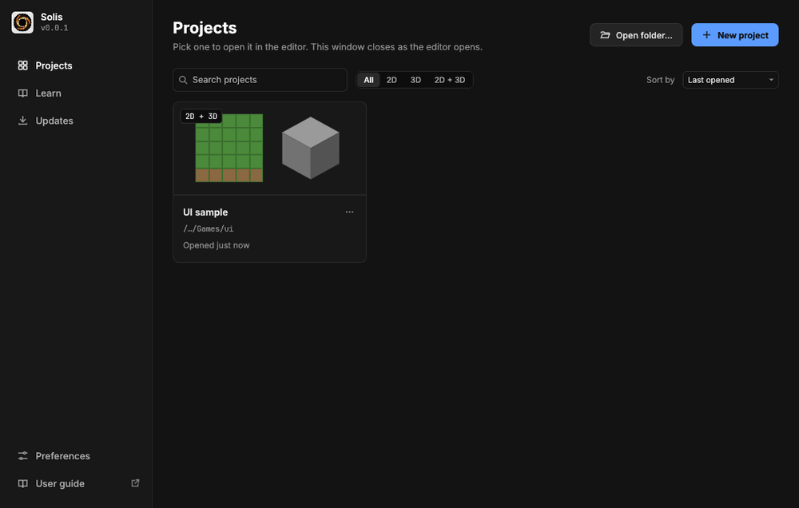

# The launcher

> The small window Solis starts in: every project you've worked on as a card, New project, and beside them Learn and Updates. Opening a project turns it into the editor; File › Close project brings it back.

## When to use it

Solis always starts on the launcher, a window of its own (about 1100 × 700). You pick the project to work on, and the window becomes the editor, at the editor's own size and place. Solis never reopens the last project by itself, so you always choose; the projects you opened most recently come first, so it's one double-click.

Why a window of its own? The launcher only has to show and organise projects, so it stays small and calm; the editor gets the whole screen for your game. Each remembers its own size and place on your computer: move the launcher to one corner and it opens there next time, and the editor still opens where you left it.

When you've finished with a project, **File › Close project** (or closing the editor's window) asks about unsaved work, closes the project and comes back to the launcher. Closing the launcher's window quits Solis.

Use it to:

- open a project you've worked on before, without hunting for its folder;
- see at a glance which projects are [2D, 3D or both](concepts.md#projects), and show only one kind;
- make a new project: Solis makes its folder from the name you type ([New project](#new-project));
- tidy the list: a project you've finished with, or one whose folder has gone, can be removed from it (its files stay), and one you moved can be found again;
- rename a project, make a copy of it to try something risky, or open its folder in Explorer;
- learn with the examples ([Learn](#learn-and-updates)), and update Solis ([Updates](#learn-and-updates)).

## How to use it

**The launcher**, where Solis starts: each project a card, the newest first.

1. Each project is a **card**: a picture of its kind (a field of tiles for 2D, a block for 3D, both for both), its kind in the picture's corner (**2D**, **3D** or **2D + 3D**), its name, its folder, and when you last opened it. A project can't keep a picture of its own yet: its kind's picture stands in. Pinned projects come first.
2. **Double-click** a card to open it, or click **Open** on it (shown on the card under the pointer or picked). Clicking a card once picks it; **Enter** then opens it, and the **arrow keys** walk from card to card.
3. **⋯** at the right of a card's name (or a right-click on the card) opens its menu:
   - **Open**.
   - **Show in Explorer**: opens the project's folder.
   - **Remove from list**: only forgets the project here. Its folder and files stay exactly where they are, and **Open folder…** brings it back.
   - **Pin to the top** (or **Unpin**): keeps it first, whatever the order.
   - **Rename…**: changes the project's name (in the title bar and on its card). Its folder keeps its name, so nothing that points at the folder breaks. Type the new name and press `Enter`; `Esc` leaves it as it was.
   - **Make a copy…**: choose an empty folder, and the whole project is copied there, named "… copy". The import cache is left out (the copy makes its own), and so are links to elsewhere on the computer. A note under the heading says when it's done, and the copy joins the list.
4. **Search projects** narrows the cards as you type, by name or folder. Every word you type must appear somewhere, in any order.
5. The **filter** beside it shows **All** projects, or only **2D**, **3D** or **2D + 3D** ones.
6. **Sort by** orders the cards by when each was last opened, or by name.
7. **Open folder…** opens a project that isn't in the list yet: choose its folder. Choose a folder that isn't a project (such as Documents) and Solis looks through it, and the folders inside it (four levels down), for projects, and adds every one it finds without opening them.
8. **New project** opens [New project](#new-project).
9. **Preferences**, at the foot of the column, are the editor's own settings, the same as **File › Preferences** in the editor ([Settings](settings.md)). **User guide** opens this guide in your browser.

## New project

Type a name, and Solis makes the project's folder for you.

1. **Name**: what the project is called. The line under it shows the folder it makes, **Create in** followed by the name (`C:\Users\Sam\Documents\Solis projects\Farm Days\`). If that folder already exists and isn't empty, or the name can't be a folder's name on Windows, the line says why instead, and **Create** waits.
2. **Create in**: the folder new projects go in. The first time it's a **Solis projects** folder in your Documents; **Browse…** chooses another. The folder you make a project in is remembered for the next one.
3. **Kind**: **2D** (sprites and tile maps), **3D** (models, lights and cameras) or **Both** (2D and 3D). It's kept in the project and can be changed later in **Project settings › General › Kind** ([Settings](settings.md#project-settings)). The kind decides what the editor shows: a 2D project hides the parts only 3D games use (the Shading tab, lighting, models), a 3D project those only 2D games use (tile maps and their painter), and Both shows everything ([What each kind hides](settings.md#what-each-kind-hides)). Pick Both if you're unsure: nothing is lost either way, and the kind can be changed whenever you like.
4. **Start from**: **Empty** (only what a project needs to open), or one of Solis's examples (**Playground**, **Turret sample**, **UI sample**, **Benchmark**), made as your project, under your name. Each example is marked with the kind it was made for: they are all **3D**, so they're greyed while **2D** is chosen.
5. **Create** makes the folder, writes the project and opens it in the editor. **Cancel** (or `Esc`) closes the dialog and makes nothing.

> **Good to know:** a new project gets only what it needs to open: its `project.solis`, Solis's `.solis` folder, and Git's `.gitignore` and `.gitattributes`. Its **assets** folder is made when you put the first file in it (an import, a new folder or file in the Library, a saved level).

A name is refused, with the reason, when it's empty, longer than 100 letters, holds a character Windows doesn't allow in a folder's name (`< > : " / \ | ? *`) or a line break, starts with a dot (a hidden folder) or ends with one, or is a name Windows keeps for itself (`CON`, `PRN`, `AUX`, `NUL`, `COM1` to `COM9`, `LPT1` to `LPT9`). A folder too deep for Windows (its whole path near 260 characters) is refused too.

## Learn and Updates

The column has two more pages:

- **Learn**: the four examples, each with a sentence about it and **Make it in a folder…** (choose an empty folder; it opens in the editor); **Your first hour**, five steps for someone new; and **Open the user guide**. The sample level, which goes into an open project, is in the editor's search: press `Space` and type *sample level*.
- **Updates**: when a newer build of Solis is out, Updates has a **1 new** mark in the column, and a card across the top of the page says what it is, with **Not now** and **Download** (it downloads while you work), then **Restart to update** (Solis closes, installs it and opens again). In a copy you didn't install with the setup file, the step is **Open the releases page** instead. Under the card: the build you have, the newest build with **Check now**, the **Look for updates when Solis starts** switch, the releases page and the list of every change. Beside them, what the new build brings. See [Installing and updating](installing-and-updating.md).

## Opening a project from the command line

A project's folder named after the program opens it in the editor straight away, without the launcher: `solis "C:\Games\Farm Days"`. The four examples can be made the same way, for a script: `solis --sample playground "C:\Games\Try"` makes the playground in that empty folder and opens it (the others are `game`, `ui` and `benchmark`).

## Settings

| Setting | What it does |
|---|---|
| Filter | **All**, or only **2D**, **3D** or **2D + 3D** projects. |
| Sort by | **Last opened** (the most recent first; projects whose time isn't known come last) or **Name** (A to Z). Pinned projects always come first. |
| Create in (New project) | Where new projects' folders are made. Remembered: the folder of the last project you made. |
| Look for updates when Solis starts (Updates) | Asks GitHub for a newer build at each start, in the background. Off, nothing is asked until you press **Check now**. The same switch is on **Preferences › General**. |

## The build each project was last opened with

When a project opens, Solis writes its build number into the project's `project.solis` file. Rest the pointer on a card to see which build last opened it: the one you're using, an older one (it opens as usual, and its files are upgraded when saved, with a backup first: [Backups and upgrades](backups-and-upgrades.md)), or a newer one (update Solis first: parts made with the newer build may not open in yours).

## Shortcuts

| Action | Shortcut |
|---|---|
| Open the project picked | `Enter`, or double-click its card |
| Walk the cards | `←` `→` `↑` `↓` |
| A card's menu | Right-click it, or its **⋯** |
| In **New project** or **Rename…**: make it, or close it | `Enter`, `Esc` |

## Tips and common problems

- **Problem:** a card says **Folder not found**. **Why:** the folder was moved, renamed or deleted, or it's on a drive that isn't plugged in. **Fix:** plug the drive in and come back to Projects (it looks each time). If you moved the folder, click **Locate…** on the card and choose where it is now. Otherwise click **Remove**.
- **Problem:** a card says **project.solis is gone from its folder**. **Why:** the folder is there, but the file that makes it a project isn't. **Fix:** if the project is in Git, get the file back from there; otherwise **Remove** it.
- **Problem:** New project says the folder **already exists and isn't empty**. **Why:** Solis never makes a project over other files. **Fix:** choose another name, or another **Create in**.
- **Problem:** `project.solis` shows as changed in Git after opening a project. **Why:** Solis noted its build number in it (`saved_by`), and a kind changed in Project settings is kept there too (`kind`). **Fix:** commit it with your other changes.
- **Problem:** a project made with an earlier Solis shows **2D + 3D**. **Why:** projects from before the kind was asked are both, so nothing they use is ever hidden. **Fix:** choose its kind in **Project settings › General › Kind**.
- **Problem:** Open folder… on a big folder says **it stopped early**. **Why:** it looks through at most 20,000 folders, so choosing a whole drive can't keep it busy for long. **Fix:** choose the folder your projects are in, such as Documents.

## Related

- [Projects and the Library](projects-and-the-library.md): what a project is and what's in it.
- [Settings](settings.md): Preferences, and Project settings with the kind.
- [Installing and updating](installing-and-updating.md): getting a newer build.
- [Backups and upgrades](backups-and-upgrades.md): what happens to a project made with an older build.
- [Concepts](concepts.md): [launcher, project, project kind and build](concepts.md#projects).
