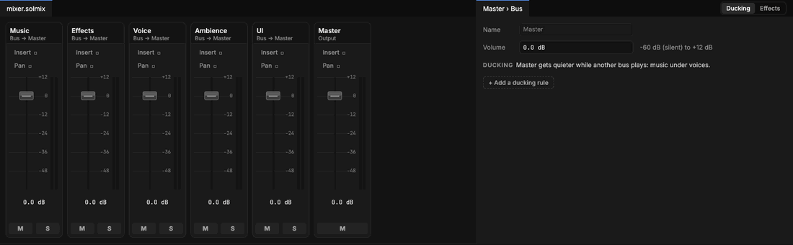

# The Mixer

> The Audio tab: the project's buses as strips side by side, each with a fader, a meter, mute and solo, the bus picked with its ducking rules, and the project's sound events.

## When to use it
When you want to balance a game's sound as a whole rather than one [sound event](sound-events.md) at a time: the music a little quieter, every effect a little louder, voices always clear. Each sound event plays through a [bus](concepts.md#sound), and a bus's fader turns all of its sounds up or down together, like a channel on a mixing desk. To change how one sound is heard (its volume, how far it carries), change its event instead.

## How to use it

The Audio tab: a strip for each bus with **Master** last, and the bus picked beside them with its ducking rules.

1. Click **Audio** in the tab bar. The mixer fills the left of the middle (its tab is the project's mixer file, `mixer.solmix`): a **strip** per bus, side by side, with **Master** last at the right. Beside it is the **Bus** group, showing the bus you picked (Master until you pick one).
2. Each strip, top to bottom: the bus's name and where it goes ("Bus → Master"; Master's is "Output"), an **Insert** and a **Pan** that aren't built yet ([Unfinished parts](unfinished-parts.md)), the **fader** on its scale of [dB](concepts.md#sound) beside the **meter**, the fader's value, and **M** (mute) and **S** (solo). Master has M only: every other bus is inside it, so its fader turns everything up or down.
3. **Drag a fader** up or down. Hold **Shift** while dragging for a fine move. Double-click it to put it back to 0 dB. The change is heard at once and saved in the project when you let go. To type a number, use **Volume** in the Bus group.
4. Press **Play**: the meters show how loud each bus is as the game plays, grey, topping out in amber when loud. A thin white line over each meter holds its loudest moment for a second; **click the meter** to drop the line back to the level now. If Master's meter keeps reaching amber, turn something down.
5. **Click a strip's name** to pick it: its strip is outlined in the accent colour and the Bus group shows its **Name**, the bus it's **Inside**, its **Volume**, and its **ducking** rules as cards. The switch at the group's top right turns it to the bus's **Effects**, which aren't built yet.
6. **Bus** on the ribbon makes a new bus inside the one picked (or inside Master): "Footsteps" inside Effects, say, so footsteps can be balanced on their own. Then pick it as the **Bus** of the sound events that belong to it. **Remove** (or **Remove bus** in the Bus group) removes the bus picked; Master is shown after, with nothing picked, so a second click removes nothing.

**Ducking** turns one bus down while another plays, so speech is always heard over the music without turning the music down by hand. A new project already has one rule: while **Voice** plays, **Music** goes down 8 dB, taking 0.2 s to go down and 1 s to come back after the last voice ends. Each rule is a card, **Quieter while Voice plays**; **Add rule** on the ribbon (or **+ Add a ducking rule**) adds one to the bus picked. While a rule is working, the ducked bus's strip says so in amber ("ducked -8"), its card says **Right now**, and the shelf bar says who is ducking whom.

**Heard at once**, on the ribbon, is how many sounds play at the same time: 64 to start with, from 16 to 256 (its list). When more want to play (a big battle), the most important are heard: by their event's **Priority**, then the loudest where you are. Sounds too far away aren't counted at all. More voices sound fuller and cost a little more time each frame (the [Profiler](profiler.md)'s Sound part shows it).

**Mute and solo** are for listening while you work, and aren't saved: **M** silences a bus (its strip goes faint), **S** plays only the soloed buses (and the buses they're inside), so you can hear one part of the game on its own. **Clear solo** on the ribbon hears every bus again. **Mute the game** on the ribbon, or the speaker in the **Game** tab's top right corner, mutes everything.

**The sound events** are on the shelf's **Sound events** tab: every event in the project as a row (its bus, volume, where it's heard and how many takes), and the one you click beside them, to change and play ([Sound events](sound-events.md)).

## Settings
| Setting | What it does |
|---|---|
| Name | What sound events call the bus. Renaming it renames it everywhere in the Mixer (buses inside it, ducking rules); sound events that named the old name play through Master until you pick the new one. Master keeps its name. |
| Inside | The bus it's inside: its sounds go through that bus's fader too. A bus can't be inside itself or a bus inside it, and buses nest up to 8 deep. |
| Volume | The fader, from -60 dB (silent) to +12 dB; type or drag the number in the Bus group. 0 dB plays the sounds as they are; -6 dB is about half as loud. |
| Quieter while | The bus whose sounds turn this one down (a bus inside it counts too). |
| By | How much quieter, down to -60 dB. -6 to -10 dB is usual for music under speech. |
| Fade down | How long going quieter takes, in seconds. Short (0.1 to 0.3 s) so the first word is clear. |
| Fade back | How long coming back takes after the last of those sounds ends. Longer (0.5 to 2 s), so the music doesn't jump back between sentences. |

A bus can have up to 8 ducking rules (**Add a ducking rule**, and the card's **×** to remove one), and a project up to 64 buses. **Remove bus** moves the buses inside it up to its parent. Adding, removing or moving a bus while the game plays rebuilds the mix: sounds already playing once stop (sounds that keep playing start again at once), so do it while stopped if you're listening closely.

**From game code**, `Audio:setVolume(Bus.Music, volume)` sets a bus for the rest of the play to a share of its fader, from 0 (silent) to 1 (as set in the Mixer): what an options menu's sliders call. See [Game code: Sounds](game-code.md#sounds).

## Shortcuts
| Action | Shortcut |
|---|---|
| Move a fader finely | Hold `Shift` while dragging it |
| Put a fader back to 0 dB | Double-click it |
| Drop a meter's peak line to the level now | Click the meter |

## Tips and common problems
- **Problem:** a sound event isn't affected by its bus's fader. **Why:** its **Bus** names a bus that isn't there any more (renamed or removed), so it plays through Master. **Fix:** pick the bus again on the event (Audio's Sound events tab, or its Details in the Library).
- **Problem:** some sounds don't play in a busy moment. **Why:** more sounds wanted to play than **Heard at once** allows, and they ranked lowest. **Fix:** raise their event's Priority, or raise Heard at once.
- **Problem:** the meters don't move. **Why:** they show the game's sounds while it plays; the Library's ▶ and a sound event's Play don't go through the buses. **Fix:** press Play.
- **Problem:** everything is silent. **Why:** a bus is soloed (only soloed buses are heard), Master is muted, or the game is muted. **Fix:** **Clear solo**, click the lit **M**, or turn off **Mute the game**.
- **Problem:** the Console says the mixer file had a mistake. **Why:** `mixer.solmix` was edited by hand and can't be read, so the standard buses are used. **Fix:** fix the line it names, or change anything in the Mixer: that writes the file again and keeps the old one as `mixer.solmix.bak`. Changes made to the file by hand are read when the project is opened.

## Related
- [Sound events](sound-events.md): each event's Bus.
- [Game code: Sounds](game-code.md#sounds): `Audio:setVolume`.
- [Concepts](concepts.md#sound): bus, ducking, decibel.
