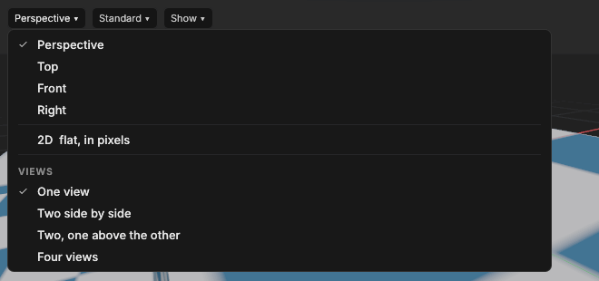

# Moving around the viewport

> Fly the camera through the 3D world, split the viewport into several views (flat ones too), and use the tool bar and the [pills](concepts.md#pill) floating over each view.

## When to use it
Whenever you want to look at the world from somewhere else. Solis has one camera style, the [fly camera](concepts.md#the-3d-view): you steer it like a drone, as in Unreal Engine.

## How to use it

The view pill at the viewport's top left: the four views, **2D**, and how many views to show at once.

**Looking and flying:**
1. Point at the viewport and **hold the right mouse button**. The pointer disappears.
2. Move the mouse to look around.
3. While still holding the button, use the keys:
   - **W** forward, **S** back, **A** left, **D** right (forward follows where you look, so looking down and pressing W flies down);
   - **E** straight up, **Q** straight down;
   - **Shift** to go three times faster while held.
4. Let go of the right button. The pointer comes back where it was.

**Without holding the right button:**
- **Mouse wheel:** moves forward or back in steps.
- **Hold the middle button (the wheel) and drag:** slides the view sideways and up or down. The ground under the pointer moves with it.

**Several views** (the view's pill, **Perspective ▾**, under *Views*): **One view**, **Two side by side**, **Two, one above the other**, or **Four views**. Each view has its own camera and its own look; with four, they start as Perspective, Top, Front and Right, the classic way to line things up exactly.
- **Click in a view** (or turn the wheel over it) to use it: it gets a thin coloured outline, the frame time and the axis locks. **F**, the ribbon's Create buttons, and anything else that goes "where the camera looks" use that view.
- Selecting, the gizmos, and dragging things in from the Library work in every view.
- **Maximise** (in each view's own **Perspective ▾** list, while there are several) shows that view alone, filling the viewport; **All views** brings the others back.
- Solis remembers the layout and every view's camera next time.

**Flat views** ([concepts](concepts.md#the-3d-view)): the **Perspective ▾** pill at the top left of each view chooses what it shows: **Perspective**, **Top**, **Front** or **Right**. A flat view shows things at their true size whatever their distance, with the grid standing in the view's own plane, so lining up edges and heights is exact.
- **Hold the right or middle button and drag** to slide the view.
- **Turn the wheel** to zoom in or out, towards the pointer.
- Flat views don't fly: switch back to Perspective for that.
- Flat views have no [fog](concepts.md#light), so faraway parts are as clear as near ones.
- A camera or spotlight added from a flat view (and **Move here**) goes just in front of where the view looks from, as if it were a camera above or beside the area looking in.

These are the flat-view controls Unreal Engine uses.

**The 2D view** (the last in the **Perspective ▾** list): a flat view from above like Top, measured in your game's pixels, for 2D games ([2D](2d-pixel-perfect.md)). It slides the same way, but the wheel zooms in whole steps (100%, 200%, 300%…) and every pixel of the game lands on whole screen pixels, so pixel art looks as it will in the game. The grid is the project's tile size, a dashed frame shows what each 2D camera sees, and the pills at the bottom right are **Lock X Y**, **Snap: Whole pixels ▾** (moves land on whole pixels, tiles, or anywhere), the grid and **Zoom ▾**. Moves go across the ground only (X and Y).

**The tool bar** floats at the foot of the view in use, in the middle: Select (**Q**), Move (**W**), Rotate (**R**), Scale (**S**) and Transform (**T**), each with its key small in its corner, the tool in use filled with the accent colour. While you edit a [brush](brushes.md)'s insides, a short line and **Points (1)**, **Edges (2)** and **Faces (3)** follow. See [Selecting and moving things](selecting-and-moving.md). It floats over the picture rather than taking a column beside it, so the view keeps its whole width. It keeps clear of the pills at the bottom right: when the view is too narrow for both on one row, it moves left of them and its buttons get a little smaller; if there's still no room, it goes above them, and in a very narrow view its buttons shrink to fit (point at one to see its name and key). With two or four views it is on the view in use, as the bottom-right pills are. A tile map's painting tools are on their own ribbon instead ([Painting tiles](painting-tiles.md)); while one is in use, no tool on the bar is lit.

**The pills** float over each view, so the picture stays as large as it can be:
- **Top left, on every view:** the view (**Perspective ▾**: its kind, and how many views), the look (**Standard ▾**, how models are shaded; see [Looks](looks.md)) and **Show ▾**: what the viewport shows (the frame time, the axis locks and camera speed, the **Tools** bar) and **Preview animation**.
- **Top right, on the view in use:** the time each frame takes and the frames per second. Point at it to see how many entities and triangles there are. When nothing moves it says **Idle**: Solis then draws only when something changes, so your computer isn't kept busy (and a laptop stays cool and quiet). Fly the camera or press Play to see the frame rate.
- **Bottom right, on the view in use:** **Lock X Y Z** (the axis locks), **World ▾** or **Object ▾** (which way the gizmo points) and the camera's speed. See [Selecting and moving things](selecting-and-moving.md).

Snapping (Grid, Angle, Scale) is on the ribbon, in Home's Snapping group.

## Settings
| Setting | What it does |
|---|---|
| Camera speed (1 to 8) | How fast W, A, S, D, Q and E move: 1, 2, 4, 8, 16, 32, 64 or 128 metres a second. Change it by turning the mouse wheel **while holding the right button**. 4 (8 metres a second) is a good start; use 6 to 8 to cross a big map. Shown in the Camera box. |

The camera's position, direction and speed are remembered next time.

## Shortcuts
| Action | Shortcut |
|---|---|
| Look around | Hold right mouse, move the mouse |
| Fly | Hold right mouse + W A S D |
| Down, up | Hold right mouse + Q, E |
| Faster for a moment | Hold Shift while flying |
| Change speed | Hold right mouse + mouse wheel |
| Forward, back in steps | Mouse wheel |
| Slide | Hold middle mouse, drag |
| Slide a flat view | Hold right or middle mouse, drag |
| Zoom a flat view | Mouse wheel (towards the pointer) |
| Use a view | Click in it |

## Tips and common problems
- **Problem:** pressing W picked the Move tool instead of flying. **Why:** the right mouse button wasn't held. The tool keys work only when it isn't. **Fix:** hold the right button first, then press W.
- **Problem:** you're lost. **Fix:** fly up with E, look down, and find where the red and green lines cross: that's the origin.
- **Problem:** holding the right button doesn't fly. **Why:** the view is a flat one (Top, Front or Right). **Fix:** drag to slide it, or switch it to Perspective.
- **Problem:** the right button didn't fly while you were drawing a selection box or dragging a gizmo. **Why:** with the left button held on one of those, a right click cancels it (see [Selecting and moving things](selecting-and-moving.md)). **Fix:** let go of both buttons, then hold the right one.
- **Problem:** F or Add entity went to the wrong view. **Why:** they follow the view in use, the one with the outline. **Fix:** click in the view you want first.
- **Problem:** flying feels too slow or too fast. **Fix:** change the speed with the wheel while holding the right button.

## Related
- [Keyboard shortcuts](keyboard-shortcuts.md)
- [Concepts](concepts.md): Z up, axes, metres, grid.
