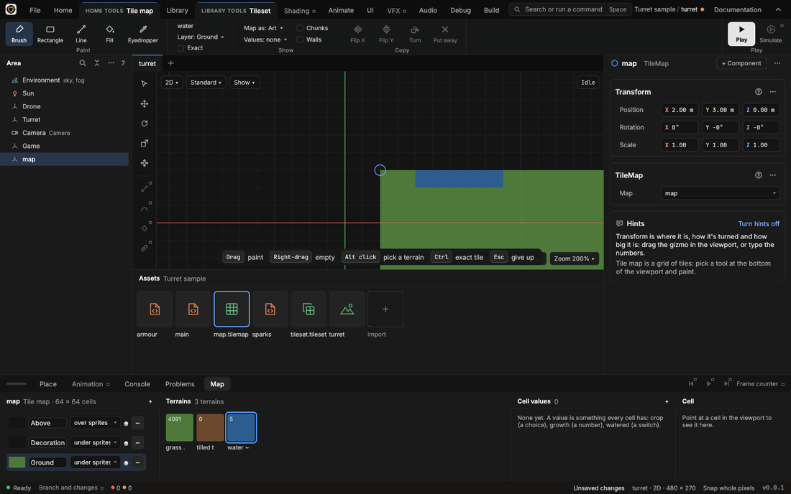

# Painting tiles

> Paint a tile map's cells with a brush, a rectangle, a line or a fill, copy an area to paint with, and place a tile exactly as it is.

## When to use it
A [tile map](tile-maps.md) is a grid of [terrains](concepts.md#2d): grass, tilled earth, water. The **tile painter** is how you lay them out: paint a field of tilled earth, a pond, a path, a fence. You paint what each cell *means* (its terrain); the art is worked out from the neighbours by [autotiling](tilesets.md), so the edges of a pond come out smooth wherever you paint it.

Painting is for the map file, the world as the game starts. While the game runs, the map is the game's own copy, so painting is off then; game code changes cells as you play.

## How to use it

A tile map picked in the 2D view: the painting tools on the ribbon (**Brush**, **Rectangle**, **Line**, **Fill**, **Eyedropper**), and its layers and terrains on the **Map** tab, where a terrain's swatch is the paint.

1. **Select the map's entity** (in the Area panel). A **Home tools · Tile map** tab joins the tab bar after Home and comes to the front, with the **Map** tab of the shelf. Its [ribbon](concepts.md#the-window) holds everything for painting, so the viewport stays clear: the tools are on the ribbon rather than in the toolbox because there are five of them and they are only there while a map is selected. Bringing another shelf tab to the front (Entity, say) gives Home's own ribbon back; the Tile map tab, or the Map shelf tab, brings the painting ribbon again.
2. **Choose a tool** in the ribbon's **Paint** group or with its key: **Brush (B)**, **Rectangle (U)**, **Line (N)**, **Fill (G)** or **Eyedropper (I)**. Q, W, R, S or T goes back to the transform tools. While a tool is in use, its keys show in a hint along the foot of the view.
3. **Choose what to paint:** click a terrain's swatch in the Map tab's **Terrains** column. The outlined swatch is the one painted, and the ribbon names it beside the tools. Clicking a swatch takes the brush if no painting tool is in use.
4. **Choose the layer:** click its row in the Map tab's first column, or pick it from the ribbon's **Layer** list (**Ground** to start). The row painted on is lit. Paint fences and flowers on Decoration so the ground under them stays grass.
5. **Paint in the viewport** (the **2D** view is easiest):
   - **Brush:** drag over cells to paint them. Every cell the pointer crosses is painted, however fast you drag.
   - **Rectangle:** drag from one corner to the other. The cells show while you drag and are painted when you let go.
   - **Line:** drag from one end to the other; painted when you let go.
   - **Fill:** click a cell. Every cell joined to it by its sides with the same terrain is painted: one field, stopping at its edges.
   - **Eyedropper:** drag over cells to copy them (see below). One cell picks its terrain instead.
6. **Empty cells** by dragging with the right mouse button: the brush, rectangle, line and fill all take cells away instead.
7. **Undo** with **Ctrl + Z** while a painting tool is in use (or over the Map tab). Each stroke, from pressing the button to letting go, is one step. **Esc** during a stroke gives it up.

Everything is saved as soon as you let go.

### Picking a terrain from the map
**Alt + click** a cell to paint with its terrain, like a colour picker. It also picks the cell's exact tile, if it has one.

### Copying an area
Drag over cells with the **Eyedropper** to copy them: a **[copy](concepts.md#2d)** (some programs call it a stamp). The brush takes it, and paints the whole copy round the pointer; dragged, it repeats like a pattern, without seams. Empty cells in the copy leave the map as it is, so a copied fence keeps the grass under it.

While you hold a copy:
- **X** flips it left and right, **Y** top and bottom, **Z** turns it a quarter clockwise (the ribbon's **Copy** group does the same: Flip X, Flip Y, Turn, and Put away);
- the rectangle, line and fill paint with it as a pattern;
- **Esc**, or clicking a terrain's swatch, puts it away.

### Exact tiles
Autotiling picks each cell's tile from its neighbours. Sometimes you want one particular tile instead: a cracked stone, a corner that breaks the rule. An **[exact tile](concepts.md#2d)** is a cell that shows one tile as it is.

1. Tick **Exact** on the ribbon (or hold **Ctrl** while painting).
2. The Map tab shows the painted terrain's tiles under the swatches. Click the one to place. To start, it's the tile for the middle of a patch.
3. Paint. The cell keeps that tile; its neighbours still see its terrain, so their edges still join it.

Painting the cell again without Exact makes it autotiled again. Exact tiles are art only: the game reads the terrain, never the tile.

### Art or meaning
**Tab**, or the ribbon's **Map as** list in the Show group, switches the selected map between its **art** and its **meaning**: each terrain in its flat colour, which is what the game reads. Meaning is handy for checking that a path of tiles really is all one terrain.

## Settings
The ribbon of **Home tools · Tile map**, while a map is selected:

| Group | Setting | What it does |
|---|---|---|
| Paint | Brush, Rectangle, Line, Fill, Eyedropper | The painting tools (B, U, N, G, I). |
| (in hand) | The terrain, or *Copy W × H* | What is painted now. |
| (in hand) | Layer | The layer painted (a click on a layer's row in the Map tab does the same). |
| (in hand) | Exact | Places the tile chosen in the Map tab as it is, not the one autotiling picks. Ctrl while painting does the same for one stroke. |
| Show | Map as | What the selected map shows: its art, or each terrain in its colour (Tab). |
| Show | Values, Chunks, Walls | What is laid over the map: its [cell values](tile-maps.md), its chunks of 32 × 32 cells, and what's solid. |
| Copy | Flip X, Flip Y, Turn, Put away | Change or drop the copy held (X, Y, Z, Esc). Faint until you hold one. |

## Shortcuts
| Action | Shortcut |
|---|---|
| Brush, Rectangle, Line, Fill, Eyedropper | B, U, N, G, I (a map selected) |
| Paint | Left-drag (a click for the fill) |
| Empty cells | Right-drag |
| Paint with the terrain under the pointer | Alt + click |
| Place exact tiles for one stroke | Hold Ctrl while painting |
| Flip the copy left and right, top and bottom; turn it | X, Y, Z (holding a copy) |
| Give up a stroke; put the copy away; leave the painting tool | Esc |
| Art or meaning | Tab |
| Undo or redo a stroke | Ctrl + Z, Ctrl + Y |
| Slide the view while painting | Middle-drag |

## Tips and common problems
- **Problem:** on a very big map, what you just painted disappears when you let go, and the Console says the map *wasn't changed*. **Why:** with that stroke the map's file would be too big for Solis to open again, so the stroke isn't kept; the map is as it was before it. **Fix:** see [Tile maps](tile-maps.md#tips-and-common-problems) for how much a map can hold and what to do.
- **Problem:** the painting tools aren't on the ribbon. **Why:** they are on the **Home tools · Tile map** tab, there only while a tile map's entity is selected, and faint while the game runs. **Fix:** select the map in the Area panel and click the Tile map tab (or the Map shelf tab); stop the game.
- **Problem:** right-dragging empties cells instead of sliding the view. **Why:** while a painting tool is in use, the right button empties. **Fix:** slide with the middle button, or press Q for Select.
- **Problem:** the fill painted more than expected. **Why:** the fill follows every cell of the same terrain joined by its sides, on the layer painted. **Fix:** Ctrl + Z, then break the field with a line first.
- **Problem:** painting does nothing. **Why:** the map has no tileset (nothing to paint with), or the layer painted is hidden. **Fix:** choose a tileset in the map file's Properties; check the ribbon's Layer list and the Map tab's eyes.
- **Problem:** a flipped copy's exact tiles look the wrong way round. **Why:** exact tiles move with their cells but aren't mirrored. **Fix:** pick the mirrored tile from the Map tab, or leave those cells autotiled.
- **Problem:** cells show pink. **Why:** their terrain's art is missing a tile they need (Problems names it). **Fix:** fill the slot in the [tileset](tilesets.md).

## Related
- [Tile maps](tile-maps.md): layers, values and the Map tab.
- [Tilesets and autotiling](tilesets.md): how each cell's tile is picked.
- [Undo](undo.md): what Ctrl + Z undoes where.
- [Concepts](concepts.md#2d): tile map, terrain, layer, copy, exact tile.
