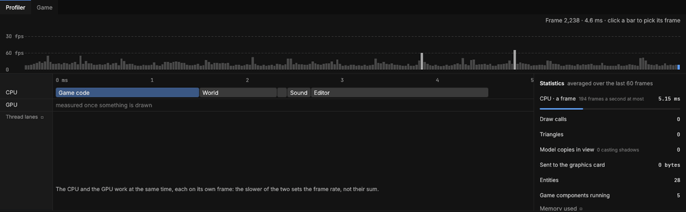

# The Profiler

> Shows where each frame's time goes, so you can see what makes a game or the editor slow.

## When to use it
A game feels slow, or you want to know how much more it can take: more units, more lights, more code. A **frame** is one picture on screen; at 60 frames a second each one has about 16.7 milliseconds (ms, thousandths of a second). The Profiler shows how those milliseconds are spent, on the **CPU** (the computer's processor, which runs game code and the editor) and the **GPU** (the graphics card, which draws). Fix the biggest part first.

## How to use it

The Profiler on the Debug tab while the game plays: a bar for each frame along the top, the frame picked as a timeline, and Statistics at the right.

1. Click **Debug** in the tab bar: the Profiler fills the middle (the **Game** is a tab beside it), with the [Console](console.md) and Problems on the shelf.
2. Press **Play**, or move around the viewport: the Profiler measures every frame the editor draws. When nothing moves, Solis doesn't draw (the viewport says *Idle*), so nothing new is measured.
3. **The frame-time graph** along the top shows the last 240 frames, a bar each, newest on the right. The dashed lines are 60 and 30 frames a second: a bar above a line is a frame too slow for it, and bars over 60 frames a second's budget are lighter. **Click a bar** to pick that frame: it turns the accent colour, and the line at the top right says its number and time.
4. **The timeline** under it shows the frame picked (or the newest): the CPU's parts laid end to end along a ruler of milliseconds, and under them the GPU's. A part long enough has its name on it. The lanes for threads aren't built yet.
5. **Statistics** on the right are averaged over the last 60 frames: the CPU's and the GPU's time a frame (each with a bar, its share of 60 frames a second's 16.7 ms), draw calls, triangles, model copies in view, what was sent to the graphics card, entities and game components running.
6. **CPU** and **GPU** on the ribbon hide or show those lanes and figures.

## What the parts mean
| Part | What it is |
|---|---|
| Game code | Your Lust, Lua and Rust components: their `update`s, events, and taking in changes made while playing. |
| World | The game's [world](concepts.md#playing): stepping its clock, working out where things are, taking in the area's changes. |
| Preparing to draw | Working out what each view shows: which models where, the lights. |
| Drawing (CPU) | Handing that to the graphics card. |
| Sound | The game's sounds: choosing which are heard, placing them, the buses. |
| Editor | Everything else: the panels, the mouse and keys, the interface. |
| GPU: shadows, models, the last pass | The graphics card's own time: the sun's shadows, the models and sky, then exposure and colour. Measured only on cards that offer it; the Profiler says when yours doesn't. |
| Projectiles drawn | How many lasers and other projectiles the Game tab drew. Shown when there are some. |
| The counts | Model copies in view, copies [casting shadows](concepts.md#light) into it, triangles, draw calls (one per model part, however many copies), and how much was sent to the graphics card. Copies out of view aren't drawn at all ([culling](concepts.md#playing)), and copies that didn't move aren't sent again, so a still scene sends next to nothing. |

The CPU and the GPU work at the same time, each on its own frame, so the slower of the two sets the frame rate, not their sum.

## Shortcuts
| Action | Shortcut |
|---|---|
| Pick a frame to look at | Click its bar in the graph |

## Tips and common problems
- **Problem:** Game code is the biggest part. **Why:** many components, or one doing a lot each tick. **Fix:** do less each tick (check things every few ticks, not every one), or move the busiest code to Rust.
- **Problem:** the GPU's times say they aren't measured. **Why:** your graphics card or its driver doesn't offer timestamps. **Fix:** the CPU's numbers still work; update the graphics driver, which often adds them.
- **Problem:** Preparing to draw goes up when I turn the camera towards the crowd. **Why:** only what's in view is drawn, so looking at more draws more. **Fix:** nothing to fix; it's the view that counts, not the size of the area.
- **Problem:** the numbers jump while nothing changes. **Why:** other programs share the computer. **Fix:** read Statistics' averages, not single bars.

## Related
- [Play mode](play-mode.md)
- [Game code](game-code.md)
- [Concepts](concepts.md#playing): frame, CPU, GPU, frames a second
