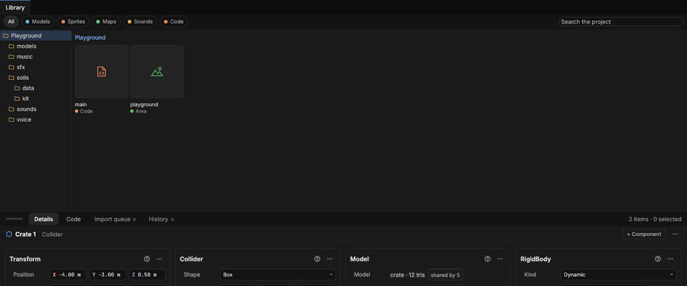

# Projects and the Library

> A project is a folder holding your game's files: models, pictures, areas and code. The Library shows what's in it, with pictures of each model, and is where you place things from.

## When to use it
Make a project as soon as you start something you want to keep. Without one, Solis works as a viewer: models you import are shown but not kept. With one:

- models you import are copied into the project's **assets** folder, so the project has everything it needs, on any computer;
- each [asset](concepts.md#projects) gets an ID that never changes, so renaming or moving a file (in Solis, in Explorer, or through Git) breaks nothing;
- when you save a model again in Blender or Aventail, Solis notices and shows the new version straight away;
- the **Library** shows every file, folder by folder, with a thumbnail of each model and picture and the waveform of each sound, ready to drag into the area (or, for a sound, to listen to: see [Sounds](sounds.md)).

## How to use it

The Library tab: the project's folders down the left, the open folder's files as tiles, the chips that show one kind, and the file picked in Details below.

**Make a project**
1. **File › New project** and choose an empty folder (make one in the window if you need to). The project is named after the folder.
2. Solis makes `project.solis`, an `assets` folder, and a hidden `.solis` folder for its cache. If you use Git, it also adds `.gitignore` and `.gitattributes` files set up for games.

**Open a project:** **File › Open…** and choose the project's folder, or pick it from **File › Recent projects** ([Projects](launcher.md)). Solis doesn't open the last project again when it starts: it always starts on Recent projects, so you choose what to work on, and the projects you opened most recently are at the top of its list (after any you pinned), one double-click away.

**Opening another project starts afresh.** Everything of the project you leave goes with it: its area, the files open in tabs (Clips, Frames, Animator, Map, Tileset, Atlas Crop, the UI canvas) and their undo steps, components' values you copied, and a `seed` chosen in the Console. Nothing of one project can then be saved into another by mistake, which matters most with a copy of a project, whose files have the same names. What's yours stays as it is: the layout, the cameras, the theme and the Console's messages.

**Add models:** **Library › Import**, or drop a `.glb` or `.gltf` file onto the window: it's copied into the project's assets and placed in the area. You can also put files straight into the assets folder (or a folder inside it) from Explorer: they appear in the Library within a moment.

**Find your way around the Library**
- The Library tab's **ribbon** holds what you do with files: **Add** (**Import** with its list, **Create** for anything New makes, **Folder**), **View** (**List** for a list in place of tiles, **Show folders** for the folder tree), **Filter** (**Type: All ▾**: one group of kinds at a time) and **Use** (**Place**: puts the picked file where the camera looks, and brings Home to the front). Tags, Missing references, Source control and Show in area are [unfinished parts](unfinished-parts.md).
- With **Show folders** on, the **folder tree** is on the left: click a folder to see what's in it. The line above the files (*Harbour › props*) shows where you are; click a part of it to go back up.
- The folder's files are **tiles** that fill the width: each a square for its picture, then its name, and a coloured dot and word saying what kind of file it is. The colours are the design's: models cyan, assemblies blue, pictures and sprite sheets coral, clips and animators purple, sounds amber, tilesets and tile maps green; sound events, code files and areas keep the colours they had, and text files are one light blue. The picked tile is tinted with the accent and outlined inside. The shelf bar's right end counts the folder's items and how many are picked.
- **Search the project**, beside the chips, finds files by name in every folder.
- The **chips** (**All**, **Models**, **Sprites**, **Maps**, **Sounds**, **Code**, each with its kind's dot) show only one kind of file, so a busy folder is easy to scan. **All** shows everything, your code files included (the **Code** shelf tab, on the Library tab, lists only code).

**Where the Library is**
- On **Home**, the **Assets** list is the Library's open folder as tiles, with **Import** last, so you can drag files from it straight into the area (or double-click one to place it where the camera looks). Where it sits depends on the [panel layout](concepts.md#the-window) chosen in **File › Preferences**: a wide strip under the area (the standard), under the Area list at the left, under Properties at the right, or a column of the shelf's **Entity** tab. The **Place** shelf tab (Home's first) is for placing: see below. The folder is the Library tab's: open another folder there and Assets follows. Drag the border at its edge for a bigger list, and press **Ctrl + Space** to fold the shelf away when you want the viewport bigger. (Older builds had a Library drawer with Pin and Unpin; the shelf takes its place.)
- The **Library** tab of the tab bar shows it filling the window, with the file picked shown on the shelf's **Details** tab and the code files on its **Code** tab.
- Point at a file to see its full path and what you can do with it.

**Place a model or assembly**
- **Drag it from the Library into the viewport**: it goes on whatever surface is under the mouse when you let go (a table, the floor), or on the ground. In a flat Front or Right view, dropped on empty space, it goes exactly where you point, at that height. It's selected, ready to move.
- **Drag it onto an entity in the Area panel**: it goes under that entity, at its place.
- Or **double-click** it in Home's Assets list to place it where the camera looks. In the Library tab a double-click only picks a file that would be placed (so a stray double-click never drops something in the area); use **Place** on the ribbon, or drag it.

**Placing, with the Place shelf tab**
Bringing Home's **Place** shelf tab to the front is placing: the ribbon shows its building form (**Place**, Snapping, **Paint** and **Transform**, which holds the five tools while the toolbox is put away), the shelf shows **Placement** (how placed things land; in the shelf panel layout with the Area tree and the files beside it), and the Assets list shows only the files that can be placed, wherever it is (**Favourites** and **Recent** are unfinished; **All**, **Models**, **Sprites**, **Maps**, and **Find something to place**, which looks in every folder). While you drag a file over the viewport, a square in the accent shows where it will land, a label says what it is and where ("crate", "x 2.75 y -13.25 · grid"), and a strip at the bottom says how. With the ribbon's **Grid** on and **Align to: Grid**, it lands on the grid's step; **Free** never snaps, and holding **Ctrl** as you drop doesn't snap that once. Choosing another shelf tab (**Entity**, or the **Console** in the other layouts) leaves placing.

**Open things:** double-click an **area** to open it (Solis asks first if yours has unsaved changes). Double-click a picture to open it in its own program (your picture editor, say); to put it in the world as a [sprite](sprites.md), drag it into the viewport instead. Any other file, one Solis doesn't know, opens its folder instead of the file itself, and its name is shown in full with its ending: a file called `brick.png.exe` is a program pretending to be a picture, and opening it would run it. Projects you download or are sent can hold anything, so Solis never runs what's in them.

**Make new things:** right-click anywhere in the Library (empty space, a folder or a file) and choose **New**, or use **Create** on the Library ribbon. Everything is made in the folder shown (or the one you right-clicked):
- **Lust code file**: your game's code. The first one is `main.lst`, at the top of the assets, because game code starts there; later ones are `component.lst`, ready to fetch from `main.lst`. Each starts with a component and opens in the program your computer uses for `.lst` files (Ledger, once it's installed). See [Game code](game-code.md).
- **Folder**: "New folder".
- **Area**: an empty level, saved there and opened (Solis asks first if yours has unsaved changes). See [Saving areas](saving-areas.md).
- **Tile map**, **Tileset**, **Animator** and **Sound event**: see [Tile maps](tile-maps.md), [Tilesets and autotiling](tilesets.md), [Animators](animators.md) and [Sound events](sound-events.md).

**Text files** (`.md` and `.txt` notes, and data in `.json`, `.csv`, `.toml` and `.ron`) show in the Library in one light blue. Click one and Properties shows it, read only: a Markdown file's headings, lists, quotes, code and **bold** as they read, the others as plain text (up to 512 KB and the first 3,000 lines). **Open in its program** (or a double-click) opens it in the program your computer uses for that kind of file, such as Ledger for Markdown, to edit it there; Properties shows the change as soon as you save. They're under the **Code** chip too.

**Import** on the Library ribbon brings in a model. It's greyed until a project is open, since the model is copied into it.

**Organise files** (right-click a file or folder):
- **Rename…**: type a new name. The file's ID file goes with it, so nothing using it breaks. Changing only capitals works too. Renaming the open area is fine: Solis saves to the new name. A name must work on every computer: at most 100 characters, none of `< > : " / \ | ? *`, and not a name Windows keeps for a device (`CON`, `NUL`, `COM1` …); the Console says why if it isn't.
- **Move**: drag a file onto a folder in the tree.
- **New**: makes something new in that folder (see below).
- **Open** or **Place** (a sprite's clips file and a picture offer both): **Open** does what a double-click on that file does, and **Place** puts it in the area. **Place** is greyed on a file Solis hasn't given its ID yet, such as one copied in a moment ago: try again shortly.
- **Show in Explorer** opens the folder in your system's file browser.
- With the pointer over the Library or the Assets column, **F2** renames and **Delete** deletes the file picked there (anywhere else they act on the selected entity).
- **Delete** moves the file (or folder) to the **Recycle Bin**, with its ID file, so you can get it back. Anything in the area still using it keeps showing it until Solis restarts.

A `.gltf` model reads the files beside it, so it can't be moved to another folder on its own: move its whole folder instead. Renaming it in place is fine.

**The Code tab** beside the Library lists the project's code files (Lust `.lst`, Lua and Rust), with a search box. Double-click a Lust file to open it in the program Windows has for `.lst` files: make that a text or code editor (right-click a `.lst` file in Explorer > Open with > Choose another app), never a program that runs Lust, since a downloaded project's code should only run inside Solis's sandbox. A Lua file shows its folder instead (some computers have a program that runs `.lua` files rather than editing them), so open it from there in your editor. Solis checks your Lust whenever you save; see [Game code](game-code.md). The `solis` folder holds files Solis writes, describing the engine to your code.

**Change a model:** export it again over the same file in Blender. Everything using it shows the new version a moment later. If the new file is broken, the old version stays, and the Console says why.

## Settings

| File or folder | What it is |
|---|---|
| `project.solis` | Marks the folder as a project and holds its name. |
| `assets/` | Everything you made or brought in. Watched for changes. |
| `<file>.solmeta` | A small text file beside each asset holding its ID. **Commit it with the asset**, and move or rename them together (Solis copes if you forget, as long as the content didn't change). |
| `.solis/` | Solis's own folder. `cache/` holds models it has already read, so they open quickly; it keeps within 4 GB, deleting the models used least lately, and is safe to delete (it's rebuilt). `backups/` holds copies of files saved by an older Solis, kept before they were upgraded ([Backups and upgrades](backups-and-upgrades.md)). Never committed. |

## Tips and common problems
- **Problem:** the Console says a sidecar couldn't be read. **Why:** the `.solmeta` file was damaged, perhaps by a bad Git merge. **Fix:** fix it in a text editor, or delete it to give the model a new ID (anything using the old ID will then say the model is missing).
- **Problem:** the Console says a model "is a copy, so it got a new ID". **Why:** a file was copied together with its `.solmeta`; two files can't share an ID. The original (whose `.solmeta` is older) keeps its ID, so nothing using it changes. Nothing is wrong.
- **Problem:** a model I saved into the assets folder from Blender takes a couple of seconds to show in the Library. **Why:** Solis waits two seconds before giving a new file its ID, because Git writes a file and its `.solmeta` one after the other: a look in between would give the file a new ID and lose the one it has on other computers. **Fix:** nothing; models brought in with **Import model** show at once.
- **Problem:** I renamed a model in Explorer *and* changed it before Solis was open, and it lost its ID. **Why:** Solis finds a renamed file by its content; with the content changed too, it can't tell. **Fix:** rename and change in separate steps, or rename the `.solmeta` along with it.
- **Problem:** models placed before opening a project disappeared. **Why:** opening a project starts a new area. **Fix:** Solis asks to save first; [save the area](saving-areas.md) inside the project to keep it.
- Imported models open much faster the second time: the cache remembers them, even after a rename.
- **Problem:** a file shows an icon instead of a thumbnail. **Why:** thumbnails are made for models and pictures only, a few at a time, and a damaged file gets none. **Fix:** wait a moment; for a damaged file, the Console says what's wrong when you place it.
- **Problem:** Solis says there's already a file with that name. **Why:** renaming and moving never replace another file. **Fix:** choose another name, or delete the other file first.

## Related
- [Importing models](importing-models.md)
- [Entities and components](entities.md)
- Concepts: [project, asset, sidecar, cache](concepts.md#projects)
