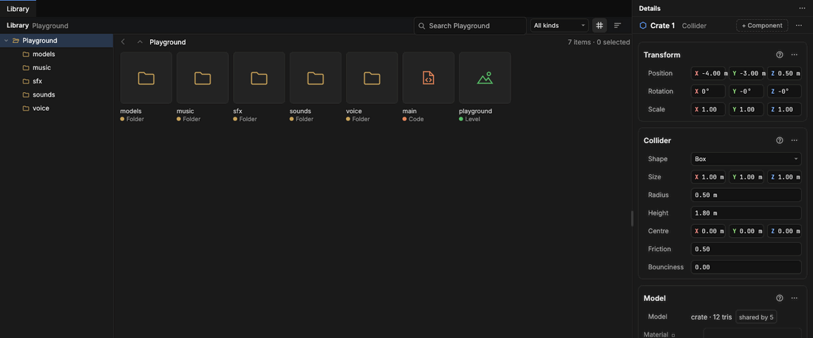

# Projects and the Library

> A project is a folder holding your game's files: models, pictures, levels and code. The Library shows what's in it, with pictures of each model, and is where you place things from.

## When to use it
Make a project as soon as you start something you want to keep. Without one, Solis works as a viewer: models you import are shown but not kept. With one:

- models you import are copied into the project's folder, so the project has everything it needs, on any computer;
- each [asset](concepts.md#projects) gets an ID that never changes, so renaming or moving a file (in Solis, in Explorer, or through Git) breaks nothing;
- when you save a model again in Blender or Aventail, Solis notices and shows the new version straight away;
- the **Library** shows every file, folder by folder, with a thumbnail of each model and picture and the waveform of each sound, ready to drag into the level (or, for a sound, to listen to: see [Sounds](sounds.md)).

## How to use it


The Library tab: the project's folders down the left, back, up and the breadcrumb over the open folder's folders and files as tiles, the search, the kind filter and grid or list at the top, and the file picked in Details at the right.

**Make a project**
1. On the [launcher](launcher.md), click **New project**, type its name and choose its kind (2D, 3D or Both). Solis makes a folder of that name in **Create in** (a **Solis projects** folder in your Documents, the first time).
2. Solis makes only what the project needs to open: `project.solis`, a hidden `.solis` folder for its cache, and `.gitignore` and `.gitattributes` files set up for games, for Git. Everything else is yours to arrange: your files go in the project's own folder, in whatever folders you make (*levels*, *pictures*, *farm*…). Solis never makes a folder for them.

**Open a project:** pick it on the [launcher](launcher.md), where Solis always starts, or use its **Open folder…** and choose the project's folder. Solis doesn't open the last project again when it starts, so you choose what to work on, and the projects you opened most recently are at the top of its list (after any you pinned), one double-click away. **File › Close project** goes back to the launcher.

**A project opens on a level**, never on an empty untitled one, so pressing **Play** straight away plays your game. It's the level you last opened or saved in that project on this computer; or, the first time (or on another computer), the level the game was last exported to start in ([Playtesting](playtest-export.md)); or else the project's first level by name, which is its only one if it has one. A new project with no levels yet starts on a new, empty level. Solis remembers the last level in the project's `.solis` folder, which isn't shared through Git, so each person opens where they left off.

**Opening another project starts afresh.** Everything of the project you leave goes with it: its level, the files open in tabs (Clips, Frames, Animator, Map, Tileset, Atlas Crop, the UI canvas) and their undo steps, components' values you copied, and a `seed` chosen in the Console. Nothing of one project can then be saved into another by mistake, which matters most with a copy of a project, whose files have the same names. What's yours stays as it is: the layout, the cameras, the theme and the Console's messages.

**Add models:** **Library › Import**, or drop a `.glb` or `.gltf` file onto the window: it's copied into the project and placed in the level. You can also put files straight into the project's folder (or a folder inside it) from Explorer: they appear in the Library within a moment.

> **Good to know:** a project made by an older Solis keeps its files in an `assets` folder. It's left exactly as it was, and the Library shows what's in it, because your game code names files by where they are in it: there, `assets` is the Library's top, and wherever this guide says *the project's folder* for your files, read `assets`. Solis's own folders (the hidden `.solis` and `.git`, `builds`, `saves` and `recordings`) and the project's settings files (`project.solis`, the input actions, the mixer, the 2D settings) never show in the Library, and nothing can be moved or saved into them from it.

**The Library is one browser, in two places.** On **Home** (and the UI and Audio tabs) it's the first tab of the [bottom panel](concepts.md#the-window) under the view; on the **Library** tab it fills the centre, with the file picked shown in **Details** at the right and the code files on the **Code** tab of the bottom panel. Both are the same browser, showing the same folder, the same search, kind filter, view and picked files: change one and the other follows, and opening or closing other panels never changes what it does. (The layouts **Library on the left** and **Library on the right** put Home's under the Level panel or under Properties instead.)

**Find your way around the Library**
- The **folder tree** on the left starts at the project's own folder, named after the project. Click a folder to open it; click a folder's arrow to fold or unfold what's inside. **Show folders** on the Library ribbon puts the tree away.
- Over the files, **‹** goes back to the folder you were in before, **˄** goes up one folder, and the **breadcrumb** (*Farm Days › farm*) shows where you are: click a part to go there. At the right, *14 items · 1 selected* counts what's shown and what's picked.
- The folder's folders come first, then its files, as **tiles** that fill the width: each a square for its picture, then its name, and a coloured dot and word saying what kind of file it is. Pictures, models and sprites show what's in them, a sound its waveform; the other kinds draw their kind in their colour. The colours are the design's: folders yellow, models cyan, prefabs blue, pictures and sprite sheets coral, clips and animators purple, sounds amber, tilesets and tile maps green, levels green, code orange, sound events teal, text light blue. The grid and list buttons at the top switch to a **list**, one row each with the kind's word.
- **Search** (*Search Farm Days*) finds files and folders by name in the whole project.
- **All kinds ▾** shows one kind of file at a time (**Models**, **Sprites**, **Maps**, **Sounds** or **Code**), so a busy folder is easy to scan. Folders still show, so you can go through them.
- **Pick several** with **Ctrl** and a click (another one, or one again to take it out) or **Shift** and a click (everything between). A click on empty space lets go of them all.
- Point at a file to see its full path and what you can do with it.

**Make new things:** right-click empty space in the Library. The menu says where they'll be made (*New in "farm"*), the folder you're in:
- **New folder**, **New level**, **New code file** and **New sound event…**: each is made with a free name (*New folder*, *level*, *component*, *New sound event*) and starts with its name picked out, ready to type over: type the name and press **Enter**. **New prefab** makes an empty [prefab](prefabs.md) there and opens it on its own page, ready to build. **New table** makes a [data table](data-tables.md) (*table*), with a Name column and one row, and opens it in the Table tab. **More** has **New tile map**, **New tileset** and **New animator** (see [Tile maps](tile-maps.md), [Tilesets and autotiling](tilesets.md) and [Animators](animators.md)).
- The first code file is `main.lst`, at the top of the project, because game code starts there: it keeps its name and opens in the program your computer uses for `.lst` files (Ledger, once it's installed). Later ones are components, ready to fetch from `main.lst`; double-click one's picture to open it. See [Game code](game-code.md).
- A new level is an empty level, saved there; double-click its picture to open it ([Saving levels](saving-levels.md)).
- **Import…** brings in a model; **Paste** is an [unfinished part](unfinished-parts.md) for now. **Show in Explorer** opens the folder in your system's file browser.

**Rename:** double-click a file's or folder's **name** (or pick it and press **F2** with the pointer over the Library, or right-click it and choose **Rename**). The name turns into a box with it picked out. **Enter** keeps the new name, **Esc** puts the old one back, and clicking somewhere else keeps it too. A file keeps its ending (*grass.png* renamed *meadow* is *meadow.png*), so it stays the same kind. A name has to work on every computer: not empty, at most 100 characters, none of `< > : " / \ | ? *`, not ending in a dot, not a name Windows keeps for a device (`CON`, `NUL`, `COM1` …), and not one already in that folder. While you type one that won't do, a red note under the box says why; keep it anyway and the old name stays, and the Console says why. Renaming the open level is fine: Solis saves to the new name.

> **Good to know:** a double-click on a tile's **picture** opens it (a folder opens, a level opens, a picture opens in its program), and a double-click on its **name** renames it. In the list, the name is the words; double-click anywhere else on the row to open it.

**Move:** drag files (or folders) onto a folder tile, a folder in the tree, or a part of the breadcrumb. Picked several? Drag one of them and they all go. The file's ID file goes with it, so everything that uses it (levels, prefabs, tile maps, sound events) still finds it. Moving can't be undone with **Ctrl + Z**: drag it back instead. Dragging a file into the viewport still places it.

**Right-click a file or folder** for: **Open** or **Place** (a sprite's clips file and a picture offer both; **Place** is greyed on a file Solis hasn't given its ID yet, such as one copied in a moment ago), what its kind can do (**Atlas Crop…** for a picture, **Play** for a sound), **Rename**, **Duplicate** (a copy beside it, *hay copy.png*, with an ID of its own, ready to rename; a folder can't be duplicated yet), **Delete**, and **Show in Explorer**. Right-click one of several picked for what applies to all of them: **Duplicate**, **Delete**, and **Show in Explorer** when they're in one folder.

**Delete** (or the **Delete** key, with the pointer over the Library) moves the files (or folders) to the **Recycle Bin**, with their ID files, so you can get them back. Anything in the level still using one keeps showing it until Solis restarts.

**Folder trees on Home's left side:** the title of Home's left slot reads **Level · Folders**. Click **Folders** and the slot shows the project as a tree of folders and files instead of the [Level panel](entities.md); click **Level** to go back. Click a folder to unfold it, double-click it to make it the tree's folder (**˄** goes back up), click a file to pick it, double-click a file to open it, and drag files onto a folder to move them there. To move files between two far-apart folders, choose **Open another tree** from a tree's **⋯** menu (or the slot's): a second tree opens beside the first, in the same slot, each showing its own folder, and you drag from one to the other. Up to four trees fit side by side; drag the line between two to share the room differently, and **Close this tree** in its **⋯** menu closes one. The trees keep their folders while Solis runs.

**Place a model or prefab**
- **Drag it from the Library into the viewport**: it goes on whatever surface is under the mouse when you let go (a table, the floor), or on the ground. In a flat Front or Right view, dropped on empty space, it goes exactly where you point, at that height. It's selected, ready to move.
- **Drag it onto an entity in the Level panel**: it goes under that entity, at its place.
- Or pick it and press **Place** on the Library ribbon to put it where the camera looks. A double-click on its picture only picks a file that would be placed (so a stray double-click never drops something in the level), on either tab; while placing (below), a double-click places it.
- **A prefab** shows a blue prefab mark on its tile (and **New** just after it's made). Pick it to see it in **Details**: its parts, its folder and how many times it's placed, in how many levels, with **Open** and **Place**. A double-click on its picture opens it on its own page ([Prefabs](prefabs.md)).

**Placing, with the Library's Place switch**
Click **Place** at the right of Home's Library bar (or in its header, where a layout puts the Library beside the view; or press **Space** and choose **Start placing**) and you're placing: the ribbon shows its building form (**Place**, Snapping, **Paint** and **Transform**, which holds the five tools while the tool bar is put away), **Placement** (how placed things land) shows beside the files (over them, where the Library is a tall list), and the Library shows only the files that can be placed (**Favourites** and **Recent** are unfinished; **All**, **Models**, **Sprites**, **Maps**, and **Find something to place**, which looks in every folder). While you drag a file over the viewport, a square in the accent shows where it will land, a label says what it is and where ("crate", "x 2.75 y -13.25 · grid"), and a strip at the bottom says how. With the ribbon's **Grid** on and **Align to: Grid**, it lands on the grid's step; **Free** never snaps, and holding **Ctrl** as you drop doesn't snap that once. Clicking **Place** again, or another tab of the bottom panel (the **Console**, say), leaves placing.

**Open things:** double-click a **level**'s picture to open it (Solis asks first if yours has unsaved changes). Double-click a picture to open it in its own program (your picture editor, say); to put it in the world as a [sprite](sprites.md), drag it into the viewport instead. Any other file, one Solis doesn't know, opens its folder instead of the file itself, and its name is shown in full with its ending: a file called `brick.png.exe` is a program pretending to be a picture, and opening it would run it. Projects you download or are sent can hold anything, so Solis never runs what's in them.

**Text files** (`.md` and `.txt` notes, and data in `.json`, `.csv`, `.toml` and `.ron`) show in the Library in one light blue. Click one and Properties shows it, read only: a Markdown file's headings, lists, quotes, code and **bold** as they read, the others as plain text (up to 512 KB and the first 3,000 lines). **Open in its program** (or a double-click) opens it in the program your computer uses for that kind of file, such as Ledger for Markdown, to edit it there; Properties shows the change as soon as you save. They're under the **Code** chip too.

**Import** on the Library ribbon brings in a model. It's greyed until a project is open, since the model is copied into it.

A `.gltf` model reads the files beside it, so it can't be moved to another folder on its own: move its whole folder instead. Renaming it in place is fine.

**The Code tab** beside the Library lists the project's code files (Lust `.lst`, Lua and Rust), with a search box. Double-click a Lust file to open it in the program Windows has for `.lst` files: make that a text or code editor (right-click a `.lst` file in Explorer > Open with > Choose another app), never a program that runs Lust, since a downloaded project's code should only run inside Solis's sandbox. A Lua file shows its folder instead (some computers have a program that runs `.lua` files rather than editing them), so open it from there in your editor. Solis checks your Lust whenever you save; see [Game code](game-code.md). The `solis` folder holds files Solis writes, describing the engine to your code; it's Solis's to change, so the Library doesn't show it (it's there in Explorer).

<a id="git-and-big-files"></a>**Git and big files.** The `.gitattributes` file a new project gets keeps Solis's own text files with the same line endings on every computer, so Git can merge them, and marks pictures, sounds and models as binary, so Git never tries to merge them line by line. They're kept in Git itself: pixel art and short sounds are small (a whole game's pictures are often under a megabyte), and Git handles them without any setup. Only kinds of file that are usually big go through [Git LFS](concepts.md#git-lfs): layered paintings (`.psd`, `.kra`), 3D scenes from Blender (`.blend`, `.fbx`), HDR pictures (`.exr`, `.hdr`) and video (`.mp4`, `.mov`, `.webm`). If you use those, install Git LFS once (`git lfs install`); if you don't, nothing in the project needs it.

**When LFS is worth it:** when a project holds many files over a few megabytes each that change often, such as painted textures or recorded music. Every version of every file is kept in Git's history, so a 50 MB file changed ten times makes the project half a gigabyte to clone; LFS keeps only the version you check out. **To send another kind through LFS**, add a line to `.gitattributes` and commit it, before committing those files:

```text
*.png filter=lfs diff=lfs merge=lfs -text
*.wav filter=lfs diff=lfs merge=lfs -text
```

(`git lfs track "*.png"` writes the same line.) **To stop using it** for a kind, take its line out. Projects made by an earlier Solis, which sent every picture and sound through LFS, keep their `.gitattributes` as it is: Solis never changes it.

**Change a model:** export it again over the same file in Blender. Everything using it shows the new version a moment later. If the new file is broken, the old version stays, and the Console says why.

## Settings

| File or folder | What it is |
|---|---|
| `project.solis` | Marks the folder as a project and holds its name. |
| Your folders and files | Everything you made or brought in, beside `project.solis`, in folders of your own. Watched for changes. (A project from an older Solis keeps them in `assets/`.) |
| `solis/` | Files Solis writes describing the engine to your game code. Not shown in the Library. |
| `<file>.solmeta` | A small text file beside each asset holding its ID. **Commit it with the asset**, and move or rename them together (Solis copes if you forget, as long as the content didn't change). |
| `.gitattributes` | Tells Git how to keep each kind of file: Solis's text files with the same line endings everywhere, pictures, sounds and models as binary, and only big kinds of file in [Git LFS](concepts.md#git-lfs). Made once with the project; yours to change. |
| `.solis/` | Solis's own folder. `cache/` holds models it has already read, so they open quickly; it keeps within 4 GB, deleting the models used least lately, and is safe to delete (it's rebuilt). `backups/` holds copies of files saved by an older Solis, kept before they were upgraded ([Backups and upgrades](backups-and-upgrades.md)). `last level.txt` names the level the project opens on. Never committed. |

## Tips and common problems
- **Problem:** a file you're writing by hand or with a script needs a new ID (an entity in a level, or a picture's sidecar). **Why:** Solis's IDs are 13 letters and digits it makes at random, so two never clash. **Fix:** run `solis --new-id` for one, or `solis --new-id 20` for twenty, one a line.
- **Problem:** the Console says a sidecar couldn't be read. **Why:** the `.solmeta` file was damaged, perhaps by a bad Git merge. **Fix:** fix it in a text editor, or delete it to give the model a new ID (anything using the old ID will then say the model is missing).
- **Problem:** the Console says a model "is a copy, so it got a new ID". **Why:** a file was copied together with its `.solmeta`; two files can't share an ID. The original (whose `.solmeta` is older) keeps its ID, so nothing using it changes. Nothing is wrong.
- **Problem:** a model I saved into the project from Blender takes a couple of seconds to show in the Library. **Why:** Solis waits two seconds before giving a new file its ID, because Git writes a file and its `.solmeta` one after the other: a look in between would give the file a new ID and lose the one it has on other computers. **Fix:** nothing; models brought in with **Import model** show at once.
- **Problem:** I renamed a model in Explorer *and* changed it before Solis was open, and it lost its ID. **Why:** Solis finds a renamed file by its content; with the content changed too, it can't tell. **Fix:** rename and change in separate steps, or rename the `.solmeta` along with it.
- **Problem:** pushing the project fails with a message about Git LFS, or a clone has pictures that are tiny text files. **Why:** the project sends some files through Git LFS (an older Solis sent every picture and sound), and LFS isn't installed on that computer or the host refused the upload. **Fix:** install Git LFS (`git lfs install`), or take those kinds' lines out of `.gitattributes` to keep them in Git itself (see [Git and big files](#git-and-big-files)).
- **Problem:** models placed before opening a project disappeared. **Why:** opening a project starts a new level. **Fix:** Solis asks to save first; [save the level](saving-levels.md) inside the project to keep it.
- Imported models open much faster the second time: the cache remembers them, even after a rename.
- **Problem:** a file shows an icon instead of a thumbnail. **Why:** thumbnails are made for models and pictures only, a few at a time on other threads, and a damaged file gets none; levels draw their kind for now. **Fix:** wait a moment; for a damaged file, the Console says what's wrong when you place it.
- **Problem:** a new file's name box opened when I came back to the Library. **Why:** something just made starts with its name picked out, wherever the Library is. **Fix:** type a name and press **Enter**, or press **Esc** to keep the one it has.
- **Problem:** Solis says there's already a file with that name. **Why:** renaming and moving never replace another file. **Fix:** choose another name, or delete the other file first.

## Related
- [Importing models](importing-models.md)
- [Entities and components](entities.md)
- Concepts: [project, asset, sidecar, cache](concepts.md#projects)
