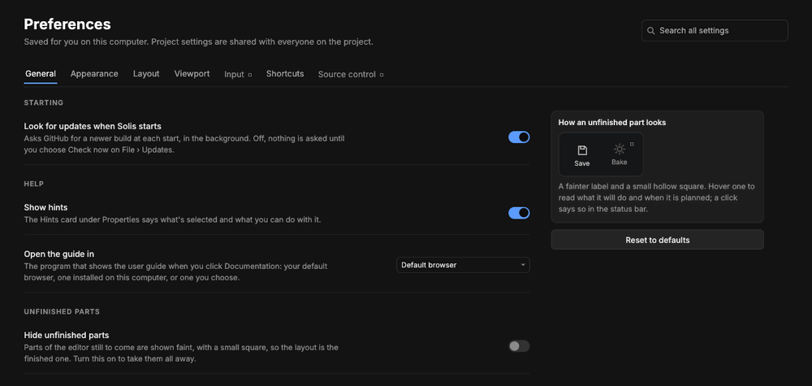

# Settings

> Preferences, the editor's own settings, and Project settings, the open project's: two File pages, each with sub-tabs and one search.

## When to use it
When you want to change how the editor itself looks or behaves (its accent colour, how large it's drawn, what the viewport shows, where the panels sit and how they're sized, or hiding the parts that aren't built yet), or a setting that belongs to the whole project, such as its 2D resolution, its game's controls or how it is exported.

- **Preferences** are yours, kept on this computer. They aren't saved in the level or the project.
- **Project settings** are saved in the open project's folder, in small text files Git can merge, so they travel with it to other computers and other people. They need a project open.

Neither is an undo step. Every change applies at once: there is no Save or Apply button.

## How to use it

**File › Preferences › General**: each setting with what it does, and the search at the top, which looks through every sub-tab.

1. Click the **File** tab, then **Preferences** or **Project settings** in its column. Or press **Space** and type *Preferences*. Preferences are on the [launcher](launcher.md) too, at the foot of its column.
2. Pick a sub-tab under the heading: Preferences has **General**, **Appearance**, **Layout**, **Viewport** and **Shortcuts**; Project settings has **General**, **2D**, **Input** and **Build**. The faint sub-tabs with a small square (Source control, Physics, Platforms and others) are [unfinished parts](unfinished-parts.md).
3. Each setting is a row, with its name and a line about it on the left and its control on the right: a switch, a row of choices side by side, a drop-down list, colour swatches, a number or a button. They work from the keyboard too: **Tab** moves from one to the next (a thin ring in the accent colour shows where you are), **Space** or **Enter** presses or flips it, and the **arrow keys** move along the swatches and the choices, or step through a drop-down list without opening it.
4. Can't find something? Type in the search at the top right: it looks through every sub-tab of the page, at the settings' names and their lines, and shows the matches together.
5. On Preferences, **Reset to defaults** (in the column at the right) puts the sub-tab's settings back as they were at first. On Project settings, a setting changed from its standard has a dot before its name and **Reset** after it; the heading counts them ("2 changed from defaults"), and a card at the right lists each, from what to what.
6. **Back to editor** (or **Esc**) leaves the page.

## Preferences
| Setting | What it does |
|---|---|
| General › Look for updates when Solis starts | Asks GitHub for a newer build at each start, in the background. Off, nothing is asked until you choose **Check now** on the launcher's **Updates**. |
| General › Show hints | The Hints card, last under Properties, says what's selected and what you can do with it. Its **Turn hints off** does the same as this switch. |
| General › Open the guide in | Which program shows the [user guide](user-guide.md) when you click **Documentation**: **Default browser** (the standard), a browser Windows lists as installed on this computer, or **A program you choose…**. A browser that's gone falls back to the default, and the status line says so. |
| General › Hide unfinished parts | Some places in the editor are for features that come in later updates. They are shown faint with a small hollow square, and do nothing yet. Switch this on to hide every one of them, so only what works is on screen. The card beside it shows what one looks like. See [Unfinished parts](unfinished-parts.md). |
| Appearance › Accent colour | The colour that marks what's chosen and selected: the chosen tool, the front tab, the selected row. Five colours: **Blue** (the standard), **Grey**, **Orange**, **Teal** and **Purple**. Colours that mean something keep their own: **Play** is the one light button on screen, and warnings and errors are amber and red. The small picture at the right shows the editor in the colour chosen. |
| Appearance › Interface scale | How large everything is drawn: **100%** to **200%**. Raise it when text is too small, common on a laptop or a very sharp (4K) screen. Everything grows together, and thin lines stay crisp. It doesn't change your game. |
| Appearance › Density | How tall buttons, fields and drop-down lists are: **Compact** (22 pixels at 100%), **Default** (24) or **Comfortable** (28). Text stays the same size. |
| Appearance › When something is selected | **Leave the panels as they are** (the standard) or **Show Properties**: Properties comes back every time you pick something, even if you hid it. |
| Appearance › This tab's panels | **Reset layout** puts the tab you came from back as it started: its bottom panel on its first tab, unfolded, its hidden panels shown, and every edge you dragged at its standard size, in every layout. To put back one edge only, double-click it. |
| Layout › Layout | Where the panels sit round the view, on every tab ([layout](concepts.md#the-window)), as cards each with a small drawing, its name and what it does: **Standard**, **Wide view**, **Two views**, **Library on the left**, **Tall properties**, **Just the view** and **Library on the right**. **Point at one** and the **Preview** box beside them shows it large, each part named. **Click one** and it's used at once, on every tab; a small note says **Layout is now …** with **Undo**, which puts back the layout before it and every panel you had hidden. **In use** marks the one in use. A layout changes where panels sit, never what they do. See [Interface tour](interface-tour.md). |
| Layout › Each tab keeps its own panel sizes | On (the standard): each tab remembers the sizes you drag on it. Off: a size you drag on one tab is used on all of them, so the frame stays the same as you go from tab to tab. |
| Layout › Panel sizes | **Reset sizes** puts every edge you dragged, on every tab, back where the layout in use starts. |
| Appearance › Code editor split | An [unfinished part](unfinished-parts.md): it will show game code next to the viewport. Today, game code opens in your own code editor ([Game code](game-code.md)). |
| Viewport › Frame time and frame rate | The pill at the top right of the viewport. |
| Viewport › Axis locks, axes and camera speed | The pills at the bottom right: Lock X Y Z, World or Object, and the camera's speed. |
| Viewport › Tools | The tool bar floating at the foot of the view. Q, W, R, S and T work either way. |
| Viewport › Preview animation | Sprites play their clips while you edit. Off (the standard), each shows its clip's frame and the editor rests. The game always animates. |
| Viewport › Grid step, Angle step | The steps moves and turns land on while snapping is on (the Home ribbon's Snapping turns it on and off). |
| Viewport › In the 2D view, moves land on | **Pixels** (whole pixels, so pixel art stays crisp), **Tiles** or **Off**. |
| Viewport › Camera speed | How fast the camera flies, 1 to 8. Also changed by holding the right mouse button and turning the wheel. |
| Viewport › Views, Look, Bands of light, Outlines | The same as the viewport's own pills: how many views, and how models are shaded while you edit ([Looks](looks.md)). |
| Shortcuts | Every key the editor has, as a table you can filter (**All**, **Keys**, **Mouse**) and search. It is to read: changing a key is an unfinished part. The full list is [Keyboard shortcuts](keyboard-shortcuts.md). |

## Project settings
| Setting | What it does |
|---|---|
| General › Project name | Its name in the window's title and on the [launcher](launcher.md). Type a new one and click elsewhere; the folder keeps its own name. |
| General › Kind | **2D**, **3D** or **Both**: what the game is made of ([project kind](concepts.md#projects)). Chosen when the project was made; a click here changes it at once, with no restart, and it's kept in the project's `project.solis`. The line under it says what the kind hides. **2D** hides what only 3D games use: the Shading tab, lighting and baking, models (Create › Model, Import model), shape brushes, the 3D view's cameras (Perspective, Top, Front, Right) and its looks, and their settings. **3D** hides what only 2D games use: tile maps and the tile painter, the 2D view, pixel snapping and Project settings › 2D. **Both** shows everything, and projects made before the kind was asked are Both. Nothing in the project is deleted when the kind changes, and the change isn't an undo step (no project setting is): choose the old kind again to see everything as it was. See [What each kind hides](#what-each-kind-hides). |
| General › Game starts in | The level the exported game opens in (the same setting as on Build). |
| General › Engine version | The build of Solis that last opened the project, with **Check now**. |
| General › Scripting | Game code is written in Lust and opens in your code editor. |
| 2D › Base resolution | The size the project's 2D games are drawn at, in pixels, before they're scaled up: 480 × 270 to start. Pick a common size from the list, or type your own. See [2D](2d-pixel-perfect.md). |
| 2D › Pixels per unit | How many pixels make a metre: 16 to start. |
| 2D › Tile size | The 2D view's grid, and new tile maps', in pixels: 16 × 16 to start. |
| 2D › Scaling to the screen | **Whole steps** (crisp, with bars if the screen doesn't divide evenly) or **Fill the screen**. The card beside it says how the base resolution fits 1920 × 1080, 2560 × 1440 and 3840 × 2160 screens. |
| Input | The game's controls: see [Input](input.md). |
| Build | Export for playtesting: see [Export for playtesting](playtest-export.md). |

A number you drag is saved once, when you let go.

## What each kind hides
A 2D game has no use for models or a perspective camera, and a 3D game none for a tile painter, so a project shows only the parts of the editor its kind uses ([project kind](concepts.md#projects)). It's one list inside Solis, so a part is hidden the same way everywhere: its tab, its ribbon button, its Create item, its component in **Add component**, its setting and its line in the search all go together, and its keys do nothing.

| Kind | Hides | Keeps |
|---|---|---|
| **2D** | The Shading tab; Home's Lighting group (Bake, Quality, Light map view); Create › Model and Shape, and Import model (lamps stay: a light shines on sprites too); the brush list (`B` paints tiles instead); the Perspective, Top, Front and Right views and the Look pill; the Model, Brush, Collider, Rigid body and Character body components; Preferences › Viewport's grid step, camera speed and looks. | Sprites, tile maps and their painter, the 2D view and its camera, lights and the Environment (lamps and day and night), zones, prefabs, animation, screens, sound, the Debug and Build tabs: everything shared. |
| **3D** | Tile maps (Create › Tile map, New tile map, the Map tab and the painter); the 2D view; Pixel perfect and Snap to tiles; the Tile map, 2D collider and Parallax components; Preferences' **In the 2D view, moves land on**; Project settings › 2D. | Models, lights, shape brushes, the 3D views, and everything shared, sprites among them. |
| **Both** | Nothing. | Everything, as before projects had a kind. |

Something of the hidden kind that's already in a level stays there: the Level panel lists it with a quiet **3D only** (or **2D only**) after its name, and Properties shows its component with the note *3D only: switch the project to Both to edit it*, its values readable but greyed. Switch the kind to **Both** to change it.

The first few times a project opens as 2D or 3D, or is switched to one, Home's ribbon says what it hides ("No Shading tab and no Lighting group: they are 3D only"), while hints are on. Its **×** puts it away for good.

## Tips and common problems
- **Problem:** everything in the editor is tiny. **Why:** on a very sharp screen each pixel is small. **Fix:** raise **Appearance › Interface scale**.
- **Problem:** a tab, a button or a setting the manual mentions isn't there. **Why:** the project's kind hides it (a 2D project has no Shading tab, a 3D project no tile painter). **Fix:** set **Project settings › General › Kind** to **Both**, or the kind it belongs to.
- **Problem:** a setting is faint, has a small square after its name, and its switch won't move. **Why:** it's an [unfinished part](unfinished-parts.md). **Fix:** rest the pointer on it to read what it will do; switch on **General › Hide unfinished parts** if you'd rather not see it.
- **Problem:** Project settings says **Open a project first**. **Why:** its settings belong to a project, and none is open. **Fix:** open or make one in the [launcher](launcher.md) (**File › Close project** goes back to it).
- **Problem:** the Console says `pixels.solpix` had a mistake. **Why:** the file was edited by hand and can't be read. **Fix:** the standard 2D settings are used meanwhile; change anything on the 2D tab and the file is written again, with the damaged one kept beside it as `pixels.solpix.bak`.
- **Problem:** the bottom panel is so tall (or folded) that what you want isn't in sight. **Why:** its height and fold are remembered per tab. **Fix:** **Ctrl + Space** opens it; double-click its top edge, or **Layout › Reset sizes**, puts it back.
- **Problem:** after an update, the shelf is gone. **Why:** every tab has one frame now, and the shelf became the bottom panel under the view; the layout chosen before became its nearest. **Fix:** see [Interface tour](interface-tour.md); try the layouts in **Preferences › Layout**.
- **Problem:** I chose a layout by mistake. **Why:** a click applies it at once. **Fix:** **Undo** on the note that says **Layout is now …**.
- **Problem:** I can't find the Settings window, or File › Input. **Why:** they became these pages. **Fix:** Preferences and Project settings are in the File column; Input is a sub-tab of Project settings.

## Related
- [The launcher](launcher.md): your projects, New project (where the kind is first chosen), Learn and Updates.
- [Input](input.md): the game's controls, on Project settings › Input.
- [Export for playtesting](playtest-export.md): on Project settings › Build.
- [2D: the pixel-perfect view](2d-pixel-perfect.md): what the 2D settings do.
- [Unfinished parts](unfinished-parts.md): what the faint controls with a square mark are, and hiding them.
- [Concepts](concepts.md): [accent colour](concepts.md#the-window), [interface scale](concepts.md#the-window), [density](concepts.md#the-window), [layout](concepts.md#the-window), [unfinished part](concepts.md#the-window).
