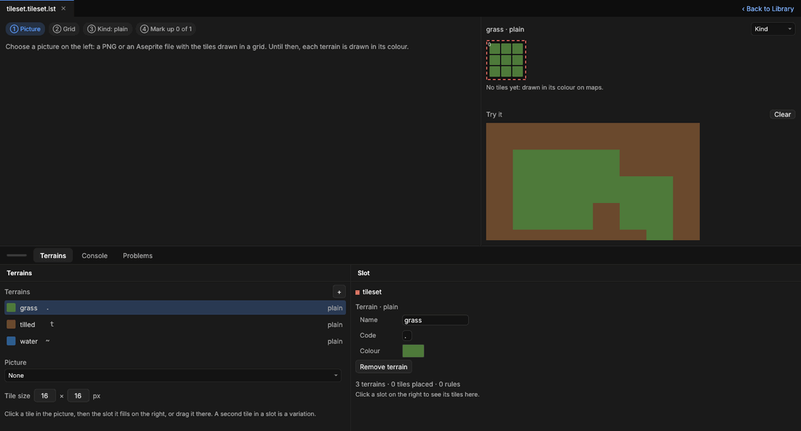

# Tilesets and autotiling

> Give each terrain its art from a picture of tiles. Solis picks each cell's tile from its neighbours, so the edges between grass and tilled earth, the corners of a pond and the joins of a fence come out right by themselves.

## When to use it
A [tile map](tile-maps.md) stores what each cell *is*: grass, tilled, water. Until a tileset has art, each terrain is drawn as a flat colour. That's enough to lay a farm out, but a game wants pictures, and pictures need their edges. Where tilled earth meets grass, the tile at the edge has to show both, and which tile depends on which neighbours are tilled.

Choosing those by hand, cell by cell, is slow and breaks whenever the map changes. **[Autotiling](concepts.md#2d)** does it for you. You draw the tiles once and say which situation each one is for (its **[slot](concepts.md#2d)**). Solis then picks the right one for every cell, on every map, as the map changes, even while the game plays.

How many tiles you need depends on the terrain's **[kind](concepts.md#2d)**:

| Kind | Tiles | Good for |
|---|---|---|
| Plain | 1 | Grass, sand: anything with no edges of its own |
| 16-tile (dual grid) | 15 | Most ground: tilled earth, paths, snow. The fewest drawings for smooth edges and corners |
| 47-tile | 47 | Ground with the most polished corners, such as water with inner corners |
| Edges | 16 | Fences, walls, roads: things that join their neighbours along their sides |
| Rules | as many as you use | Anything else: your own patterns of the cells around |

**16-tile** works on a **[dual grid](concepts.md#2d)**: each tile is drawn half a cell off, where four cells meet, and is chosen by which of those four are the terrain. That's why 15 drawings cover every case. You still paint and the game still thinks in whole cells; only the art is shifted.

## How to use it

A new tileset on its own tab: its terrains on the shelf (grass, tilled and water), the picture its tiles come from, and a patch to try them on.

1. **Draw your tiles** in one picture: a PNG, or an Aseprite file (handy for animated tiles), with every tile the same size in a grid. Not sure what to draw? Open the tileset, choose a terrain's kind, and press **Save … template** (or the ribbon's **Save its template…**): Solis saves a picture beside the tileset with every slot laid out at your tile size, ready to draw over.
2. **Open the tileset:** double-click it in the Library. A **Library tools · Tileset** tab joins the tab bar after Library and comes to the front: a [contextual tab](concepts.md#the-window), there only while the tileset is open. Its document is the tileset itself (the picture on the left, the chosen terrain's slots on the right, **Try it** under them), its **Terrains** shelf tab lists the terrains beside the slot picked, and its ribbon has **Terrain** (Add, Remove), **Kind** and **Picture** (the tile size and the **Zoom**). **‹ Back to Library**, at the right of the document's tab, goes back and leaves the tileset open.
3. **Choose the picture** on the Terrains shelf tab, under the terrains. Solis cuts it into tiles at the tile size shown. If the art looks cut differently, it offers the size it found: click it.
4. **Choose a terrain** on the Terrains shelf tab, and give it a **kind** (the ribbon's **Kind** list, or the tab's own). While it has no tiles, the tab guesses its kind from the picture (pick the top-left tile of its block first) and asks you to confirm. **Kind** at the top right changes it any time.
5. **Fill its slots** on the right. Each slot shows the neighbours it's for: the terrain's colour where they're the terrain, dark where they're not.
   - Click a tile in the picture, then the slot it's for, or drag the tile onto the slot.
   - Drawn over the template? Pick the template's top-left tile and press **Mark up from the template**: every slot is filled from its place in one go.
   - A second tile in the same slot is a **[variation](concepts.md#2d)**, so a field doesn't look tiled. Click the slot to see its tiles in Properties, with each one's **Weight** (how often it's picked).
6. **Try it** in the patch below the slots: click cells to turn the terrain on and off and watch the edges. The patch isn't saved.
7. **Look at your map:** every map using the tileset draws with the art at once, and while the game plays.

The strip at the top of the picture says where you are: ① picture, ② grid, ③ kind, ④ how many of the terrain's slots are filled.

### A terrain of its own rules
For a kind none of the others fit, choose **rules** and press **+ Rule**. A rule is a small pattern of the cells around one (3 × 3 to start, up to 9 × 9) and the slot it shows. Click a cell of the pattern to change what it asks for:

| Mark | Means |
|---|---|
| `?` | Anything |
| `=` | The same terrain |
| `!` | Not the same terrain |
| `_` | Nothing on this layer (or past the map's edge) |
| a terrain's code | That terrain |

The rules are tried in order (**↑** and **↓** move one), and the first that matches gives the slot. The slots the rules name appear below them to fill. A cell no rule matches shows pink.

### Animated tiles
Click a slot, then in Properties set a tile's **Animation**:
- **tiles to the right:** that many tiles of the picture, left to right from this one, each shown for so many milliseconds (water, flowers);
- **the picture's frames** (an Aseprite picture): the same tile in each of its frames, each for its own time.

## Settings
In the tileset's tab (the Terrains shelf tab and the ribbon):

| Setting | What it does |
|---|---|
| Picture | The PNG, JPEG or Aseprite file the art comes from. |
| Tile size | Each tile's width and height in pixels. Usually the project's tile size (2D settings). |
| Kind | How the chosen terrain's tiles are chosen: plain, 16-tile, 47-tile, edges or rules. Changing it takes its tiles away (Ctrl + Z brings them back). |
| Zoom | How big the picture is shown (the ribbon's list, or − and + under the steps). |

In Properties, for a tile in a slot:

| Setting | What it does |
|---|---|
| Weight | How often it's picked among the slot's tiles: 2 is twice as often as 1, 0 never. Each cell always gets the same one. |
| Animation | None, tiles to the right (with how many and how long each), or the picture's frames. |

For the chosen terrain (no slot picked): its **Name**, **Code** (the character map files write for it) and **Colour** (drawn where it has no art), and **Remove terrain**.

## Shortcuts
| Action | Shortcut |
|---|---|
| Give a tile to a slot | Click the tile in the picture, then the slot; or drag the tile onto the slot |
| Undo or redo a change to the tileset | Ctrl + Z, Ctrl + Y (pointer over the tileset or its Terrains tab, or over Properties while it shows the tileset) |

## Tips and common problems
- **Problem:** pink cells on a map. **Why:** a slot those cells need has no tile, or the cells' code isn't a terrain. **Fix:** the tileset's slots dash the empty ones red; Problems says which map and which slots. Fill them.
- **Problem:** the edges look one tile off. **Why:** the template was marked up from the wrong tile. **Fix:** pick the template's top-left tile in the picture first; the button says where it will start. Ctrl + Z, then try again.
- **Problem:** the grid lines don't match the art. **Why:** the tile size is different from the picture's. **Fix:** set it on the left, or click the size Solis found.
- **Problem:** a terrain still shows its flat colour. **Why:** it has no tiles yet (or the tileset has no picture). **Fix:** fill its slots.
- **Problem:** the picture won't open. **Why:** it isn't a PNG, JPEG or Aseprite file, or it's bigger than 4,096 pixels a side. The tab says why.
- If a change to the tileset can't be saved, the Console says why and the change is taken back, kept as an undo step: see [Undo and redo](undo.md).
- PNG and JPEG files get a sidecar (`.solmeta`) like other assets, so a tileset keeps its picture when the picture is moved or renamed. Commit them with the picture.

## Related
- [Tile maps](tile-maps.md): the maps tilesets draw.
- [Sprites from Aseprite](sprites.md): Aseprite pictures.
- [Concepts](concepts.md#2d): autotiling, kind, slot, dual grid, variation, template.
