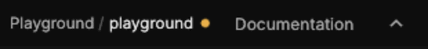

# The user guide

> The whole manual as one page in your web browser, with a search, opened by **Documentation** at the top right of the editor.

## When to use it

Whenever you want to know how something works, or what a key does. The guide is this manual: every page of it is a chapter there, so what you read in the guide and what you read here are always the same words. It describes the copy of Solis it came with, and every update brings the guide that matches it.

The guide is a single file on your computer, in the `user-guide` folder beside the program. It opens without an internet connection, and nothing in it is fetched from anywhere.

## How to use it

**Documentation**, at the right of the tab bar, beside the project's name: one click opens this guide.

1. Click **Documentation** at the right end of the tab bar, beside the project's name. It is always there: on every tab, on the File pages, and before any project is open.
2. The guide opens in your browser (which one is a setting; see below), at the welcome. **File › Learn** and **File › About** open it too, and a component's **?** in [Properties](entities.md) opens the chapter about that component.
3. Find what you're after:
   - **Search:** press `/` or `Ctrl + K` (or click the box at the top) and type. Every part of the guide holding all the words you typed is listed, with the words around them; `Up` and `Down` choose, `Enter` goes there and marks the words on the page, `Esc` clears the search.
   - **Contents:** the list on the left has every chapter, numbered and in groups. The chapter you're reading opens out to show its sections, and the one you're in is lit. Above the list, how much of the guide you've read so far.
   - **Where you are:** the top bar names the chapter and section you're reading.
4. To keep or share a place, point at a heading and click the **#** beside it: the link to that heading is copied.
5. **Top** (bottom right) goes back to the start. The button at the top right switches between **Auto** (as your computer is set), **Light** and **Dark**; your browser remembers the choice.

On a narrow window the contents fold away behind the button at the top left, and the line saying where you are opens them too.

> **Good to know:** the guide is made from the manual's pages each time Solis is built, so it can never say something the manual doesn't. If you find a mistake in it, it's a mistake in the manual: the page to fix is the chapter's own page in `docs/manual`.

## Settings

In **File › Preferences › General**, under **Help**:

| Setting | What it does |
|---|---|
| Open the guide in | Which program shows the guide. **Default browser** (the standard) is the one Windows opens web pages in. Below it are the browsers Windows lists as installed on this computer, and **A program you choose…** asks for any program file. If the browser chosen isn't there any more, the guide opens in the default browser and the status bar says so. |

## Shortcuts

The editor has no key for the guide: **Documentation** is a click. Inside the guide:

| Action | Shortcut |
|---|---|
| Search the guide | `/` or `Ctrl + K` |
| Choose a result | `Up`, `Down` |
| Go to the result chosen | `Enter`, or click it |
| Clear the search, or close the contents on a narrow window | `Esc` |

## Tips and common problems
- **Problem:** clicking Documentation only says "The user guide isn't beside this build". **Why:** this copy of Solis was built on your own computer, not installed: the guide is made and put beside the program when a build is published. **Fix:** the Console gives the line to make it, `cargo run -p user-guide -- --out <the program's folder>/user-guide/index.html`. The same page, as it is in the repository, is in `docs/user-guide/index.html`.
- **Problem:** the guide opened in a different browser from the one chosen. **Why:** the browser chosen was uninstalled or moved, so the default browser opened it instead (the status bar said so). **Fix:** choose again in **File › Preferences › General › Open the guide in**.
- **Problem:** the theme choice or the place you were reading is forgotten. **Why:** some browsers don't let a page opened from a file remember anything. **Fix:** nothing is lost: the guide follows your computer's light or dark setting instead.

## Related
- [Settings](settings.md): the other Preferences.
- [Keyboard shortcuts](keyboard-shortcuts.md): every key in one place.
- [Concepts](concepts.md#user-guide): the manual and the user guide.
