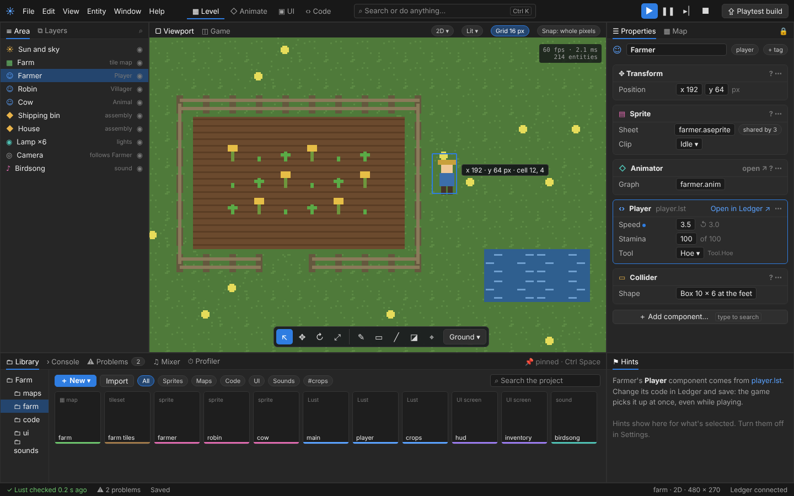

# The editor overhaul

The working plan for the editor's new look ([decision 0085](../decisions/0085-the-editor-overhaul.md)), built ahead of the game UI editor in "Usable first" (ROADMAP.md, step 7). The target is the level editor mock-up from the editor UI research of 4 November (the project lead's document "Editor UI research: what works in engine editors"), confirmed by the project lead on 5 November:

The research's rules, each from what people praise or complain about in Unreal, Godot, Unity and GameMaker:

1. **Playing is unmistakable, and nothing is lost:** the frame turns a colour while playing; changes made while playing are listed when you stop, with Keep or Undo all.
2. **The game runs inside the editor, and changes reach it at once.**
3. **One search for everything** (Ctrl+K in the mock-up): every action, file, entity and setting, each showing its shortcut.
4. **Workspaces, one per job:** Level, Animate, UI and Code switch the whole layout, each remembered.
5. **Readable first:** neutral dark grey, the blue accent, icons in their kind's colour, text contrast at least 4.5 to 1. Controls don't move between versions.
6. **Properties show values, not buttons:** rare actions in each component's ⋯, a **?** to its manual page, a dot and a reset on a changed value, "shared by 3".
7. **One place per job:** each kind of thing has one tab that does all of it.
8. **The Library is a drawer you can pin.**
9. **A status bar that says what's happening.**
10. **The game UI editor is see-as-you-build** (its own plan, [game-ui.md](game-ui.md)).
11. **Graphs don't turn into spaghetti.**
12. **Assemblies are edited in place.**
13. **Beginners get a way in:** the start page, empty panels that say what to do, tooltips as sentences, nothing shown that isn't built.

## How the work is done

- One milestone per pull request, each drawn onto a real screenshot first when it changes a panel the mock-up doesn't show closely.
- **Nothing shown that isn't built** (decision 0070) still holds: the mock-up's **Playtest build** button, the Layers tab and any workspace tab wait for the milestone that makes them work.
- New keys or mouse actions are asked about first (CONTRIBUTING.md, rule 17), with a recommended choice.
- The docking (decision 0004) stays: the mock-up is the standard layout, and panels can still be moved.

## Milestones

### O1. The frame: top bar, status bar, panel tabs

> **Built** (the first pull request): the status bar, the standard layout as in the mock-up (a new saved-layout key, so every editor starts from it once), and the logo in the top bar. The panel tabs already had their icons and underline; the viewport's chips at its top right wait for O7, with the floating tool bar. Ledger connected isn't shown: Solis doesn't talk to Ledger yet. While a viewport is too narrow for its tool bar and snapping controls in one row, the snapping controls go top right.

- **Top bar:** the logo, the menus (File, Edit, View, Entity, Window, Help), then on the right one group of Play (blue), Pause, Step and Stop.
- **Status bar** along the bottom: "Lust checked 0.2 s ago" (or the first mistake), the number of problems (clicking opens Problems), "Saved" or "Unsaved changes", and on the right the area's kind and size (`farm · 2D · 480 × 270`) and whether Ledger is connected.
- **Panel tabs** with an icon each and the accent underline; the panels' standard places as in the mock-up (Area on the left, Properties and Map on the right, Library, Console, Problems, Mixer and Profiler at the bottom).
- The viewport's own strip: Viewport and Game tabs on the left, the view's choices (2D, Lit, Grid, Snap) as small chips on the right, frame time and entity count in the corner.

### O2. Properties: values, not buttons

> **Built:** cards with icons, ? to the manual page or Open in Ledger ↗ for game code, ⋯ per card (copy, paste, reset, remove) and per entity (move here, unpack, copy and paste components, delete); a dot and ↺ on a setting that isn't its standard value (numbers, switches, words, choices, colours); "shared by N" on a file; a searchable Add component. Tags wait for entities to have tags (a change to areas, with their own decision).

- Each component a card: its icon and name, **?** (its manual page) and **⋯** (reset, remove, copy, paste, move up or down).
- A changed value shows a dot and its standard value to reset to (`3.5 ↺ 3.0`).
- A file shared by several things says so (`farmer.aseprite · shared by 3`).
- The entity's name with its tags (`player`, **+ tag**).
- **+ Add component…** you can type into to search.
- A game code component shows its file and **Open in Ledger ↗**.

### O3. The Library as a drawer

> **Built:** Unpin and Pin, the drawer on Ctrl + Space (tucks away on Ctrl + Space, Esc, a click outside, placing or opening, or a drag out), the choice remembered; chips for All, Models, Sprites, Maps, Sounds and Code, with code files now in the Library; **+ New** filled in the accent. Tags (`#crops`) wait for tags; a UI chip comes with UI screens.

- Filter chips (All, Sprites, Maps, Code, UI, Sounds) and tags (`#crops`), a search box for the whole project.
- Cards coloured along the bottom by kind, as now.
- A drawer that pops up over the editor and can be pinned to stay docked (Ctrl + Space, as in Unreal).

### O4. One search for everything

> **Built:** the box in the top bar (left of Play) and Space open a list at the top middle; it finds the menus' actions with their shortcuts (leaving out what can't be done now), the project's files (opening them, or showing a placeable one in the Library), the area's entities (selecting and framing them) and the panels. Words score by where they match: the start of a word, inside one, or letters in order. Settings themselves come into it with more settings.

- A search box in the top bar ("Search or do anything…") that finds every menu action, file, entity and setting, with its shortcut beside it, and runs or opens what's picked (Space, tapped, with nothing being typed; the Frames tab keeps Space for its clip).

### O5. Playing is unmistakable

> **Built:** the window's edge and its top and status bars take blue while playing, amber paused; Stop lists the edits made while playing (the undo steps made since Play) and asks Keep or Undo all in a modal question, Play and the editor's keys waiting meanwhile. Only the user's edits are offered and kept, never what the game did: Keep makes those steps again on the area from before Play.

- The editor's frame takes a colour while the game runs (paused: another).
- Changes made to the area while playing are kept in a list; when you stop, **Keep** or **Undo all**, never thrown away silently.

### O6. Workspaces

> **Built:** Level, Animate and Code tabs after the menus, each a layout of its own (remembered, saved with the others, read back as a saved layout is), a file's panels carried over, Reset layout per workspace, workspaces in the search; the Code panel shows which entities use each code file's components. Game-wide objects' live values in the Code workspace wait for a panel of their own (with game UI's tied values, which read them too); UI comes with the UI editor.

- Level, Animate, UI and Code in the top bar, each a remembered layout of the panels. Each appears once what it holds is built: Level and Animate first; UI with the game UI editor; Code as a testing layout beside Ledger (the game big, Console and Problems, the code files and who uses them, objects' live values).

### O7. Help in place

> **Built:** the Hints panel under Properties (a sentence per component, a game code component's file, how to start, a word while playing; off in Settings > Appearance; older layouts get it under Properties); the readout beside the pointer in 2D. The floating tool bar (with the map's choices) and the Area panel's kinds and eye switches were already there. The view's choices as chips at the viewport's top (`2D ▾`, `Lit ▾`, `Grid`, `Snap`) stay at the bottom for now: moving them is a change of its own, mocked up first if wanted.

**The overhaul is complete** (O1 to O7). Next, as the project lead ordered (2026-11-05): all of game UI, starting with screens in Lust, then the UI editor in a UI workspace.

- A **Hints** panel that says what the selected thing is and what to do with it, which can be turned off in Settings.
- The viewport's tool bar floating at the bottom middle, as the tile painter's already does, with the tool's choices beside it (`Ground ▾`).
- A readout by the cursor in 2D (`x 192 · y 64 px · cell 12, 4`).
- The Area panel's rows with their kind on the right (`tile map`, `Player`, `assembly`, `follows Farmer`) and an eye to hide each.

After O7, the game UI editor (the game UI plan's M4 onwards) is built inside the UI workspace.

## Chosen by the project lead (5 November)

- **The search opens with Space** (tapped, with nothing being typed and the game not holding the keys), as in Spotlight and Raycast. In the Frames tab Space still plays and stops the clip.
- **The Library drawer opens with Ctrl + Space**, as in Unreal.
- **The Code workspace is a testing layout** (B of three): the Game panel big; the Console and Problems side by side, a Lust mistake clicked opening its line in Ledger; the project's code files and which entities use each; game-wide objects' live values. Code is still written in Ledger, beside Solis.

## Still open

- The other three mock-ups of 4 November (playing, the UI workspace, the search) shape O4 to O6; they're used as drawn there if found.
