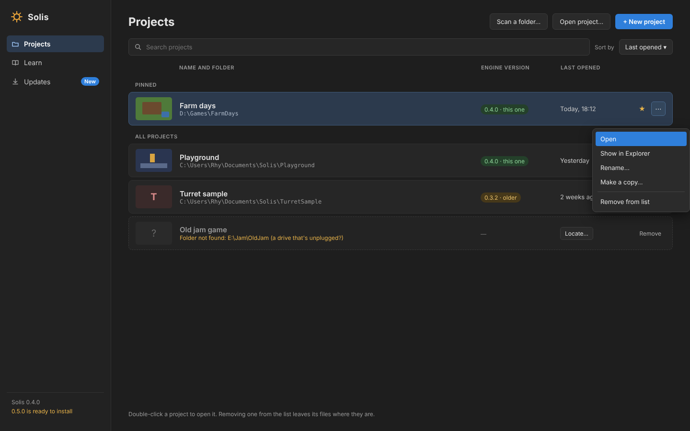

# The launcher

The working plan for the launcher ([decision 0086](../decisions/0086-the-launcher.md)): the start page grown into a full page where people manage their projects, learn, and update Solis. Asked for by the project lead on 5 November, before game UI; the mock-up below was approved the same day ("build it as drawn").

The Updates and Learn pages: [launcher-updates.png](launcher-updates.png), [launcher-learn.png](launcher-learn.png).

The mock-up's version numbers (0.4.0, 0.5.0) stand for Solis's build numbers: what's built shows "build 57".

## How the work is done

- One milestone per pull request, as always.
- **Nothing shown that isn't built** (decision 0070): each page's buttons arrive with the milestone that makes them work.
- Keys: **double-click** or **Enter** opens a project (the project lead, 5 November); arrow keys move along the list; typing goes into the search box.

## Milestones

### L1. The Projects and Learn pages

> **Built:** as planned. A project's name, the build that last opened it and whether its folder is there are read each time the launcher opens; arrows move along the list and typing goes to the search box. A copy built from source shows each project's build without comparing it. Updates' place in the sidebar waits for L3.

- The launcher replaces the start page: a full page with the sidebar (the logo, Projects, Learn, Updates' place, and the build at the bottom), shown when no project is open and from File > Projects….
- **Projects:** the list of known projects (up to 200, read from the old recent list once), pinned first; search; sort by last opened or name; ☆ to pin; double-click or Enter opens; ⋯ with Open and Remove from list; a missing folder says so, with Remove; New project and Open project….
- Each row: the first letter in a colour of its own, the name (from the project file), the folder, the build that last saved it ("this one", "older", "newer") and when it was last opened.
- **The project file records `saved_by`**, the build that last saved it (optional, so older files are read as before).
- **Learn:** the three examples (made in a folder the user picks), the steps for someone new, and the manual.

### L2. Rename, copy, show, scan and locate

- ⋯ gains Show in Explorer, Rename… (the project's name, not its folder) and Make a copy… (the folder, without the import cache, to a new one).
- **Scan a folder…** looks through a folder and the folders inside it (a few levels down) for projects not yet in the list, and adds them.
- A missing project's **Locate…** points it at its folder's new place.

### L3. The Updates page

- This build and when it was installed; the newest build and what it brings (its release's text); **Check now**; **Download** or **Restart to update**; "Look for updates when Solis starts".
- Updates' place in the sidebar marks a new build; the bottom line says it's ready.
- The release workflow writes what the build brings: the pull request's title instead of the merge's commit line.

## Later

- A picture of each project (its last view, saved with it) instead of its letter.
