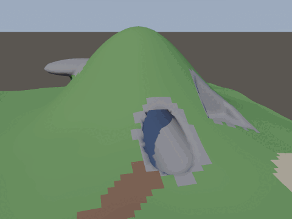
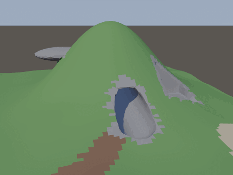
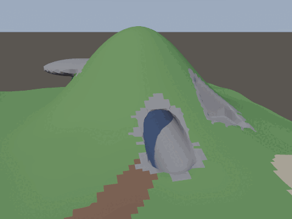
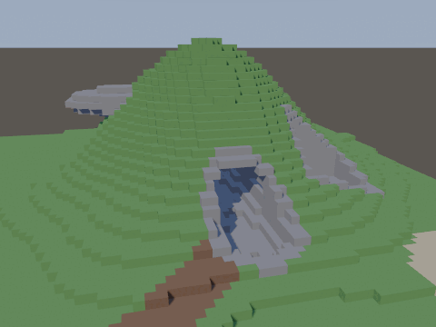
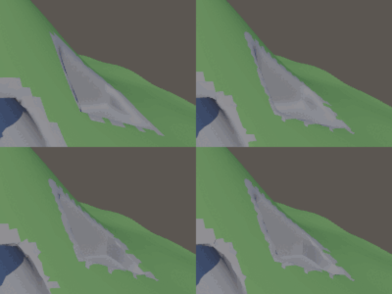

# Study: how to keep and draw the ground (Tools 1b, G0)

**2026-11-14.** Tools 1b gives every area a sculpted **ground** with caves and overhangs, drawn in one of three looks chosen per ground (Smooth, Blocky, Sharp), sculpted with a round brush and painted ([decision 0111](../decisions/0111-tools-1-brushes-and-ground.md), [the plan](../plans/tools-1.md)). Rule 22 asks that a big system start by building competing approaches and measuring them against each other. This study did that: three ways to keep the ground, two ways to draw each look, all built as small working, tested versions in [`tools/ground-study`](../../tools/ground-study/README.md) and timed at the scale target. It ends with what to build, three questions for the project lead, and the draft decisions.

**Where the numbers come from.** Every number was measured by `cargo run --release -p ground-study` (uploads and pictures with `--features gpu`) on this machine: **2 cores, no graphics card** (uploads and pictures go through Mesa's software driver, llvmpipe, on OpenGL). Times on this machine vary by about a third from run to run; the tables are one run, and the comparisons hold across the three runs made. A real graphics card uploads faster; a desktop with more cores has more workers.

## In one paragraph

Keep the ground as **fixed chunks** of 32 × 32 × 32 one-metre voxels, two bytes each (how far the voxel is from the surface, and its material), with chunks that are the same all through (sky, deep rock) kept as a single voxel: fastest to sculpt, nothing lost, about 118 MB a square kilometre. Draw **Smooth** with **surface nets**, **Sharp** with **surface nets sharpened** (the same points pulled towards the planes they lie on, with hard edges where faces meet steeply), and **Blocky** with **cube faces merged** into large rectangles (four times fewer triangles). Make chunks on the job system's worker, never on the frame, and build colliders when a stroke ends, not every frame of it. And a finding for G5: 2,000 units should follow the ground by reading its voxels (0.25 ms a tick), not each be a physics character on it (43 ms a tick).

## The scale target for a ground

DESIGN.md §2's target is large strategy battles: **2,000 moving units at 60 frames a second**, 10,000 as the stress level. Two thousand units need room to form up and move around each other: at a few metres each, a battle fills a few hundred metres across, and the field around it, where armies approach and flank, is several times that. So the study takes **a ground 1,024 × 1,024 metres (just over 1 km²), 128 metres high**, as the target, and four times that (2 × 2 km) as the stress level, which the numbers below simply multiply by four.

- **Voxels a metre wide.** The approved mock-up's Blocky look draws cubes a metre each, and the three looks are the same ground drawn three ways, so all of them share that grid.
- **128 metres high** holds hills up to about 70 m with caves 30 m under them.
- That is **4,096 chunks** of 32³ voxels (134 million voxels). The test ground (rolling hills 16 to 72 m high, valleys of sand, winding caves under it) has the surface passing through **1,975** of them; the rest are all sky or all rock.

## The approaches, in plain words

### What a voxel ground is

A height map, a grid of heights, can't have a cave: each spot on the map has one height. A **voxel** ground is instead a 3D grid of points (voxels), each saying how far it is from the surface: negative inside the ground, positive in the air. The surface is where that number crosses zero, somewhere between two voxels, so the grid can describe caves, overhangs and arches. Sculpting changes the numbers; drawing finds where they cross zero and makes triangles there.

Each voxel here is **two bytes**: the distance in 1/64ths of a voxel (so the surface is placed to within 2 cm), held between −2 and +2 voxels (farther away only "inside" or "outside" matters), and a **material** number (grass, rock…). The ground is cut into **chunks** of 32 × 32 × 32 voxels, so a brush stroke only touches and redraws the chunks near it.

### Storage: three ways to keep the voxels

| Way | What it is | Why it might win |
| --- | --- | --- |
| **Fixed chunks** | Every voxel of a chunk in one block of memory (64 KB a chunk). Chunks that are the same all through are one voxel, in every store. | Simplest and fastest: reading or changing a voxel is one step. Nothing is lost. |
| **Sparse chunks** | Only the voxels within two voxels of the surface are kept, found through one bit per voxel; the rest are just "inside" or "outside". | The surface is a thin skin, so most of a chunk needn't be kept: about a quarter of the memory. |
| **Octree** | The chunk is halved and halved again; any part that is the same all through is kept as one value. | Big empty and solid parts cost almost nothing, and it is the textbook structure for sparse 3D data. |

One cost the sparse store has that the others don't: voxels deep inside keep no material of their own (one per chunk), so digging into a mound of sand shows the chunk's deep material (rock), not sand.

### Smooth: marching cubes against surface nets

- **Marching cubes** looks at each cube of eight voxels, sees which corners are inside, and looks up the triangles for that pattern in a table of 256 cases, with points on the cube's edges where the distance crosses zero. It is the classic. Its table here is worked out from the cube's faces rather than typed in, so neighbouring cubes and chunks always agree and no crack can open.
- **Surface nets** puts one point inside each cube the surface passes through, at the middle of where the surface crosses that cube's edges, and joins the four cubes round each crossed edge with a square. Fewer, better-shaped triangles, and its squares are the same ones the Sharp look uses.

### Sharp: dual contouring against sharpened surface nets

Both keep surface nets' squares and move each cube's point so corners and cliff edges stay crisp, then give the faces **hard edges** where they meet at more than 40° (the faces on each side of the edge are shaded separately, so the edge reads as a crease).

- **Dual contouring** puts each point where the planes the surface crosses at come closest to meeting, solving a small least-squares problem (three equations) per cube.
- **Sharpened surface nets** starts at surface nets' middle point and pulls it four times towards those same planes: no equations, so nothing can go wrong with nearly parallel planes.

### Blocky: cube faces against merged cube faces

Every voxel inside the ground is a one-metre cube, and a square is drawn wherever a cube faces the air. **Merged**, the squares of one slice that face the same way and share a material grow into the largest rectangles that fit ("greedy meshing"): the same picture, far fewer triangles. The per-cube lines the mock-up shows would then come from the material (drawn by world position), not from the triangles.

### The ground's edges in the prototypes

Past its edges, the ground continues its outermost voxels outward, so the surface simply stops at the edge and nothing is drawn below its floor. Question 2 below asks how it should end.

## Pictures

The same voxels (a hill on a meadow with a cave dug into its south side, a rock shelf overhanging its west side, a square cut with straight walls on its south-east side, a dirt path and sand), drawn by the engine's own renderer in each way. Each triangle takes one material's colour; blending where materials meet is G4's.

| Smooth | |
| --- | --- |
|  |  |
| Marching cubes | Surface nets |

| Sharp | |
| --- | --- |
|  |  |
| Dual contouring | Sharpened surface nets |

| Blocky | |
| --- | --- |
|  |  |
| Cube faces | Cube faces, merged (the same picture, 7,462 triangles instead of 28,106) |

The square cut up close (top left marching cubes, top right surface nets, bottom left dual contouring, bottom right sharpened surface nets): surface nets wears the cut's inner corner round; the two Sharp ways keep it a crease. Marching cubes keeps edges that lie on the voxel grid fairly crisp too, but it can't be told to.

## The numbers

### Storage

The target ground; every store keeps chunks that are the same all through as one voxel. Every chunk in full, nothing folded, would be 244 MB a km².

| Store | Memory | A km² | Bytes a surface chunk | Read one voxel | Decode a chunk (ms) | Encode a chunk (ms) | Gather a chunk's samples (ms) |
| --- | --- | --- | --- | --- | --- | --- | --- |
| Fixed chunks | 123.5 MB | 117.8 MB | 65,585 | 182 ns | 0.006 | 0.002 | 0.11 |
| Sparse chunks | 32.0 MB | 30.6 MB | 17,010 | 167 ns | 0.061 | 0.061 | 0.39 |
| Octree | 51.2 MB | 48.8 MB | 27,160 | 91 ns | 0.046 | 0.10 | 0.20 |

"Read one voxel" is a million reads at random places near the surface, so it is mostly the time to fetch memory: the smaller stores fit more in the processor's cache. "Gather" copies a chunk's voxels and two more all round into the block a mesher reads (what the frame pays to hand a chunk to a worker).

A stroke's frames, editing only (60 dabs along 31 m over the corner where four chunk columns meet, strength 40 %):

| Store | Stroke | Chunks a dab, mean (worst) | Edit, median (ms) | Edit, worst (ms) |
| --- | --- | --- | --- | --- |
| Fixed chunks | Add, 3 m brush | 3.9 (8) | 0.072 | 0.14 |
| Fixed chunks | Dig, 12 m brush | 4.0 (8) | 0.39 | 0.54 |
| Fixed chunks | Smooth, 6 m brush | 4.2 (8) | 0.14 | 0.21 |
| Sparse chunks | Add, 3 m brush | 3.9 (8) | 0.33 | 0.80 |
| Sparse chunks | Dig, 12 m brush | 4.0 (8) | 1.00 | 1.74 |
| Sparse chunks | Smooth, 6 m brush | 4.2 (8) | 0.56 | 1.28 |
| Octree | Add, 3 m brush | 3.9 (8) | 0.34 | 1.39 |
| Octree | Dig, 12 m brush | 4.0 (8) | 0.85 | 1.79 |
| Octree | Smooth, 6 m brush | 4.2 (8) | 0.73 | 1.68 |

### Meshing

Every surface chunk of the target ground (1,975), one at a time on one core. The busy chunk is the worst case there is: lumps and holes 3.5 m across all through it, every voxel a random material.

| Look | Way | Chunk, mean (ms) | 95th (ms) | Worst (ms) | Busy chunk (ms) | Triangles a km² | Points a km² | Graphics memory a km² | Thin triangles (an angle under 10°) |
| --- | --- | --- | --- | --- | --- | --- | --- | --- | --- |
| Smooth | Marching cubes | 0.44 | 0.66 | 1.11 | 1.28 | 3,631,875 | 1,925,670 | 100.3 MB | 9.4 % |
| Smooth | Surface nets | 0.60 | 1.16 | 2.60 | 4.46 | 3,629,880 | 1,912,804 | 99.9 MB | 1.5 % |
| Sharp | Dual contouring | 0.98 | 2.06 | 3.28 | 9.21 | 3,629,880 | 2,485,419 | 117.4 MB | 2.8 % |
| Sharp | Surface nets, sharpened | 0.74 | 1.44 | 2.46 | 9.36 | 3,629,880 | 2,435,012 | 115.9 MB | 2.0 % |
| Blocky | Cube faces | 0.48 | 0.60 | 0.92 | 1.43 | 3,629,880 | 7,259,761 | 263.1 MB | 0.0 % |
| Blocky | Cube faces, merged | 0.51 | 0.65 | 1.24 | 1.36 | 915,044 | 1,830,089 | 66.3 MB | 12.5 % |

The busy chunk has 27,554 triangles in every way but marching cubes (27,799): surface nets' squares and cube faces both come one per voxel edge the surface crosses. Graphics memory counts a point as the engine's model vertex (32 bytes) and 4 bytes an index. Thin triangles shade unevenly and make physics less sure; merged cube faces' long thin rectangles are flat, so theirs don't matter.

**How close the Sharp ways come to an edge.** On a block with straight walls placed off the voxel grid, the nearest point to its top edge was 0.16 voxels away with either Sharp way, 0.21 with surface nets and 0.30 with marching cubes (`mesh_tests.rs`). Neither Sharp way lands on the edge exactly, because the surface's facing is worked out from the voxels, and the voxels right beside an edge face half one way and half the other. Landing exactly would need the facing stored in each voxel as well, doubling the memory: not worth it for a look whose edges read through their shading.

### A brush stroke, from the mouse to the screen

Each frame of a stroke changes the voxels, makes the touched chunks' meshes again, uploads them and (if the ground is solid) builds their colliders. Fixed chunks; median (worst) in ms:

| Way | Stroke | Edit | Remesh, one core | Remesh, both cores | Colliders | Frame's work (edit, remesh on both, colliders) |
| --- | --- | --- | --- | --- | --- | --- |
| Marching cubes | Add, 3 m brush | 0.072 (0.18) | 1.11 (3.78) | 0.98 (2.47) | 2.59 (9.38) | 3.88 (11.53) |
| Marching cubes | Dig, 12 m brush | 0.26 (0.40) | 1.32 (3.09) | 1.08 (2.25) | 6.30 (11.34) | 7.56 (13.80) |
| Marching cubes | Smooth, 6 m brush | 0.14 (0.33) | 1.21 (4.30) | 0.95 (2.54) | 3.64 (10.36) | 4.82 (12.96) |
| Surface nets | Add, 3 m brush | 0.077 (0.17) | 1.34 (3.99) | 1.16 (2.96) | 2.31 (8.35) | 3.56 (11.33) |
| Surface nets | Dig, 12 m brush | 0.30 (0.53) | 3.02 (7.58) | 1.94 (5.04) | 7.41 (15.83) | 9.73 (20.59) |
| Surface nets | Smooth, 6 m brush | 0.13 (0.97) | 1.44 (6.99) | 1.22 (2.93) | 2.41 (14.30) | 4.04 (18.00) |
| Dual contouring | Add, 3 m brush | 0.095 (0.16) | 2.49 (10.09) | 1.72 (6.51) | 3.16 (12.26) | 5.24 (17.89) |
| Dual contouring | Dig, 12 m brush | 0.33 (0.57) | 4.36 (17.76) | 2.60 (8.65) | 7.09 (16.79) | 9.78 (24.67) |
| Dual contouring | Smooth, 6 m brush | 0.12 (0.21) | 1.73 (7.82) | 2.03 (8.27) | 2.44 (9.46) | 4.31 (17.64) |
| Surface nets, sharpened | Add, 3 m brush | 0.073 (0.16) | 2.30 (11.62) | 1.94 (6.21) | 3.18 (10.41) | 5.57 (16.24) |
| Surface nets, sharpened | Dig, 12 m brush | 0.28 (0.54) | 4.04 (9.60) | 2.83 (7.46) | 6.82 (15.27) | 9.90 (20.89) |
| Surface nets, sharpened | Smooth, 6 m brush | 0.14 (0.20) | 2.44 (8.58) | 1.94 (8.78) | 3.08 (8.88) | 5.44 (16.94) |
| Cube faces | Add, 3 m brush | 0.083 (0.38) | 2.17 (7.26) | 1.63 (5.02) | 3.52 (11.64) | 5.11 (15.94) |
| Cube faces | Dig, 12 m brush | 0.27 (0.50) | 2.97 (7.33) | 1.87 (4.29) | 7.85 (16.95) | 10.28 (20.73) |
| Cube faces | Smooth, 6 m brush | 0.14 (0.29) | 1.79 (7.46) | 1.54 (5.13) | 2.93 (11.10) | 5.58 (15.77) |
| Cube faces, merged | Add, 3 m brush | 0.10 (0.33) | 2.37 (7.83) | 1.62 (9.12) | 0.79 (3.14) | 2.46 (11.71) |
| Cube faces, merged | Dig, 12 m brush | 0.29 (0.56) | 3.07 (8.45) | 2.48 (5.04) | 2.09 (3.77) | 4.87 (9.15) |
| Cube faces, merged | Smooth, 6 m brush | 0.14 (0.58) | 2.10 (6.63) | 1.65 (9.97) | 0.63 (1.86) | 2.38 (11.85) |

Uploading a chunk's mesh through the engine's renderer (`ViewportRenderer::upload_model`, 300 surface chunks, the software driver):

| Way | Upload, mean (ms) | Worst (ms) | Bytes a chunk, mean |
| --- | --- | --- | --- |
| Marching cubes | 0.38 | 0.97 | 51 KB |
| Surface nets | 0.29 | 0.67 | 51 KB |
| Dual contouring | 0.38 | 1.23 | 60 KB |
| Surface nets, sharpened | 0.51 | 1.79 | 59 KB |
| Cube faces | 0.74 | 3.48 | 134 KB |
| Cube faces, merged | 0.24 | 1.62 | 32 KB |

**On the frame or on a worker.** The app's job system has one worker per core, leaving one core for the window: on this 2-core machine, one worker. Median of 20, ms:

| Way | Chunks | On the frame: the frame pays | On the worker: the frame pays | On the worker: the mesh is back after |
| --- | --- | --- | --- | --- |
| Surface nets | 1 | 1.11 | 0.21 | 1.28 |
| Surface nets | 4 | 4.04 | 0.74 | 3.78 |
| Surface nets | 8 | 7.21 | 1.47 | 6.17 |
| Dual contouring | 1 | 1.47 | 0.18 | 1.79 |
| Dual contouring | 4 | 4.07 | 0.48 | 5.51 |
| Dual contouring | 8 | 7.09 | 0.92 | 9.03 |
| Cube faces, merged | 1 | 0.67 | 0.11 | 1.17 |
| Cube faces, merged | 4 | 2.96 | 0.45 | 3.58 |
| Cube faces, merged | 8 | 5.81 | 0.95 | 5.33 |

And the rest of the frame (7 ms of plain arithmetic standing in for it) while chunks are made, 60 frames, ms:

| While | Frame's own work, median | Worst |
| --- | --- | --- |
| Nothing else | 7.28 | 7.53 |
| One worker meshing without pause (the app's job system on this machine) | 6.99 | 7.58 |
| Two workers meshing (both cores taken) | 9.47 | 21.51 |

### Collision

Every surface chunk made solid with the physics crate's still triangle collider (B1's, with the edges inside the surface smoothed over); the points are welded first, so hard edges' doubled points become one:

| Way | Collider, mean (ms) | 95th (ms) | Worst (ms) | Triangles a collider, mean |
| --- | --- | --- | --- | --- |
| Marching cubes | 1.56 | 3.64 | 6.81 | 1,869 |
| Surface nets | 1.50 | 3.39 | 7.15 | 1,919 |
| Dual contouring | 1.65 | 3.71 | 8.63 | 1,921 |
| Surface nets, sharpened | 1.43 | 3.07 | 6.87 | 1,920 |
| Cube faces | 1.74 | 4.11 | 14.50 | 1,927 |
| Cube faces, merged | 0.44 | 1.14 | 2.51 | 485 |

The scale target's **2,000 characters walking for 2 s** over the whole target ground (every surface chunk solid, each walking its own way at 4 m/s from a grid over the square kilometre), as the physics crate's characters (standing capsules that climb steps up to 35 cm and slopes up to 45°), and as plain units that read the voxels under them:

| Ground | A tick, median (ms) | Worst (ms) | Standing at the end | Stopped by hills | Dropped > 0.5 m in a tick | Fell through |
| --- | --- | --- | --- | --- | --- | --- |
| A flat floor (two triangles) | 6.42 | 12.47 | 2,000 | 0 | 0 | 0 |
| Surface nets | 43.45 | 133.15 | 1,999 | 2 | 0 | 0 |
| Dual contouring | 43.73 | 135.32 | 1,998 | 1 | 0 | 1 |
| Cube faces, merged | 27.35 | 47.53 | 1,765 | 411 | 0 | 0 |
| No physics: each unit reads the voxels under it | 0.25 | 0.99 | 2,000 | 63 | 0 | 0 |

Characters cross chunk seams without catching (no drop over half a metre in any tick; a test walks one across a seam too). "Fell through" counts a character buried at the end: one in 2,000 on dual contouring's ground. The 411 stopped on the merged cubes are the Blocky look's one-metre steps, which a character that climbs 35 cm can't climb.

### The ground's file

The target ground written each way (the readers check every count and are fuzz-tested with damaged files):

| Form | Size | A km² | Write (ms) | Read (ms) |
| --- | --- | --- | --- | --- |
| Every voxel as text (`distance material`) | 806.1 MB | 768.8 MB | - | - |
| Text, runs of equal voxels | 60.2 MB | 57.4 MB | 973.91 | 292.81 |
| Binary, runs of equal voxels | 30.0 MB | 28.6 MB | 305.70 | 148.41 |
| Binary runs, deflated | 10.4 MB | 9.9 MB | 3345.34 | - |
| Text runs, deflated | 12.1 MB | 11.6 MB | 5189.11 | - |

A run is a count of equal voxels one after another, which is how sky and deep rock shrink. Deflating was at the compressor's standard setting; its quicker settings trade a little size for much less time (not measured here). Deflated, a surface chunk is about 5 KB.

## What the numbers say

- **Every store is fast enough for a stroke** (an edit is about 1 ms or less at the median in all three), so the choice is memory against speed and simplicity. Fixed chunks edit two to five times faster than the others, hand a chunk to a worker three times faster than sparse chunks, lose nothing, and are the least code. Sparse chunks take a quarter of the memory. The octree takes less than half, but is slower than fixed chunks and bigger than sparse ones, so it wins nowhere.
- **Meshing is cheap in every way**: under 1 ms a chunk on average, under 10 ms for the busiest chunk there can be. The ways differ more in what they make than in what they cost.
- **Smooth:** marching cubes is a little quicker here, but one in ten of its triangles is a sliver (against one in seventy for surface nets), which shades unevenly and makes physics less sure; the pictures can't tell them apart otherwise. Surface nets' squares are also the very ones the Sharp look uses, so Smooth and Sharp share their code and differ only in where each point goes.
- **Sharp:** dual contouring and sharpened surface nets give the same shape (the same distance from an edge, the same triangles), at about the same cost; sharpened surface nets has no equations to solve, so nothing can go wrong on nearly flat or nearly parallel ground.
- **Blocky:** merging the cube faces draws four times fewer triangles, takes four times less graphics memory, and makes colliders three to four times quicker with a quarter of the triangles, for the same picture.
- **Chunks must be made on a worker.** On the frame, a dab touching 4 to 8 chunks costs the frame 3 to 7 ms; on the worker, the frame pays under 1.5 ms and the mesh is back within 1 to 9 ms, the same frame or the next. One busy worker doesn't slow the frame on two cores; a second one does (its worst frame tripled), which is why the app keeps one core for the window.
- **Colliders are the expensive part of a stroke**: 1.4 to 1.7 ms a chunk in the smooth and sharp ways, 2 to 8 ms a frame while a stroke touches 4 to 8 chunks. Nobody walks on the ground while it is being sculpted, so they need building only when a stroke ends.
- **2,000 physics characters on a voxel ground cost 43 ms a tick on this machine**, seven times their cost on a flat floor, because each character's moves are tested against thousands of nearby triangles. At the scale target, units should follow the ground by reading its voxels (0.25 ms a tick for all 2,000, about an eighth of a microsecond each), and only the few that need real physics (the player, a hero, a ragdoll) be physics characters.
- **Uploads** cost 0.2 to 0.7 ms a chunk on the software driver; a graphics card does it faster.
- **Files:** voxels as plain text are out of the question (770 MB a km²); as runs of equal voxels, text is 57 MB a km² and binary 29 MB, and deflated either is about 10 to 12 MB.
- **Triangles to draw:** the whole square kilometre is 3.6 million triangles in Smooth or Sharp (0.9 million Blocky), about 100 MB of graphics memory. A view sees a part of it, and the renderer culls chunks outside the view; a later step could draw far chunks coarser, and a smaller vertex would halve the memory.

## Recommendations

**Storage: fixed chunks** of 32 × 32 × 32 voxels, two bytes each (distance in 1/64ths of a voxel, material), a chunk the same all through kept as one voxel. They are the fastest to sculpt and to mesh from, keep every voxel's material (so digging shows what was put there), and are the simplest code to make robust. Their cost, 118 MB a km² at the target, is affordable on a PC. If the project lead picks the 2 km ground in question 2 (470 MB in fixed chunks), the answer becomes **sparse chunks** (122 MB), accepting that buried material is one per chunk; the store sits behind one small interface (`store::Store`), so the change stays inside the ground's crate.

**Smooth: surface nets.** Well-shaped triangles, smooth facings from the voxels, and the same squares as Sharp. Its busiest chunk (4.5 ms) is the slowest of the smooth ways; G1 should work out each crossed edge once rather than once per cube, which marching cubes already does.

**Sharp: sharpened surface nets**, hard edges where faces meet at more than 40°. The same shape as dual contouring for the same cost, with nothing that can fail; and switching between Smooth and Sharp only moves points and changes the facings.

**Blocky: cube faces, merged**, with the cube lines drawn by the material. Two things for G3: rectangles meeting another's side mid-way can show a hairline of sky on some graphics cards (the renderer can close them, or slices can be cut where neighbours' edges are), and characters on a Blocky ground need a step height of a metre (or the collider rounded), or the one-metre steps stop them.

**Making and solidifying chunks:**
- Chunks are made on the job system's worker, never on the frame (rule 10): the frame changes the voxels (under 0.4 ms), copies the touched chunks' samples (0.1 ms each) and hands them over; meshes come back within a frame or two and are uploaded then.
- Colliders are made when a stroke ends (one undo step, decision 0111), not on every frame of it, and their building moves off the frame too: the physics crate gains a way to build a triangle collider's shape on a worker and swap it in.
- Switching a ground's look makes every chunk again: about 1.2 s of one worker's time at the target, so the old look stays drawn until the new one is ready, chunk by chunk.

**Units (for G5):** the scale case "2,000 units walking over it" uses units that follow the ground through game-code questions answered from the voxels (its height at a place, a ray against it), not 2,000 physics characters.

## Three questions for the project lead

**Answered on 2026-11-14 ([decision 0116](../decisions/0116-the-ground-voxels-regions-and-what-games-may-change.md)):** binary regions with text settings; 1 × 1 km now, with vast open worlds in a following phase; the ground just stops at its edges; game code may change everything the editor can; a palette of ground kinds. The options as they were asked follow.

### 1. The ground's file: text, or a binary chunk file?

The project's text-first rule is [decision 0006](../decisions/0006-git-built-in.md): project files are made for Git, scenes as text with one entity a block so changes show as small, readable differences and most merges just work; big binary assets (models, textures, sound) go through Git LFS with locking so two people can't edit one at once. A ground is authored like a scene but is as big as a texture: 10 to 60 MB a km².

| Option | What it is | What it costs |
| --- | --- | --- |
| **A. Settings as text, voxels as binary regions** (recommended) | A small text file per ground (its look, size, palette, Solid) beside one binary file per 256 × 256 m region, each the region's chunks as runs of voxels, deflated (about 0.6 MB a region, 16 regions a km²). | The voxels can't be read or merged as text; but Git stores only the regions that changed, two people sculpting different regions merge cleanly, and a region is locked like any binary asset when two people want the same one. Everything a person reads stays text. |
| **B. One binary file** | The whole ground as runs of voxels, deflated: about 10 MB a km². | The smallest and simplest; every save stores the whole file again in Git's history (10 MB a save for a 1 km² ground), and two people can never sculpt the same ground at once. |
| **C. Text** | The runs written as text: about 57 MB a km² (12 MB if Git compresses it, which it does). | Follows the rule to the letter, but a diff of voxel runs means nothing to a person, a merge of two people's sculpting gives a broken ground or a conflict nobody can resolve by hand, and reading it is twice as slow. |

### 2. How big a ground can be, and how it ends at its edges

Size:

| Option | What it is | What it costs |
| --- | --- | --- |
| **A. 1 × 1 km at the target, 2 × 2 km tested as stress** (recommended) | Enough for 2,000 units to manoeuvre (DESIGN.md §2); 128 m high, voxels a metre. | 118 MB of voxels and about 100 MB of graphics memory (Smooth) at the target; the stress ground is four times that and wants sparse chunks. |
| **B. 512 × 512 m** | A quarter of the area. | A quarter of every cost (30 MB of voxels); big battles feel cramped. |
| **C. 2 × 2 km at the target** | Room for the largest battles. | Sparse chunks needed (122 MB), 14 million triangles to draw, so drawing far chunks coarser becomes part of Tools 1b. |

Edges:

| Option | What it is | What it costs |
| --- | --- | --- |
| **A. The edge goes on to the horizon** (recommended) | Past the last voxel, a flat ring continues the edge's heights outward (drawn, not sculpted), so the world doesn't visibly end; the game keeps players inside. | A ring of a few thousand triangles; a cave reaching the edge is cut open there. |
| **B. A wall** | The sides are closed straight down to the floor, like a cut-out diorama, in the deep material. | A few percent more triangles; looks like a model on a table, which suits some games. |
| **C. It just stops** | What the prototypes do: the surface ends at the edge, open underneath. | Free; seen from outside, the ground is a thin skin. |

### 3. What game code may change on a ground while playing

| Option | What it is | What it costs |
| --- | --- | --- |
| **A. Nothing; game code only asks** | The ground's height at a place, a ray against it, the material at a place. | Cheapest, nothing to save; digging games need their own trick. |
| **B. Dig, add, smooth and paint at a place** (recommended) | Calls on the ground, as the game-code rules want (decision 0065), with the same round brush as the editor. Changes are kept in save games (only the changed chunks, about 5 KB each) and gone on Stop. | Per change: under 0.4 ms on the game's thread, meshes on the worker, colliders rebuilt off the frame (about 1.5 ms a chunk) and swapped in; a limit on changes per tick so a game can't flood it. |
| **C. Everything the editor can** | Also the look, the size and the palette. | Changing the look remakes every chunk (over a second); it is an editor's job, not a game's. |

## Material per voxel until Shared 7

Solis has no material assets yet (a material per brush face moved to Shared 7 on 2026-11-14), but G4 paints "materials" (grass, rock, sand, dirt in the mock-up). Every option keeps the voxel's material as a number, so real materials replace what G4 paints without touching the voxels.

| Option | What it is | What it costs |
| --- | --- | --- |
| **A. A palette of ground kinds** (recommended) | Each ground has a list of up to 256 kinds; each kind is a name and a colour now, and a picture (laid on from three sides, so steep and overhanging ground isn't stretched) when one is chosen. Each voxel holds its kind's number (the byte measured above). When Shared 7 brings materials, a kind can name a material instead, and the numbers stay. | Nothing more than measured. Blends where kinds meet are worked out when drawing, from neighbouring voxels' kinds (G4), so they are as soft as a voxel is wide. |
| **B. A few kinds with a weight each** | Up to four kinds per ground, each voxel holding how much of each. | Soft blends painted at any strength, but two and a half times the voxel memory (118 → about 295 MB a km²) and a limit of four. |
| **C. Wait for Shared 7** | G4 waits until material assets exist. | Tools 1b's gate can't show a painted ground. |

## Limits of this study

- One machine with two cores and no graphics card: uploads were through the software driver, and the frame-against-worker numbers have one worker. More cores make the worker side better, never the frame side worse.
- The test grounds are made from formulas (rolling hills, caves from two noise fields); a ground sculpted by hand has more flat ground and fewer caves, which makes everything cheaper.
- Drawing coarser far away, a smaller vertex and the physics crate building colliders on a worker were noted, not built.
- Each triangle took one material's colour; how blending looks is G4's to show.

## Draft decisions

The lead writes the decision records after the project lead answers; these are their drafts. Numbers are given when they are written.

**Draft: the ground is kept in fixed chunks.** *Problem:* a ground with caves needs voxels, and three ways of keeping them were measured (this report). *Decision:* chunks of 32 × 32 × 32 one-metre voxels, each two bytes (distance from the surface in 1/64ths of a voxel, held to two voxels; a ground-kind number), every voxel of a chunk the surface passes through kept in full, and a chunk the same all through kept as one voxel; behind one small interface, so sparse chunks can replace it if grounds grow past 1 km². *Consequences:* about 118 MB a km²; edits under 0.4 ms a dab; buried kinds kept.

**Draft: how each look is drawn.** *Decision:* Smooth by surface nets; Sharp by sharpened surface nets with hard edges where faces meet at more than 40°; Blocky by cube faces merged into rectangles, the cube lines drawn by the material. Chunks are made on the job system's workers, never on the frame; colliders when a stroke ends, built off the frame. *Consequences:* one code path for Smooth and Sharp; Blocky draws a quarter of the triangles; the physics crate gains collider shapes built on a worker; G3 settles the step height on Blocky grounds and the hairlines between merged rectangles.

**Draft: the ground's file** (after question 1; as recommended). *Decision:* a text file per ground for its settings and palette, and its voxels in binary files of 256 × 256 m regions (runs of voxels, deflated), each region a file Git stores and locks on its own; a format with a version, upgraders and a fuzz target (rules 9 and 23), saved through the backup as other formats are. *Consequences:* decision 0006's text-first rule holds for everything a person reads; voxels are treated like a texture.

**Draft: a ground's size and edges** (after question 2; as recommended). *Decision:* up to 1 × 1 km and 128 m high at the scale target, 2 × 2 km tested as the stress case; past the edge, a flat ring continues the edge's heights to the horizon. *Consequences:* G5's scale cases are the 1 km² ground (target) and the 4 km² ground (stress).

**Draft: what game code may change on a ground** (after question 3; as recommended). *Decision:* game code asks the ground (height at a place, a ray, the kind at a place) and may dig, add, smooth and paint at a place, through calls on the ground (decision 0065), with a limit per tick; changed chunks are kept in save games and put back on Stop. *Consequences:* the game-code interface grows (rule 24); the 2,000-unit scale case follows the ground through these calls rather than as physics characters.

**Draft: ground kinds until materials** (after the material question; as recommended). *Decision:* each ground has a palette of up to 256 kinds, each a name and a colour (a picture later), one byte a voxel; Shared 7 lets a kind name a material. *Consequences:* G4 paints kinds; nothing in the voxels changes when materials arrive.
