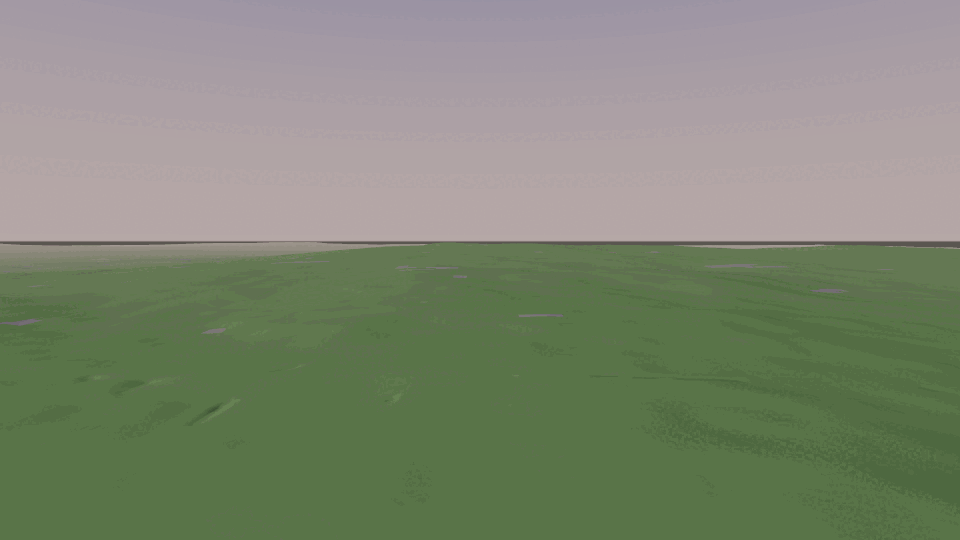
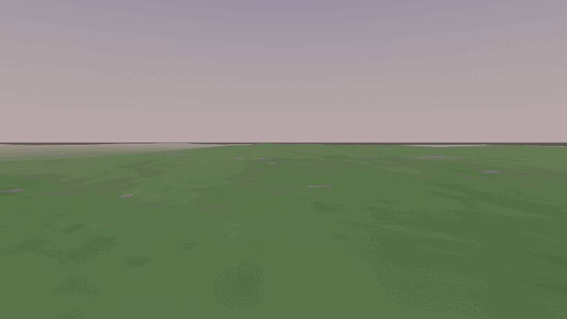
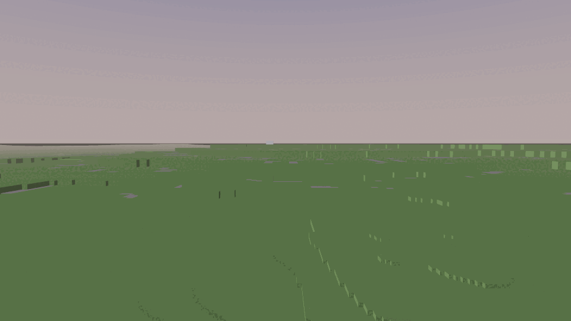
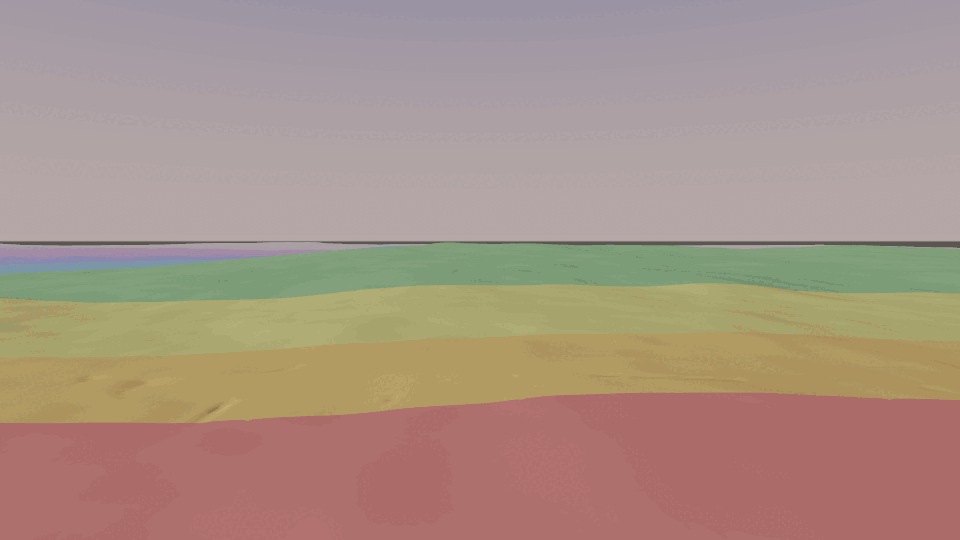
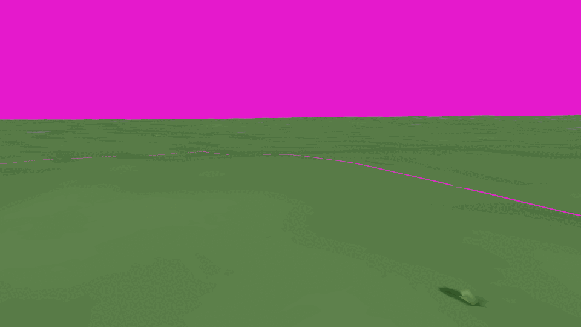
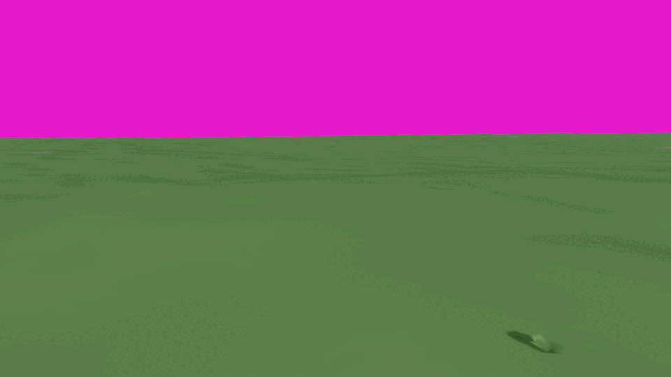
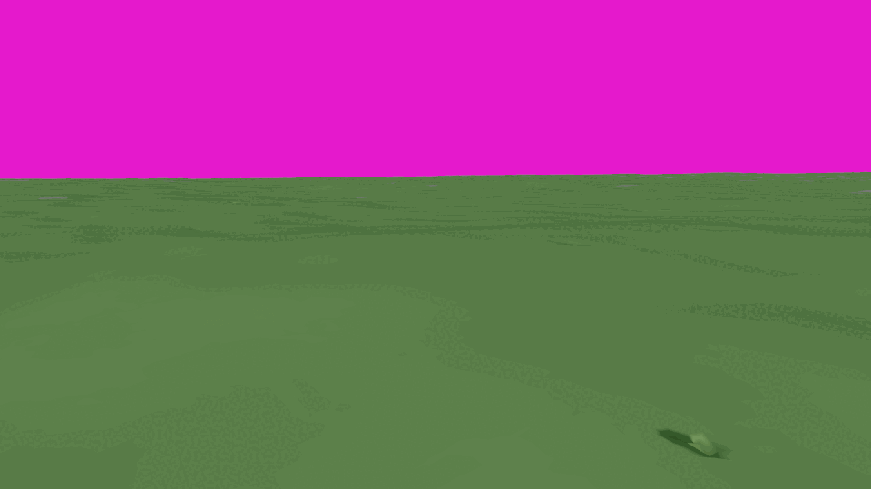
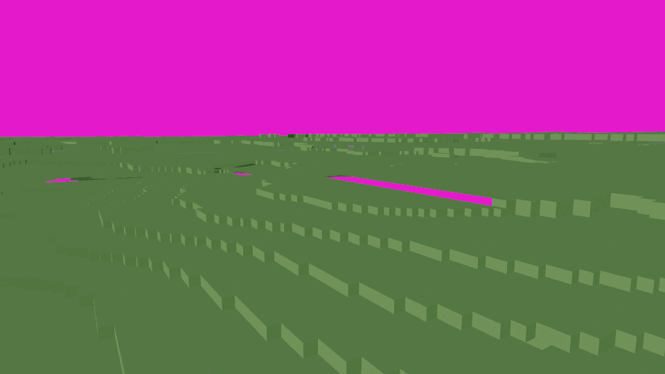
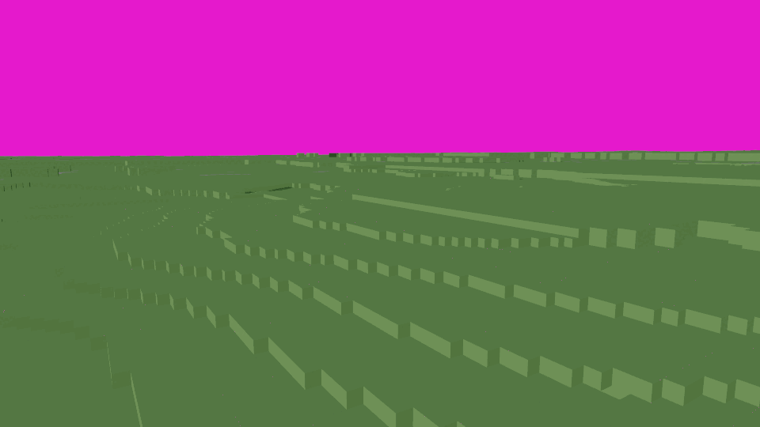
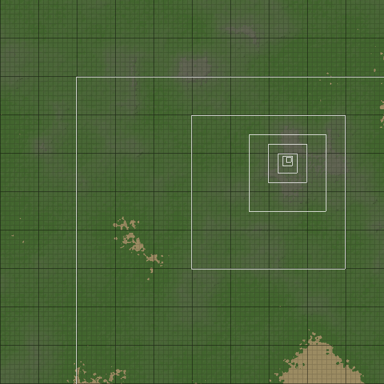

# Study: open worlds, 20 × 20 km and beyond

**2026-11-14.** Tools 1b builds a sculpted ground of 1 × 1 km, with 2 × 2 km tested ([decision 0116](../decisions/0116-the-ground-voxels-regions-and-what-games-may-change.md)). The project lead talked about vast open worlds when Solis was first planned, so decision 0116 also set **a following "Open worlds" phase that takes the ground to 20 × 20 km or more**. This study plans that phase. Rule 22 asks that a big system start by building competing approaches and measuring them against each other; this study did that, on top of [the ground study](ground-study.md) and in the same crate, [`tools/ground-study`](../../tools/ground-study/README.md). It ends with what to build, the phase's milestones, five questions for the project lead and the draft decisions.

**Where the numbers come from.** Every number was measured by `cargo run --release -p ground-study -- worlds` (the pictures by `worlds-pictures`, with `--features gpu`) on this machine: **2 cores, 7.8 GB of memory, no graphics card** (pictures through Mesa's software driver, llvmpipe, on OpenGL). Times here vary by about a third from run to run; the tables are the last of three runs, and the comparisons held across all three. Region files were read just after being written, so they came from the system's cache, not the disk; an SSD adds about a tenth of a millisecond a read. Estimates for a typical gaming PC are marked as estimates.

## In one paragraph

Keep only the chunks wanted near the camera (and near units) in memory, **read by priority on a worker** from the region files with a ring read ahead, under a **memory budget**, letting go of the least wanted first and **writing sculpted chunks back before they go**. Draw the ground in **nested rings of fixed-size chunks**, eight columns across each, every ring's voxels twice as wide as the one inside it, made by **averaging**: levels 0 to 3 (voxels of 1, 2, 4 and 8 m) out to about 2 km, kept in each region's file. Close the seams between rings with a **transition band** (the finer side's border cells joined straight to the coarser side's cells), which leaves no crack at all in Smooth and Sharp, and, for Blocky, **walls between sizes**. Past 2 km draw the **far field**, a height map made from the voxels, to the edge of the world. The whole 20 km view is then under a million triangles and about 25 MB of graphics memory, and a chunk costs the same to make at every level (about a millisecond). Build **colliders only near physics characters**, on workers, and hold a character at the edge of ground not yet solid. Bake a starting ground (from noise or a height map picture) into region files. Drawing it all grows only slowly with the world's size (164 km draws about a third more than 20 km); what limits a world's size is the disk (about 4.7 GB at 20 km, 19 GB at 41 km) and the time to make it.

## The target

| | 20 × 20 km |
| --- | --- |
| Area | 400 km², 128 m high (decision 0116) |
| Regions (256 × 256 m) | 6,400 |
| Chunks at level 0 (32 m) | 1.6 million |
| Every voxel in memory (two bytes each) | about 47 GB |
| Region files (measured from a sample, below) | about 4.7 GB |

None of that fits in memory, and almost none of it is needed at once. A camera 60 m over the ground sees to the world's edge, 10 to 14 km away; at that distance a one-metre voxel is a hundredth of a pixel. So the ground must be **streamed** (only what's near kept), **drawn coarser far away** without seams, popping or stalls, and **solid only where something walks on it**.

The test world is made from formulas so any part of it can be made at any level without the rest (`world.rs`): mountain ranges over kilometres, valleys of sand, hills over hundreds of metres, snow on the peaks, rock on steep slopes, and winding caves 1 to 28 m under the surface, 4 to 118 m high.

## The approaches, in plain words

### What's kept, and how it's streamed

Each region's file holds its chunks with a **table** at the start saying where each chunk is, so one chunk can be read without reading the rest (the ground study's files deflated a whole region at once). Two ways of choosing what to read were built (`stream/`):

| Way | What it is | Why it might win |
| --- | --- | --- |
| **Whole regions round the camera** | Each region (a level at a time) any wanted chunk is in is read whole, in one go, and kept. | One file read per region; neighbours come along for free, so nothing is ever late. |
| **Chunks by priority** | Just the chunks the frame wants, nearest first, each read alone from its region's file, with one ring of chunks read ahead (rings move two columns at a time). | Reads and keeps only what's needed. |

Both read on a worker (the job system's one worker on this machine), never on the frame. Over a **memory budget**, the least wanted chunks are let go of first; a chunk that was **sculpted** is written back first (its whole region file written beside the old one and swapped in, rule 11) and let go of only once that's done, so **an edit is never lost**. Sculpting reads the level-0 chunks it reaches first, then averages levels 1 to 3 again where they changed.

### Far ground drawn coarser

**Levels.** Level 0 is the ground as sculpted. Each level up has voxels twice as wide, each the average of the 27 voxels round its place below (the middle counts half along each axis, its neighbours a quarter), with the kind of the solid voxel nearest the surface, so a painted surface keeps its colour far away. A chunk is always 32 × 32 × 32 voxels, so at level 3 it covers 256 m with 8 m voxels, and **costs the same to make as a chunk next to the camera**. A level's samples sit every `2^level` metres, so every other sample of a level is one of the next level's, and the edges of every level's chunks line up.

**Which size is drawn where** (`lod/layout.rs`), two ways:

| Way | What it is | Why it might win |
| --- | --- | --- |
| **Nested rings of fixed-size chunks** | Round the camera, a square of 8 × 8 columns of level 0, inside a square of 8 × 8 of level 1, and so on; each square moves two columns at a time, in the middle of the one around it. | Simple, the same number of chunks wherever the camera is, so memory and time are predictable. |
| **An octree of chunk sizes** | The world split like a tree: a column splits in four wherever the camera is nearer than a few times its width, then more split until neighbours differ by one level. | Follows the camera's height too; the textbook way. |

Both make the same kind of chunk, meshed the same way at any level: "one meshing for many sizes".

**Closing the seams.** Where a chunk of one level meets one of the next, their surfaces are made from different samples and don't quite meet: a crack opens, and the sky shows through. The ways compared (`lod/nets.rs`, `lod/blocky.rs`):

| Way | What it is | Why it might win | What it costs |
| --- | --- | --- | --- |
| **Nothing** | Each chunk made alone. | Free. | Cracks: the backdrop shows through. |
| **Skirts** | Each chunk hangs a strip down into the ground from its open edges along its sides, so a crack is backed by a strip from either side. | A chunk's mesh never depends on its neighbours' levels, so moving the camera never makes a neighbour again. Works the same in every look. | About an eighth more triangles; the strips can show from below (in caves near a seam) and as a line where light differs. |
| **Transition band** | On the border with a coarser chunk, the finer chunk's samples take the coarser level's values (its samples, and halfway between them the average), and its border cells are joined straight to the coarser chunk's cells with a square or a triangle round each crossed edge; the coarser chunk leaves those out. (Surface nets' form of Lengyel's transition cells.) | Closed: no crack can open, and no extra triangles. | Both chunks are made again when a neighbour's level changes. |
| **Stitched seams** | The same joins, kept in a small border mesh of their own beside each chunk's own mesh. | Closed too; when a neighbour's level changes, only the border mesh is made again. | Two meshes a chunk to draw. |
| **Walls between sizes** (Blocky) | Each side draws its cube faces against the other side's cubes at the other's size: the finer side sees the coarser cube; the coarser side sees its neighbour's place as solid only if every finer cube in it is. | Every face between ground and air is drawn by one side or the other: closed, for cubes. For cubes the transition band and the stitches come to this. | None to speak of. |

Every sample's value comes from **one rule, whichever chunk asks** (a place on the edge of a coarser column takes that level's value), so two chunks making the same cell make the same point to the bit; that is what makes the transition band closed.

**The far field** (`far.rs`). Past some distance, the ground is drawn as a **height map made from the voxels**: the top of each column of samples, a grid of 32 × 32 squares per column of chunks, with skirts round each tile. Caves and overhangs that far away can't be seen anyway. It's cheap to make (no voxels to walk), and for the world as a whole it is one small file (1.2 MB at 32 m spacing for 20 km), which also serves the editor's map and units far from the camera. The voxel chunks next to it mesh up to it as if it were their own level, and its skirts close the seam.

### Physics only where it's needed

The ground study found that 2,000 physics characters on voxel ground cost 43 ms a tick, so the scale target's units follow the ground by reading its voxels (0.25 ms a tick), and only a few (the player, a hero, a vehicle) are physics characters. Here: a collider is built only for chunks round a physics character, in two halves (welding the mesh into points and triangles; building the collider's shape), measured to see what can leave the game's thread; a character (a vehicle at 20 m/s) runs onto ground whose collider is late, with nothing done and held at the edge; and 2,000 units are spread over 20 km and gathered in one square kilometre.

### Disk and the editor

A sample of 16 regions spread over the world, made from the formulas and packed, gives the 20 km file set's size. Opening a project reads the ground's settings, its folder's file names (not the files) and the far field, then only what the first view wants. Two ways of making a starting ground were timed: from formulas (noise), and from a height map picture.

## Pictures

The 20 km view in each look, drawn by the engine's renderer through the software driver: rings of 8, voxels to 2 km with transition bands (walls between sizes for Blocky), the far field beyond, the camera 35 m over the ground at the south edge of the world's hilliest part, looking north, with haze. Past the far edge of the world (about 8 km ahead here), the ground just stops (decision 0116), and the sky's own ground shows as a thin dark line.

| Smooth | Sharp |
| --- | --- |
|  |  |

| Blocky | The levels |
| --- | --- |
|  |  |

The levels picture tints each level: level 0 red (1 m voxels, round the camera), then orange, yellow, green (8 m, to about 2 km), and the far field's levels in blues and purples to the horizon.

**A seam up close.** The border between levels 0 and 1, seen low and grazing from 85 m away, with a magenta backdrop instead of the sky, so anything seen through the ground shows. The study counts the backdrop's pixels under the horizon in each.

| Smooth, nothing done: 435 pixels | Smooth, skirts: 0 | Smooth, transition band: 0 |
| --- | --- | --- |
|  |  |  |

| Blocky, nothing done: 2,106 pixels | Blocky, walls between sizes: 0 |
| --- | --- |
|  |  |

**The editor's map of a 20 km world** (drawn on the processor from the far field): heights shaded, each 256 m region a faint square, every 2 km a stronger line, and the rings round the camera in white, from level 0's 256 m square out to level 6's 16 km.

## The numbers

### Far ground drawn coarser

**Popping.** When the camera moves, a column switches level and its surface jumps by the difference between the two levels. Measured over every sample of a square kilometre, and turned into pixels on a 1080-line screen at the distance where rings of 8 switch:

| Levels | Voxel | Height apart, mean (m) | 95th (m) | Worst (m) | Switch distance, rings of 8 (m) | On screen, mean (px) | 95th (px) |
| --- | --- | --- | --- | --- | --- | --- | --- |
| 0 → 1 | 2 m | 0.05 | 0.12 | 19.01 | 112 | 0.49 | 1.24 |
| 1 → 2 | 4 m | 0.21 | 0.55 | 12.84 | 224 | 1.07 | 2.86 |
| 2 → 3 | 8 m | 0.47 | 1.65 | 5.07 | 448 | 1.22 | 4.26 |
| 3 → 4 | 16 m | 1.56 | 4.06 | 8.31 | 896 | 2.02 | 5.24 |

**Closing the seams**, on a square kilometre with every level made by averaging, seen from its middle (rings of 6, so that four levels fit). "Open edges" welds every chunk's triangles together and counts edges with a triangle on one side only (but at the world's edges); skirts leave theirs underground, out of sight. "Seen through" casts low, grazing rays from 60 m away at places just inside the cracks the ground with nothing done has, and counts those that see inside the ground. Chunk times here are with both cores meshing at once.

| Look | Way | Triangles | More than nothing | Chunk, mean (ms) | Worst (ms) | Open edges | Rays at the seams | Seen through |
| --- | --- | --- | --- | --- | --- | --- | --- | --- |
| Smooth | Nothing | 255,486 | +0.0 % | 2.96 | 4.52 | 3,483 | 448 | 9 (2.01 %) |
| Smooth | Skirts | 285,418 | +11.7 % | 3.23 | 4.96 | 3,560 | 448 | 3 (0.67 %) |
| Smooth | Transition band | 254,929 | -0.2 % | 4.36 | 8.34 | 0 | 448 | 0 (0.00 %) |
| Smooth | Stitched seams | 254,929 | -0.2 % | 4.33 | 7.25 | 0 | 448 | 0 (0.00 %) |
| Sharp | Nothing | 255,486 | +0.0 % | 3.36 | 5.90 | 3,483 | 448 | 6 (1.34 %) |
| Sharp | Skirts | 285,416 | +11.7 % | 3.29 | 5.42 | 15,664 | 448 | 1 (0.22 %) |
| Sharp | Transition band | 254,929 | -0.2 % | 4.78 | 8.32 | 0 | 448 | 0 (0.00 %) |
| Sharp | Stitched seams | 254,929 | -0.2 % | 5.19 | 11.06 | 0 | 448 | 0 (0.00 %) |
| Blocky | Nothing | 38,952 | +0.0 % | 2.34 | 3.50 | (rectangles meet mid-side) | 448 | 3 (0.67 %) |
| Blocky | Skirts | 44,572 | +14.4 % | 2.28 | 6.02 | (rectangles meet mid-side) | 448 | 0 (0.00 %) |
| Blocky | Walls between sizes | 39,120 | +0.4 % | 2.50 | 3.61 | (rectangles meet mid-side) | 448 | 2 (0.45 %) |

**When the camera moves**, levels change round it, and some chunks must be made again:

| Way | Columns new | Neighbours made again | Chunks | Time (ms) |
| --- | --- | --- | --- | --- |
| Nothing | 107 | none | 279 | 1047.11 |
| Skirts | 107 | none | 279 | 812.98 |
| Transition band | 107 | 43 columns' 85 chunks | 364 | 1313.95 |
| Stitched seams | 107 | 43 columns' 85 chunks | 364 | 1277.06 |

**A chunk at each level** (one core):

| Look | Level | Chunk's width | Chunks | Chunk, mean (ms) | 95th (ms) | Triangles a chunk, mean |
| --- | --- | --- | --- | --- | --- | --- |
| Smooth | 0 | 32 m | 1660 | 1.68 | 3.05 | 2,212 |
| Smooth | 1 | 64 m | 340 | 1.48 | 2.01 | 2,156 |
| Smooth | 2 | 128 m | 64 | 1.11 | 1.23 | 2,530 |
| Smooth | 3 | 256 m | 16 | 1.08 | 1.16 | 2,515 |
| Smooth | 4 | 512 m | 4 | 1.10 | 1.19 | 2,542 |
| Sharp | 0 | 32 m | 1660 | 1.92 | 3.47 | 2,213 |
| Sharp | 1 | 64 m | 340 | 2.11 | 3.18 | 2,156 |
| Sharp | 2 | 128 m | 64 | 2.19 | 2.75 | 2,530 |
| Sharp | 3 | 256 m | 16 | 1.75 | 1.96 | 2,515 |
| Sharp | 4 | 512 m | 4 | 2.16 | 2.61 | 2,542 |
| Blocky | 0 | 32 m | 1676 | 0.74 | 1.11 | 331 |
| Blocky | 1 | 64 m | 340 | 0.70 | 1.02 | 339 |
| Blocky | 2 | 128 m | 64 | 0.57 | 0.61 | 398 |
| Blocky | 3 | 256 m | 16 | 0.51 | 0.54 | 595 |
| Blocky | 4 | 512 m | 4 | 0.52 | 0.59 | 885 |

**Sculpting far away**: a brush where the ground is drawn coarse. Level 0 is sculpted and every level above averaged again where it changed; then the far chunk drawn there is made again. "Moved" is how far the far surface's farthest point moved.

| Brush | Drawn at level | Sculpt and average every level (ms) | Chunks changed, levels 0 to 4 | Far chunks made again (ms) | The far surface moved (m) |
| --- | --- | --- | --- | --- | --- |
| Add, 3 m | 2 (4 m voxels) | 0.14 | 1, 1, 2, 0, 0 | 2.32 | 0.05 |
| Add, 3 m | 3 (8 m voxels) | 0.14 | 1, 1, 2, 1, 0 | 1.21 | 0.02 |
| Add, 3 m | 4 (16 m voxels) | 0.16 | 2, 2, 2, 1, 0 | 0.000 | 0.00 |
| Dig, 12 m | 2 (4 m voxels) | 0.49 | 2, 2, 1, 1, 2 | 1.08 | 4.82 |
| Dig, 12 m | 3 (8 m voxels) | 0.59 | 4, 4, 1, 1, 2 | 1.12 | 5.18 |
| Dig, 12 m | 4 (16 m voxels) | 0.60 | 4, 8, 4, 2, 1 | 1.09 | 1.15 |
| Dig, a 40 m crater | 2 (4 m voxels) | 5.64 | 8, 8, 2, 2, 1 | 2.44 | 19.44 |
| Dig, a 40 m crater | 3 (8 m voxels) | 6.07 | 12, 8, 4, 4, 1 | 4.51 | 30.37 |
| Dig, a 40 m crater | 4 (16 m voxels) | 6.04 | 18, 4, 2, 1, 1 | 1.23 | 14.96 |

### The 20 km view

The camera in the middle of the world, 60 m over the ground; every way draws to the world's edges all round. "In a 90° view" counts what a camera looking one way would draw (the renderer already leaves out chunks out of view). "Seam rays" are cast from the camera at places on every border between levels within 3 km. "Voxels kept" includes a ring read ahead round every column.

| Way | Columns | Triangles, all round | In a 90° view | Graphics memory | Made on one core (ms) | On both cores (ms) | Voxels kept | Seam rays seen through (within 3 km) |
| --- | --- | --- | --- | --- | --- | --- | --- | --- |
| Every chunk at level 0 (from level 0's triangles round the camera) | 409,600 | about 1,473,583,984 | about 368,395,996 | about 50 GB | - | - | about 47 GB | - |
| Rings of 8, coarser voxels to the edge, skirts | 361 | 965,172 | 195,346 | 31.3 MB | 1614.16 | 807.50 | 69.5 MB | 2 of 1984 |
| Rings of 8, coarser voxels to the edge, transition band | 361 | 862,320 | 172,944 | 23.8 MB | 1800.60 | 902.43 | 69.5 MB | 0 of 1984 |
| Rings of 16, coarser voxels to the edge, transition band | 1,252 | 3,040,809 | 686,976 | 83.8 MB | 6973.41 | 3532.01 | 170.0 MB | 0 of 1920 |
| Octree, split within 3 widths, transition band | 772 | 1,860,664 | 498,786 | 51.3 MB | 4869.89 | 2437.70 | 121.2 MB | 0 of 1560 |
| Octree, split within 6 widths, transition band | 2,392 | 5,831,304 | 1,530,260 | 160.8 MB | 13046.24 | 6584.48 | 284.8 MB | 0 of 1400 |
| Rings of 8, voxels to level 3 (2 km), far field beyond | 361 | 890,674 | 178,361 | 26.5 MB | 1656.49 | 853.50 | 69.5 MB | 0 of 1984 |
| Rings of 8, voxels to level 2 (1 km), far field beyond | 361 | 895,526 | 179,430 | 27.2 MB | 1647.79 | 834.30 | 69.5 MB | 1 of 1984 |

In each look:

| Look | Way | Triangles, all round | Graphics memory | Made on one core (ms) |
| --- | --- | --- | --- | --- |
| Smooth | Rings of 8, coarser voxels to the edge, transition band | 862,320 | 23.8 MB | 2089.94 |
| Smooth | Rings of 8, voxels to level 3 (2 km), far field beyond | 890,674 | 26.5 MB | 1753.62 |
| Sharp | Rings of 8, coarser voxels to the edge, transition band | 862,320 | 24.9 MB | 2287.99 |
| Sharp | Rings of 8, voxels to level 3 (2 km), far field beyond | 890,672 | 27.6 MB | 1702.15 |
| Blocky | Rings of 8, coarser voxels to the edge, transition band | 108,454 | 7.9 MB | 1225.02 |
| Blocky | Rings of 8, voxels to level 3 (2 km), far field beyond | 420,278 | 16.4 MB | 1002.04 |

**Flying across**: the camera moving 2 km east in steps of 32 m, what must be made each kilometre, and how fast one worker keeps up (the work for the far field and new data is in the streaming tables below):

| Way | Columns new a km | Chunks and tiles made a km | One core's time a km (ms) | One worker keeps up to (m/s) |
| --- | --- | --- | --- | --- |
| Rings of 8, coarser voxels to the edge | 575 | 1258 | 3707.34 | 270 |
| Rings of 16, coarser voxels to the edge | 1149 | 2516 | 7605.41 | 131 |
| Octree, split within 3 widths | 1082 | 2290 | 6814.01 | 147 |
| Rings of 8, voxels to 2 km, far field beyond | 575 | 1258 | 3757.33 | 266 |

### Streaming

A 2 × 2 km set of region files (64 regions) written from the formulas into a folder:

| Regions | All of them | A km² | A region, mean | Largest | Level 0's share | Levels 1 to 3's share | Chunks the same all through |
| --- | --- | --- | --- | --- | --- | --- | --- |
| 64 | 45.7 MB | 10.9 MB | 731 KB | 851 KB | 75 % | 25 % | 9,282 of 18,752 |

| Read | Mean (ms) | 95th (ms) | Bytes, mean |
| --- | --- | --- | --- |
| One chunk (its region's table read once, then kept) | 0.056 | 0.14 | 2,975 |
| A region's level 0 whole (256 chunks) | 9.81 | 11.42 | 744,767 |

**Flying across the 2 km set**, the camera 1.5 km east at 60 frames a second, one worker reading. "Drawn chunks missing" counts, every frame, the chunks the frame draws that aren't in memory yet; "first view" is everything wanted at the start, read with nothing else to do.

| Reading | Budget | Speed (m/s) | First view ready (ms) | Frames with a drawn chunk missing | Drawn chunks missing, frames summed | Most memory | Read a km | Worker busy | Let go of |
| --- | --- | --- | --- | --- | --- | --- | --- | --- | --- |
| Whole regions round the camera | none | 50 | 148.26 | 0 of 1801 | 0 | 184.8 MB | 27.2 MB | 1 % | 0 |
| Whole regions round the camera | none | 200 | 153.77 | 0 of 451 | 0 | 184.8 MB | 27.2 MB | 3 % | 0 |
| Whole regions round the camera | none | 800 | 129.82 | 0 of 113 | 0 | 184.8 MB | 27.2 MB | 13 % | 0 |
| Whole regions round the camera | 96.0 MB | 200 | 150.20 | 0 of 451 | 0 | 96.0 MB | 27.2 MB | 3 % | 2,562 |
| Chunks by priority | none | 50 | 77.62 | 0 of 1801 | 0 | 134.9 MB | 5.1 MB | 1 % | 0 |
| Chunks by priority | none | 200 | 77.78 | 0 of 451 | 0 | 134.9 MB | 5.1 MB | 3 % | 0 |
| Chunks by priority | none | 800 | 64.66 | 0 of 113 | 0 | 134.1 MB | 5.1 MB | 12 % | 0 |
| Chunks by priority | 48.0 MB | 200 | 88.72 | 0 of 451 | 0 | 48.0 MB | 5.3 MB | 3 % | 2,644 |
| Chunks by priority | 24.0 MB | 200 | 83.74 | 451 of 451 | 15,943 | 23.9 MB | 72.8 MB | 30 % | 29,184 |

**A far edit written back**: a 12 m dig 1.7 km from the camera, where the level-0 chunks aren't in memory; then every changed chunk read back fresh from its file and compared voxel by voxel:

| Chunks read first | Sculpt, read and average levels 0 to 3 (ms) | Chunks changed | Written back (ms) | Read back, all of them (ms) | Every voxel the same when read back |
| --- | --- | --- | --- | --- | --- |
| 7 | 1.47 | 7 | 11.96 | 0.72 | yes |

**Making the ground from its formulas as it's wanted**, instead of reading it (nothing on disk but what was sculpted):

| Speed (m/s) | First view ready (ms) | Frames with a drawn chunk missing | Worker busy |
| --- | --- | --- | --- |
| 50 | 2050.07 | 0 of 1201 | 25 % |
| 200 | 2587.14 | 6 of 301 | 92 % |

### Physics and units

| Half | Where it can run | Mean (ms) | 95th (ms) |
| --- | --- | --- | --- |
| Welding the mesh into the collider's points and triangles | a worker, today | 0.039 | 0.080 |
| Building the collider's shape and adding it | the game's thread, today (a worker, if the physics crate builds the shape first) | 1.20 | 2.46 |

| Made solid after | When it reaches ground not yet solid | Ticks held | Fell more than 2 m | Got |
| --- | --- | --- | --- | --- |
| 30 ticks (500 ms) | nothing done | 0 | no | 230 m |
| 30 ticks (500 ms) | held at the edge | 0 | no | 230 m |
| 90 ticks (1500 ms) | nothing done | 0 | no | 230 m |
| 90 ticks (1500 ms) | held at the edge | 0 | no | 230 m |
| 240 ticks (4000 ms) | nothing done | 0 | yes | 67 m |
| 240 ticks (4000 ms) | held at the edge | 879 | no | 230 m |

| Units | Level-0 columns kept | Their memory | Columns new a second, walking at 4 m/s | Reading them (worker ms a second) | If all were physics characters: colliders | Building them once (s) | Colliders new a second |
| --- | --- | --- | --- | --- | --- | --- | --- |
| Spread over 20 × 20 km, each keeping the 3 × 3 columns round it | 17,580 | 1993.0 MB | 900 | 134 | 31,863 | 39.5 | 1632 |
| Spread over 20 × 20 km, each keeping the column it stands on | 1,994 | 226.1 MB | 307 | 46 | 3,614 | 4.5 | 557 |
| All in 1 × 1 km, each keeping the 3 × 3 columns round it | 1,156 | 131.1 MB | 15 | 2 | 2,095 | 2.6 | 28 |

(Measured on the 256 m square: 1.81 surface chunks a level-0 column, 0.1 MB a column kept, 0.082 ms to read a chunk from its packed bytes, 1.24 ms a collider.)

### Disk and the editor

| Regions in the world | A region, mean | Smallest | Largest | The whole set | Making a region from the formulas (ms) | Packing it (ms) |
| --- | --- | --- | --- | --- | --- | --- |
| 6,400 | 713 KB | 611 KB | 810 KB | 4.67 GB | 719.90 | 125.45 |

| Step | Time (ms) | Size |
| --- | --- | --- |
| Listing the ground's folder (6400 region files, names only) | 2.26 | - |
| Reading the far field: the whole world's heights and kinds every 32 m | 0.34 | 1.2 MB |
| (Making that far field from the formulas, once, when the ground is saved) | 131.42 | - |

| How | Measured | The whole 20 × 20 km, one core | On both cores here | On 8 cores (an estimate) |
| --- | --- | --- | --- | --- |
| From formulas (noise): every level 0 to 3 of a region, packed | 845.35 ms a region | 90 min | 45 min | 13 min |
| From a height map picture (16 bits a metre): voxels and levels 1 to 3 | 3408.59 ms a km² on both cores | 45 min | 23 min | 6 min |

### How far each way goes

The recommended way (rings of 8, voxels to level 3, the far field beyond) drawn round the middle of ever bigger worlds; the region files' size is the sample's mean times the regions, the precision is how finely a 32-bit place can be told apart at the world's far edge.

| World | Regions | Region files, all made | Far field every 32 m | Columns drawn | Triangles drawn | Graphics memory | Place precision at the far edge | Making it all from formulas, one core |
| --- | --- | --- | --- | --- | --- | --- | --- | --- |
| 20 × 20 km | 6,400 | 4.7 GB | 1.2 MB | 361 | 879,048 | 25.9 MB | 2.0 mm | 1.5 h |
| 41 × 41 km | 25,600 | 18.7 GB | 4.7 MB | 409 | 983,588 | 29.4 MB | 3.9 mm | 6.0 h |
| 82 × 82 km | 102,400 | 74.7 GB | 18.8 MB | 457 | 1,087,214 | 32.8 MB | 7.8 mm | 24.0 h |
| 164 × 164 km | 409,600 | 299.0 GB | 75.0 MB | 505 | 1,211,910 | 36.8 MB | 15.6 mm | 96.2 h |

## What the numbers say

**Far ground drawn coarser**

- **A chunk costs the same at every level**: about 1.1 to 1.7 ms in Smooth, 1.8 to 2.2 ms in Sharp and 0.5 to 0.7 ms in Blocky on one core, with about 2,200 to 2,500 triangles in Smooth, whether it covers 32 m or 512 m. So what a view costs is how many chunks it has, not how much ground it shows.
- **Averaging keeps the levels close**: on average each level's surface is within half its own voxel of the level below's (5 cm between levels 0 and 1, 1.6 m between levels 3 and 4), under 2 pixels where rings of 8 switch, and 1 to 5 pixels for the worst twentieth. The few big jumps (12 to 19 m) are caves and overhangs, whose thin roofs close when their voxels are averaged: those pop.
- **Closing the seams.** With nothing done, the ground has thousands of open edges and the backdrop shows through in the close-up (435 pixels in Smooth, 2,106 in Blocky). **Skirts** hide it in the close-up but cost an eighth more triangles (a seventh in Blocky), and a grazing ray from the coarser side still sees under a strip now and then. The **transition band** and the **stitched seams** leave no open edge and no ray through, and draw no more triangles than nothing. **Walls between sizes** do the same for Blocky (0.4 % more triangles, no pixel through).
- **What moving costs each way.** When the camera moves, skirts make only the new columns again; the transition band also makes again the chunks whose neighbours changed level (about a third more chunks, about 60 % more time here); keeping the joins as stitched seams of their own saves very little of that (a chunk's border costs nearly as much as the chunk: reading its samples is most of it), and doubles the meshes to draw. **So the transition band beats the stitched seams**, and against skirts it trades a little making for fewer triangles and no leaks.
- **Rings against the octree.** For the same ground next to the camera, rings of 8 draw 361 columns and 0.86 million triangles all round; the octree that splits within 3 widths draws 772 columns and 1.9 million, and within 6 widths, 2,392 and 5.8 million. The octree splits a whole column when its nearest corner is close, and splits more only to keep neighbours within a level, so it keeps more fine ground than it needs; it also changes almost twice the chunks per kilometre flown (2,290 against 1,258). **Rings are cheaper and predictable**: the same number of chunks wherever the camera is, so memory and time are known in advance. Rings of 16 look finer (each level twice as far out) for three and a half times the triangles.
- **The far field** draws about what coarser voxels draw (0.88 against 0.86 million triangles: a tile is the same 32 × 32 grid as a chunk's surface) and is a little quicker to make. Its real gain is **data**: coarser voxels to the edge need levels 4 to 7 kept somewhere (files of their own above the regions, averaged again on every far edit), while the far field is one small file for the whole world (1.2 MB at 32 m for 20 km), which the editor's map and units far away read too. What it loses is caves and overhangs past 2 km, which no camera can see there. In Blocky, coarser cubes to the edge are much cheaper (0.11 against 0.42 million triangles), since big flat cubes merge into few rectangles.
- **The 20 km view** in the recommended way: about **0.88 million triangles all round** (0.18 million in a 90° view) and **26 MB of graphics memory** in Smooth or Sharp; half that in Blocky. Every chunk at level 0 would be 1.5 billion triangles and 50 GB. Making the whole view from nothing takes about 1.7 s of one core (0.9 s on both), which is what opening a project or jumping across the map costs.
- **Flying across it**, one worker keeps up with a camera at about 270 m/s on this machine (rings of 8): 1,258 chunks a kilometre at about 3 ms each.
- **Sculpting far away** costs what sculpting near does (0.1 to 0.6 ms a dab, about 6 ms for a 40 m crater, every level averaged again), plus 1 to 5 ms to make the far chunk again. A 3 m dab drawn 1 km away moves the far surface by a few centimetres, or not at all at 16 m voxels: correct, since it can't be seen; a 40 m crater shows at once.

**Streaming**

- **Region files**: 731 KB a region, 10.9 MB a km², a quarter of it levels 1 to 3; half the chunks are the same all through and take three bytes. One chunk reads in 0.06 ms (3 KB from its region's file, once the table is known); a region's level 0 whole in 9.8 ms (745 KB).
- **Whole regions** are never late, but read five times as much (27 MB a km) and keep 185 MB with no budget. **Chunks by priority with a ring read ahead** are never late either, at 50 to 800 m/s, read 5 MB a km, and keep everything they need in **48 MB**. With 24 MB, less than one view's worth, every frame misses chunks and the worker reads the same ones again and again (73 MB a km): a budget must hold the view. Without the ring read ahead (the first run), chunks by priority missed about a thousand chunk-frames on every flight whatever the speed, because rings move two columns at a time.
- **Edits are never lost**: a dig 1.7 km away read its 7 chunks first, took 1.5 ms with every level averaged, wrote its region back in 12 ms, and read back the same voxel for voxel. The streaming tests check the same, through being let go of and read again.
- **Making the ground from its formulas as it's wanted**, rather than reading it, takes 2 to 2.6 s for the first view (against under 0.1 s) and keeps the worker 92 % busy at 200 m/s, with frames late: reading a chunk from a baked file (0.06 ms) is about forty times cheaper than making it (2.5 ms, a region's 0.72 s over its 293 chunks).

**Physics and units**

- **A collider is almost all shape-building**: welding the mesh takes 0.04 ms on any thread; building the collider's shape and adding it takes 1.2 ms, on the game's thread today. The physics crate should build the shape on a worker and only add it on the game's thread.
- **A character outrunning its colliders**: a vehicle at 20 m/s whose colliders came 0.5 or 1.5 s after they were wanted never noticed (the columns round it are wanted before it reaches them); at 4 s it fell through the ground 67 m on. **Held at the edge** of the solid ground until it's ready, it waited 15 s over the run and never fell.
- **2,000 units over 20 km** following the voxels each need the ground they stand on in memory: keeping the 3 × 3 columns round each is 17,580 columns and 2 GB, but **just the column each stands on is 1,994 columns, 226 MB**, with 307 new columns a second at a walk (46 ms a second of a worker). All in one square kilometre they need 131 MB. If they were all physics characters, spread out they'd need 3,600 to 32,000 colliders and 560 to 1,630 new ones a second, which no machine builds: they must follow the voxels (decision 0116).

**Disk and the editor**

- **The 20 km file set is about 4.7 GB** (712 KB a region on average, 610 to 810 KB, over 6,400 regions).
- **Opening a 20 km project reads almost nothing**: the folder's 6,400 names in 2 ms, the far field (1.2 MB) in 0.3 ms, then the first view's chunks, 65 to 150 ms from the cache (an estimate of under a second from a disk).
- **Making a starting ground** from formulas takes 0.85 s a region on one core: 90 minutes for the whole 20 km on one core, about 45 on both here, and an estimated 13 minutes on 8 cores. From a height map picture: 3.4 s a km² on both cores, about 23 minutes for 20 km here and an estimated 6 on 8 cores.

## How far each way goes

| Way | This machine (2 cores, 7.8 GB, software driver) | A typical gaming PC (an estimate: 8 cores, 32 GB, a mid-range graphics card, an SSD) | What limits it |
| --- | --- | --- | --- |
| Every chunk at level 0 | under 1 km² in view at once | about 2 × 2 km | Triangles and graphics memory: 3.6 million and 100 MB a km². |
| Coarser voxels to the edge, rings of 8 | Draws any size (0.86 million triangles at 20 km); 20 km, as disk allows | 80 km and more | Levels 4 and up need files of their own; past level 7 a 128 m world is one voxel thick. Then disk, as below. |
| Rings with the far field past 2 km (recommended) | **20 km** (4.7 GB baked fits the 9 GB free; 41 km doesn't) | **41 km comfortably (19 GB), 82 km possible (75 GB)** | Not drawing: 164 km draws only a third more than 20 km (1.21 against 0.88 million triangles). **Disk** (11 MB a km²), the **time to make it** (1.5 h of one core for 20 km, 24 h for 82 km), and **precision**: 2 mm at 20 km, 8 mm at 82 km, so past about 40 km the engine must draw and simulate near the camera relative to it, not to the world's corner (DESIGN.md §8's floating origin). |
| The octree | 20 km, at two to six times the triangles of rings for the same nearness | as rings | The same as rings, plus the extra triangles. |
| Streaming whole regions | Any size; 185 MB kept without a budget | Any size | Reads five times as much; fine on an SSD. |
| Streaming chunks by priority (recommended) | Any size, 48 MB for the view; 270 m/s with one worker | Any size, an estimated 1,500 m/s with seven workers | The budget must hold a view and the units' columns (about 300 MB with 2,000 units spread out). |
| Region files, one per 256 m | 6,400 files at 20 km, listed in 2 ms | 409,600 at 164 km | Git and its large-file storage get slow with hundreds of thousands of files: past about 80 km, bigger regions or a pack of them. |

The software driver draws the 20 km view (0.88 million triangles) in 140 to 300 ms (Blocky to Smooth) a frame on this machine; a graphics card draws it in well under a millisecond (an estimate).

## Recommendation

**Streaming: chunks by priority, read on workers, under a budget.** Keep in memory only the chunks the layout draws, a ring of each level round them read ahead, and the level-0 column each unit stands on, nearest first; read each on a job-system worker from its region's file, never on the frame (rule 10). Over the budget, let go of the least wanted first; a sculpted chunk is written back first (its region file written beside the old one and swapped in) and let go of only when that's done, so an edit is never lost. Region files gain a table of their chunks and levels 1 to 3, each chunk deflated on its own (a format version with an upgrader, rules 9 and 23).

**Far ground: rings of 8 fixed-size chunks, coarser voxels to 2 km, the far field beyond.**
- Levels 0 to 3 (voxels of 1, 2, 4 and 8 m), each made by averaging the one below and kept up to date as the ground is sculpted (by the editor or game code), saved in each region's file.
- Rings of 8 columns of each level round the camera, moving two columns at a time.
- Seams closed by the **transition band** in Smooth and Sharp (closed, no extra triangles; the chunks beside a level change are made again) and **walls between sizes** in Blocky.
- Past level 3 (about 2 km), the **far field**: the top of the voxels as a height map, one file for the world (a level per halving, from 16 m), drawn as tiles with skirts, to the world's edge; the voxel chunks beside it hang skirts too. Caves and overhangs past 2 km aren't drawn.

**Physics only where it's needed.** Colliders only for the chunks round physics characters (the player, heroes, vehicles), built on workers (the physics crate gains a call to build a collider's shape off the game's thread, 1.2 of its 1.24 ms); a physics character is held at the edge of ground not yet solid. Units follow the ground by reading its level-0 voxels (decision 0116); the streamer keeps the column each stands on, whatever the camera sees, so the game plays the same wherever the camera is.

**Disk and the editor.** A starting ground made from noise or a height map picture is **baked into region files** on workers (reading a chunk is about forty times cheaper than making it). The editor shows a **map of the world** from the far field, with its regions, where clicking goes to a place; nothing loads the whole world.

**Size.** The design holds well past 20 km: drawing barely grows. Promise 20 × 20 km and test 41 × 41 km as the stress case; past about 40 km the camera-relative drawing and simulation (floating origin) must be in place first.

## The Open worlds phase (proposed)

Five milestones (decision 0097: two to six), each one pull request. They are proposed until the project lead answers the questions below.

| Milestone | What it gives | Its gate |
| --- | --- | --- |
| **W1 Regions and streaming** | Region files with levels 0 to 3 and a table of chunks (a new format version, its upgrader, a fuzz target); levels 1 to 3 averaged as the ground is sculpted; chunks read on workers by priority with a ring read ahead, under a memory budget, sculpted chunks written back before they go; grounds bigger than 2 km in the editor. | A 20 × 20 km ground (made by a test generator) opens in under a second; flying across it at 200 m/s never shows a missing chunk; a dig 5 km away, saved and reopened, is there; memory stays under the budget. |
| **W2 Far ground coarser** | Rings of 8; levels 1 to 3 drawn and joined by the transition band (Smooth, Sharp) and walls between sizes (Blocky); the far field (a height map made from the voxels, one file) drawn past 2 km, with skirts; a setting for the rings' width. | The 20 km view in each look with no crack (the study's crack tests as the crate's tests), under about a million triangles, popping under 2 pixels on average; the scale check's frame targets met while flying. |
| **W3 Physics and units across the world** | Colliders only round physics characters, their shapes built on workers; a physics character held at the edge of ground not yet solid; units' ground answered anywhere in the world (their columns kept by the streamer). | A vehicle crossing 5 km never falls through; 2,000 units spread over 20 km and 2,000 in one square kilometre at the scale target. |
| **W4 The world map and a starting ground** | A map of the world's regions, from the far field, to go to a place; a starting ground made from noise (a few settings) or a height map picture, written as region files on workers with progress, cancellable. | Make a 20 × 20 km ground from a height map picture, find a place on the map, go there and sculpt. |
| **W5 Speed, game code, the manual** | Drawing and physics near the camera precise however far from the world's corner (floating origin); game code's calls for big grounds (its size, waiting for ground under a place, regions loaded); the scale cases; the manual. | **The phase's gate:** a 20 × 20 km ground made from noise, sculpted and painted in places kilometres apart, flown across without holes or stalls in each look, walked on and crossed by 2,000 units, saved and reopened. |

## Questions for the project lead

**Answered on 2026-11-14 ([decision 0117](../decisions/0117-open-worlds-ten-km-a-recipe-and-far-caves.md)):** 10 × 10 km (100 km²) by default, further by setting; voxels to 4 km by default with voxels to the horizon as an option made as well; the starting ground kept as a recipe; 1 GB of memory; 512 m high or more. The questions as they were asked follow.

### 1. How big a world does Solis promise?

| Option | What it is | What it costs |
| --- | --- | --- |
| **A. 20 × 20 km, with 41 × 41 km tested as the stress case** (recommended) | The vast open world asked for, and twice its width tested. | 4.7 GB of region files at 20 km, 19 GB at 41 km; the floating origin is needed for the stress case. |
| **B. 41 × 41 km, with 82 km tested** | Room for the very largest worlds. | 19 GB at the target and 75 GB at the stress level: heavy for Git, slow to make (6.5 h of one core). |
| **C. 10 × 10 km** | A quarter of the area. | 1.2 GB; no floating origin needed; still 100 times Tools 1b's ground. |

### 2. May caves and overhangs disappear far away?

| Option | What it is | What it costs |
| --- | --- | --- |
| **A. Yes, past about 2 km the ground is a height map** (recommended) | Voxels (levels 0 to 3) to 2 km; the far field beyond. | A cave mouth more than 2 km away isn't drawn; Blocky's far ground is smooth heights (or drawn as flat-topped steps, a little more work). One small file for the far field. |
| **B. No: coarser voxels to the horizon** | Every level is voxels, to level 7. | Far caves show as blobs; levels 4 to 7 need files of their own, averaged again on every far edit. Blocky far away is big cubes (cheapest to draw). |
| **C. Voxels to 4 km, the far field beyond** | One level more of voxels. | A little more memory and making; caves vanish at 4 km instead. |

### 3. How is a starting ground made?

| Option | What it is | What it costs |
| --- | --- | --- |
| **A. From noise or a height map picture, baked into region files, in W4** (recommended) | A few settings (seed, height, roughness) or a 16-bit picture; made on workers once, then sculpted. | Minutes on a gaming PC for 20 km (an estimate: 6 to 13); the files are the whole world (4.7 GB). |
| **B. Only from a height map picture** | Made in an outside terrain tool and brought in. | Simpler; nothing without another program. |
| **C. Kept as its recipe: only sculpted regions are files** | The ground made from its settings whenever it's read. | Tiny files; but making a chunk is about forty times slower than reading it (one worker can't keep up at 200 m/s), and the formulas could never change again without changing every world. |

### 4. How much memory may the ground take on a typical PC?

| Option | What it is | What it costs |
| --- | --- | --- |
| **A. 512 MB** (recommended) | The view and its ring read ahead (50 to 70 MB), 2,000 units spread out (about 230 MB), and sculpting not yet written back. | Comfortable on 16 GB. |
| **B. 256 MB** | The view and units, little room to spare. | Units spread over 20 km nearly fill it; more reading again. |
| **C. 1 GB** | Room for anything. | Wasted on most games; tight on 8 GB machines. |

### 5. How tall may a big world be?

Decision 0116 set 128 m. Across 20 km, 128 m reads as gently rolling (the pictures): a mountain a few kilometres away is a degree tall.

| Option | What it is | What it costs |
| --- | --- | --- |
| **A. 128 m, as now** (recommended) | Hills and valleys; mountains under 120 m. | Nothing more. Asked again if a game needs mountains. |
| **B. 256 m** | Real hills and small mountains. | A chunk the same all through is one voxel, so flat ground costs nothing more; steep ground up to twice the chunks where it stands (not measured here). |
| **C. 512 m or more** | Mountain ranges. | Mountains up to four times the chunks where they stand (not measured); a level-3 chunk (256 m) no longer holds the world's height. |

## Limits of this study

- One machine with two cores and no graphics card: drawing was through the software driver; the job system had one worker. Region files came from the system's cache. The gaming PC's numbers are estimates and say so.
- The test world is made from formulas; a hand-sculpted ground has more flat ground and fewer caves, and a generated one may be rougher. The coarse levels of the 20 km world were made from the formulas at each level (eroding caves narrower than a voxel), not averaged from level 0, which would have meant making the whole world first; the square kilometre's levels and the streaming tests' were averaged.
- Units were counted, not simulated, over 20 km; their memory and reading are from measured per-chunk costs.
- A character on Blocky ground, the step height and how kinds blend are Tools 1b's (G3, G4).
- The crack rays are a measuring tool, not proof: of 1,984 rays at the seams in the 20 km view with the far field from 1 km, one (at a corner where the far field and voxels meet) saw the back of a skirt, and on the square kilometre 2 of 448 grazing rays slipped between Blocky's merged rectangles where one meets another's side mid-way (the hairline the ground study left to G3). The transition band's closedness is proved by its open-edge count (none), in the crate's tests and here.

## Draft decisions

The lead writes the decision records after the project lead answers; these are their drafts.

**Draft: the ground streams in chunks by priority.** *Problem:* a 20 km ground is 47 GB of voxels and 4.7 GB of files; only what's near can be kept. *Decision:* chunks are read on the job system's workers, nearest first, from region files with a table of their chunks and levels 0 to 3 (a new version of the format); the chunks the layout draws, a ring read ahead and the column each unit stands on are kept, under a memory budget; the least wanted go first, and a sculpted chunk is written back (beside the old file, then swapped in) before it goes. *Consequences:* opening reads almost nothing; flying at 270 m/s on two cores never misses a chunk; an edit is never lost; region files grow a quarter for levels 1 to 3.

**Draft: far ground is drawn in rings, coarser, then as the far field.** *Problem:* every chunk at level 0 would be 1.5 billion triangles. *Decision:* rings of 8 fixed-size chunks round the camera, each level's voxels twice as wide, made by averaging; seams closed by the transition band (Smooth, Sharp) and walls between sizes (Blocky); past level 3 (about 2 km) a height map made from the voxels, drawn in tiles with skirts. *Consequences:* about 0.9 million triangles and 26 MB of graphics memory for a 20 km view; caves past 2 km aren't drawn; chunks beside a level change are made again as the camera moves.

**Draft: physics only where it's needed.** *Decision:* colliders only round physics characters, their shapes built on workers; a physics character is held at the edge of ground not yet solid; units follow the voxels, their columns kept whatever the camera sees. *Consequences:* the physics crate gains collider shapes built off the game's thread; the 2,000-unit scale case runs over 20 km.

**Draft: a world's size** (after question 1; as recommended). *Decision:* 20 × 20 km is the promise and 41 × 41 km the stress case; past about 40 km, drawing and physics near the camera are relative to it (floating origin). *Consequences:* the scale cases add a 20 km world; W5 brings the floating origin.

**Draft: far caves** (after question 2; as recommended). *Decision:* past about 2 km the ground is the far field; caves and overhangs there aren't drawn.

**Draft: a starting ground** (after question 3; as recommended). *Decision:* made from noise or a height map picture and baked into region files on workers (W4).

**Draft: the ground's memory** (after question 4; as recommended). *Decision:* the ground's budget is 512 MB by default, a project setting.

**Draft: a big world's height** (after question 5; as recommended). *Decision:* 128 m, as decision 0116; asked again if games need mountains.
